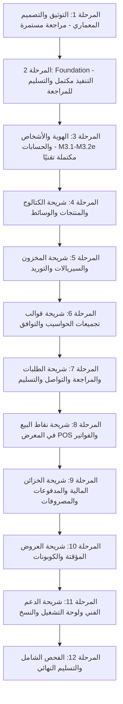

# خارطة طريق التنفيذ المرحلي (ROADMAP.md)

تاريخ التحديث: نوفمبر 2026  
الحالة: **M2 وM3.1-M3.3 مكتملة تقنيًا. M4 Catalog & Media مكتملة. M5 تضم Supplier Directory، Supplier Product Catalog، Warehouse Directory، Purchase Drafts، والاستلام الفعلي. Practical Retail Core منفذ (Stock/Assemblies/Orders/Partner accrual). Returns/Invoices/Expenses/Installments/Full Reports/Financial posting ما زالت مراحل لاحقة ببوابات قرار.**

## حالة Waves التوسع — 9 نوفمبر 2026

- **Wave 0 — Stabilization:** مكتملة. Preview initialization guard + PostgreSQL regression test، Supplier public projection، وعدم إعادة بناء الشرائح المكتملة.
- **Wave 1 — Storefront Visual:** منفذ جزئيًا وقويًا: إزالة Compare، توحيد الخطوط/عناصر النماذج، سطح بطاقة فاتح، Store Settings (WhatsApp/Social/Pickup/Trust)، New/Used + فلتر. Image derivative بالشعار لم يُنفذ بعد.
- **Wave 2 — Accounts:** منفذ منه ترجمة الصلاحيات/البحث في Roles، إنشاء مستخدم بدعوة Admin، Reset Password إداري، Profile، Sessions/Devices، Customer Addresses، وWishlist دائم. Email Change verification وNewsletter Consent مؤجلان.
- **Wave 2.5 — Content & Trust:** منفذ: Homepage Draft/Published، Articles + Revisions، FAQ، Policies بنسخ مرقمة، Media Library بUsage Guard، وAdmin Audit Viewer. المحتوى القانوني/الشعار ينتظران المالك.
- **Wave 3–7:** نُفذ الجزء العملي الأساسي: Stock Units + Assemblies + Orders + Manual Payment + Partner Accrual/Settlement. ما زال مطلوبًا: Returns، Expenses، Installments، Invoice/PDF، Reports، Financial posting، وPOS/Gallery cash drawers.
- **Overnight Batch (9 نوفمبر 2026):** Media Original Preservation، Cart Integrity، وInventory Readiness Read-only. راجع `RIGX_OVERNIGHT_CONSOLIDATED_BATCH_2026-11-09.md`.
- **Consolidated Expansion (9 نوفمبر 2026):** راجع `RIGX_CONSOLIDATED_EXPANSION_2026-11-09.md` وADR-023..026. M5 Purchasing Gate ما زال مفتوحًا.
- **Main Engineering Round (9 نوفمبر 2026):** Header/Navigation موحّد، Account Center، Reviews/Moderation، Offers، Purchase Drafts متعددة المصادر (ADR-027)، Admin Analytics، وإصلاح Catalog Nav. راجع `RIGX_MAIN_ENGINEERING_2026-11-09.md`.
- **Practical Retail Core (9 نوفمبر 2026):** استلام فعلي → وحدات مخزون → تجميعات → Checkout حقيقي → تأكيد/تسليم → استحقاق شريك → تسوية. راجع `RIGX_PRACTICAL_RETAIL_CORE_2026-11-09.md`.

---

## المبدأ المعماري لخطة التنفيذ: شرائح رأسية متكاملة (Vertical Slices)

وفقاً لتوجيهات المراجعة، يتم تنظيم مراحل العمل البرمجية اللاحقة على شكل **شرائح رأسية صغيرة ومتكاملة (Vertical Slices)** بدلاً من بناء طبقات Backend منفصلة ثم واجهات منفصلة في النهاية.  
كل شريحة رأسية تشمل:
$$\text{Database Schema} \longrightarrow \text{Domain & Application} \longrightarrow \text{API Endpoints} \longrightarrow \text{Frontend UI} \longrightarrow \text{Permissions & Tests}$$

ولا يتم الانتقال من مرحلة إلى أخرى إلا بعد اكتمال الشريحة واختبارها واعتماد صاحب المشروع الصريح.

## أعمال تحسين عابرة للمراحل — لا تغيّر حالة Milestone

يمكن تنفيذ مهام تصميم وتجربة مستخدم تمتد عبر عدة صفحات عندما يعتمدها المالك، مثل توحيد Design System أو إصلاح App Chrome / Global Background / Footer أو تحسين Responsive / Accessibility أو استكمال Demo Frontend. هذه المهام:
- يجوز أن تمتد تقنيًا عبر Components وRoutes وTests متعددة لحل السبب الجذري داخل الهدف المعتمد.
- لا تنشئ وحدات تجارية أو جداول أو سياسات جديدة، ولا تغيّر ترتيب المراحل أو حالة M4/M5.
- لا تُعد اعتمادًا نهائيًا لـM4 ولا تصريحًا ببدء M5؛ تظل بوابات الاعتماد التجارية كما هي.
- تُسجل في `PROGRESS.md` و`NEXT_TASK.md` مع الفصل بين Demo أمامي والوظائف التجارية الفعلية.

---

## المخطط العام للمراحل التنفيذية (Proposed Milestones)

---

### المرحلة 1: إعداد واعتماد الوثائق (مرحلة سابقة؛ مراجعة القرارات مستمرة بالتوازي)
* **الهدف:** توحيد وتصحيح المتطلبات، وإغلاق التعارضات، وتوثيق المسائل المفتوحة.
* **المخرجات:** الوثائق المصححة كاملة، مصفوفة تتبع المتطلبات، والأرشيف الرقمي الموثق.
* **شرط الإغلاق:** مراجعة واعتماد صاحب المشروع الصريح.

---

### المرحلة 2: الأساس والبنية التحتية المشتركة (Foundation Blueprint)
* **النطاق التقني المعتمد لمرحلة Foundation:**
  1. **حل .NET 10 (Backend Solution):** إعداد حل .NET بمجلدات المونوليث النمطي (`src/Common/...` وهياكل مجلدات الوحدات).
  2. **واجهات Next.js (Frontend Monorepo):** إعداد مشروع Next.js و React و TypeScript و TailwindCSS مع دعم RTL المدمج بالخصائص المنطقية.
  3. **بيئة التطوير المحلية (Docker Compose):** إعداد `docker-compose.yml` لتشغيل قاعدة بيانات PostgreSQL 17 محلياً مع فحص الجاهزية.
  4. **إعدادات البيئة والتسجيل (Config & Logging):** ضبط `appsettings.json` وتسجيل الأحداث عبر Serilog.
  5. **فحص الصحة والاتصال (Health Checks):** تهيئة نقاط الفحص `/health/live` و `/health/ready` والتحقق من الاتصال بقاعدة البيانات.
  6. **البنية التحتية للاختبارات (Testing Setup):** إعداد xUnit باختبارات Foundation باستخدام `Assert` المدمج، وTestcontainers لـ PostgreSQL. تُضاف مكتبات Assertions عند وجود حاجة واضحة في اختبارات المراحل التالية.
  7. **خطوط البناء والتشغيل (Build & Run Pipeline):** التحقق من بناء الحل وتشغيله بنجاح بدون أخطاء.

**حالة Foundation — 4 نوفمبر 2026 (سجل تاريخي):** اكتمل تنفيذ الهيكل والتحقق منه: نجح بناء .NET وNext.js، ونجحت اختبارات Smoke في xUnit/Vitest/Playwright، ووصلت خدمات Compose الثلاث إلى `healthy`. كان التسليم حينها ينتظر الاعتماد المعماري ولم تكن Milestone 3 قد بدأت. التفاصيل الحالية في [PROGRESS.md](PROGRESS.md).

**نتيجة مراجعة Foundation النهائية (سجل تاريخي):** تعمل صورة API بمستخدم Runtime غير Root `app`؛ أُعيد بناؤها ووصل Docker Health Check إلى `healthy` وفحص `/health/ready` إلى HTTP 200. انتهى انتظار اعتماد Foundation لاحقًا، والحالة الحالية موضحة في أعلى هذه الوثيقة.

> [!CAUTION]
> **قاعدة نطاق حاسمة في مرحلة Foundation:**  
> **لا تنشئ مرحلة Foundation جداول وكيانات ومخططات الوحدات الوظيفية.**  
> مرحلة Foundation تُجهّز فقط بيئة العمل والهيكل التجريدي المشترك؛ ويُمنع منعاً باتاً إنشاء كيانات الطلبات، المخزون، المشتريات، الفواتير، أو عمل Migrations وظيفية لها في هذه المرحلة. كل وحدة وظيفية تُبنى بجداولها وكياناتها ومساراتها كاملة داخل شريحتها الرأسية المخصصة لها (Milestones 3 إلى 11) وفق الترتيب المرحلي.

---

### المرحلة 3: شريحة الهوية والأشخاص والحسابات (Party & Identity Slice)
* **النطاق الرأسي:**
  - **قاعدة البيانات:** جداول `persons`, `user_accounts`, `roles`, `permissions`.
  - **الـ Backend:** تسجيل الدخول، إصدار الرموز الآمنة، وتوليد كود الشخص `PersonCode`.
  - **الواجهة:** شاشات تسجيل الدخول، إنشاء حساب العميل في المتجر، وإدارة موظفي لوحة الإدارة.
  - **الاختبارات:** اختبارات وحدة وتكامل للتحقق من أمان الجلسات ومنع تكرار المعرفات الفريدة.

**الحالة الحالية — 5 نوفمبر 2026:** M3.1-M3.2e مكتملة تقنيًا وفق نتائجها المسجلة. التسجيل لا يُفتح في Production قبل استكمال بنود ما قبل الإطلاق وموافقة المالك الصريحة، لكن هذه البنود لا تحجب تطوير M4 محليًا.

---

### المرحلة 4: شريحة الكتالوج والمنتجات والوسائط (Catalog & Media Slice)
* **النطاق الرأسي:**
  - **قاعدة البيانات:** جداول التصنيفات، الماركات، المنتجات، وجدول `product_images`.
  - **الـ Backend:** معالجة رفع وتسمية الصور وتخزين `StorageKey`، وتوليد صيغ `WebP`.
  - **الواجهة:** شاشات إدارة الكتالوج في لوحة الإدارة، وعرض وتصفية المنتجات في المتجر الخارجي.
  - **الاختبارات:** فحص حماية مسار الملفات (`Path Traversal`)، ورفع الصور، والتحقق من صحة المدخلات.

**التقدم الحالي — 6 نوفمبر 2026:** M4 مكتملة محليًا: Storefront Home تجاري، بحث بالاسم/SKU، ستة أوامر ترتيب، Sidebar لمواصفات منشورة فعلًا، Pagination، Carousels أصلية، Variant Selector، Product/Variant Specs، Server-side WebP processing، Media audit، Admin Workspace/Dashboard وCatalog، Light/Dark، RTL/LTR محفوظين، PasswordField موحد، وLocal Preview مع 14 منتجًا واختصار Windows. تم إصلاح Bootstrap 500 وCategory root validation وHorizontal Overflow في Desktop Navigation. Playwright سجل `7/7` والـVisual QA غطى `360–1920px`. ينتظر اعتماد المالك ثم M5.

**RIGX V2 داخل M4:** أُضيفت هوية RIGX، Product Cards/Details، Gallery/Lightbox، Share، WhatsApp Inquiry شرطي، Admin taxonomy drawers/filters، Product SEO/Open Graph/JSON-LD/Sitemap/Robots. أُضيف Product Comparison V1 سابقًا ثم أُزيل بالكامل في 9 نوفمبر 2026، وأُضيف Product Condition New/Used. كل ذلك Frontend فوق Catalog APIs الحالية؛ لا Backend أو Dependency أو Migration جديدة لهذه الجولة. التحقق: Vitest `17/17` وPlaywright المتأثر `11/11`. يظل اعتماد العلامة والبيانات التجارية والمحتوى الرسمي قرار مالك.

**توحيد الهوية البصرية — 7 نوفمبر 2026:** نُفذت جولة RIGX Visual Identity Unification عبر Storefront وAdmin: Graphite/Obsidian + Ambient Orange، ورق دافئ في Light وObsidian في Dark، Grid تقني وPointer Glow، وتوحيد Semantic Tokens عبر Header/Products/Categories/Product Detail/Cart/Checkout/Auth/Footer/Admin. أُصلح الفوتر من جذره بإزالة Gradient المكرر وكتلة `bg-slate-950`/`#0b0f15 !important`، وأصبح شفافًا فوق نفس الـAmbient Canvas. أُزيل مؤشر M4 من واجهة العميل. التحقق: `tsc --noEmit` = 0، Vitest `28/28`، Build ناجح بـ22 Route، Playwright غير المتطفل `12` ناجحًا و`1` متجاوزًا بالتصميم، وVisual QA على 1440/390 في AR/EN وLight/Dark بلا Horizontal Overflow. لا تغيير في Backend/Database/API/Dependencies.

---

### المرحلة 5: شريحة المخزون والسيريالات والتوريد والتحويلات (Inventory & Procurement Slice)
* **النطاق الرأسي:**
  - **قاعدة البيانات:** جداول المخازن `warehouses`، أرصدة الأصناف `stock_items`، أرصدة الدفعات `inventory_batch_balances`، السيريالات `serial_numbers` (مع عهدة النقل)، أذونات الاستلام (`GRN`)، فواتير الموردين، أوامر التحويل `stock_transfers` وبنودها وأحداث الاستلام الجزئي `stock_transfer_receipts`.
  - **الـ Backend:** منطق منع الرصيد السالب، تتبع السيريالات الاختيارية، وتوزيع تكاليف الشحن.
  - **الواجهة:** شاشات جرد المخزون، استلام شحنات الموردين ومسح السيريالات بالباركود.
  - **الاختبارات:** اختبارات حتمية لمنع الصرف بالسالب، واختبارات التزامن على السيريالات.

**التقدم الحالي — 8 نوفمبر 2026:** نُفذت ثلاث شرائح M5 آمنة ومتكاملة: **Supplier Directory** (Person+SupplierProfile+بحث/تعديل/تعطيل/RowVersion، مع فصل البيانات المالية بصلاحيات مستقلة وAudit fail-closed)، **Supplier Product Catalog** (`supplier_products`: Supplier↔ProductVariant + SupplierSku + Notes + Activation، بلا أسعار/MOQ/Lead Time/Stock/PO)، و**Warehouse Directory** (`warehouses`: Code/Name/Address/IsActive/RowVersion فقط، بلا أرصدة أو حركات). أضيف Module `Inventory` وواجهات Admin، و`PreviewInitializationService` يطبق Migrations لـIdentity/Auditing/Catalog/Purchasing/Inventory بالترتيب. التحقق: `dotnet build` 0/0، PostgreSQL focused 18/18، PermissionAuthorization 11/11، `tsc`=0، Vitest 40/40، Next build ناجح، Playwright Admin M5 1/1، وVisual QA Desktop/Mobile وAR/EN وLight/Dark. Migrations مولدة وغير مطبقة على Preview/Owner DB.

بوابات M5 المتبقية: Q2.1–Q2.5 (السيريالات/الحجز/التسويات/Partial Dispatch)، Q6.3 (نطاق SKU/Barcode)، وQ8.7 (Condition/Warranty/Inspection). لا تبدأ Stock/Transfers/Reservations/Purchase Orders قبل حسمها.

---

### المرحلة 6: شريحة قوالب التجميعات والتوافق (Build Templates & PC Builder Slice)
* **النطاق الرأسي:**
  - **قاعدة البيانات:** جداول `build_templates`, `template_slots`, `slot_alternatives`.
  - **الـ Backend:** محرك فحص التوافق الأساسي (Socket, RAM Generation, Advisory Wattage).
  - **الواجهة:** واجهة مجمّع الحواسيب في المتجر، تبديل القطع التفاعلي، وإعادة الحساب اللحظي للسعر.
  - **الاختبارات:** تغطية اختبارات قواعد التوافق الأساسية وظهور تنبيه التوافق غير المؤكد.

---

### المرحلة 7: شريحة الطلبات والمراجعة والتواصل والتسليم (Orders & Fulfillment Slice)
* **النطاق الرأسي:**
  - **قاعدة البيانات:** جداول `orders`, `order_items`, `order_status_history`, `stock_reservations` (متضمنة حماية الحجز `FulfillmentHold`)، مسار الشحن `order_deliveries`، ومسار الاستلام `store_pickups`.
  - **الـ Backend:** دورة الطلب (11 خطوة)، حجز المخزون القابل للضبط، وإرسال البريد الإلكتروني.
  - **الواجهة:** سلة العميل المسجل (منع Guest Checkout)، شاشة مراجعة الطلبات وتوثيق تواصل WhatsApp، ومسار الاستلام من المحل وتوثيق المستلم.
  - **الاختبارات:** اختبار E2E لمسار الطلب والمراجعة والموافقة الإدارية.

---

### المرحلة 8: شريحة نظام الفواتير الشامل وإصدارات القوالب ونقاط البيع (Invoicing & POS Slice)
* **النطاق الرأسي:**
  - **قاعدة البيانات:** جداول وحدة الفواتير المستقلة `invoices`، بنودها `invoice_items`، قوالبها `invoice_templates`، إصدارات القوالب `invoice_template_versions`، النسخ الثابتة `invoice_snapshots`، وإشعارات الدائن `credit_notes`.
  - **الـ Backend:** محرك تخصيص أرقام الفواتير الفريدة عند الإصدار، عقود الوحدة `IInvoicingModuleContract`، توليد النسخ الجديدة للقوالب عند التعديل، حفظ اللقطات وملفات الـ PDF الثابتة، ومنع تعديل الإجماليات يدوياً.
  - **الواجهة:** شاشة محرر قوالب الفواتير (A4 / Thermal)، شاشة مراجعة المسودة قبل الإصدار، قائمة السياق السريعة (Context Menu وزر الإجراءات) في جداول الإدارة، وشاشة كاشير المعرض السريعة (POS).
  - **الاختبارات:** اختبار فرادة أرقام الفواتير تحت التزامن، ثبات النسخة والـ PDF بعد تعديل القوالب، إعادة طباعة الفواتير القديمة بنفس محتواها، وطباعة الـ PDF.

---

### المرحلة 9: شريحة الخزائن المالية والمدفوعات والمصروفات (Financials & Treasury Slice)
* **النطاق الرأسي:**
  - **قاعدة البيانات:** جداول الخزائن، الحركات النقدية، المصروفات التشغيلية.
  - **الـ Backend:** التحقق اليدوي من إيصالات InstaPay، تقارير الأرباح وتكلفة البضاعة.
  - **الواجهة:** شاشات أرصدة الخزائن، إيصالات الصرف والقبض، وتقرير الأرباح والخسائر.
  - **الاختبارات:** مطابقة رصيد الخزينة المحسوب مع الحركات ومنع الصرف بما يتجاوز الرصيد.

---

### المرحلة 10: شريحة العروض المؤقتة والكوبونات (Promotions & Coupons Slice)
* **النطاق الرأسي:**
  - **قاعدة البيانات:** جداول `promotions` و `coupons` و `coupon_usages`.
  - **الـ Backend:** تطبيق الخصومات المجدولة بتوقيت السيرفر، والتحقق من شروط الكوبونات.
  - **الواجهة:** شاشة إدارة العروض باللوحة، وبنر العرض مع العداد التنازلي في المتجر.
  - **الاختبارات:** اختبار تفعيل وإيقاف العروض تلقائياً واختبار شروط تطبيق الكوبون.

---

### المرحلة 11: شريحة الدعم الفني ولوحة التشغيل والنسخ (Support & Ops Slice)
* **النطاق الرأسي:**
  - **قاعدة البيانات:** جداول تذاكر الدعم `support_tickets` وجداول `backup_records`.
  - **الـ Backend:** الإجراءات التشغيلية المصرح بها، وسكربت النسخ الاحتياطي لقاعدة البيانات والوسائط.
  - **الواجهة:** لوحة الـ Ops Panel، استعراض السجلات، أزرار الصيانة، ورفع واستعادة النسخ.
  - **الاختبارات:** اختبار إجراء نسخ احتياطي شامل واستعادته وتوثيق العملية في سجل الاستعادة.

---

### المرحلة 12: الفحص النهائي والتسليم (Quality Gates & Delivery)
* **النطاق:**
  - تشغيل الاختبارات الشاملة (Unit, Integration, Architecture, E2E).
  - التأكد من الأداء والأمان وسد الثغرات.
  - تجهيز أرشيف تسليم نظيف للمشروع خالٍ من الملفات المؤقتة واعتماده النهائي.
