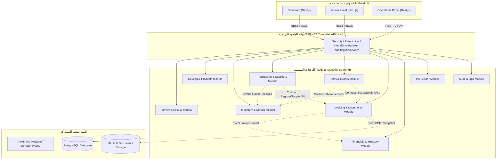

# المعمارية وتقسيم الوحدات — Modular Monolith Architecture

تاريخ التحديث: نوفمبر 2026  
الحالة: **M3.2d وM3.2e مكتملتان تقنيًا؛ M4 Catalog & Media وAdmin Workspace مكتملان محليًا في Module وAPI وStorefront وPreview tooling، واجتازا PostgreSQL/Playwright/Visual QA. وحدات المخزون والمبيعات والمالية ما زالت حدود Assemblies فقط.**

---

## 1. فلسفة المعمارية ومبررات الاختيار (Architecture Rationale)

تم اعتماد نمط **المونوليث النمطي (Modular Monolith)** للمشروع بناءً على دراسة متطلبات النظام والأداء وفريق العمل للأسباب التالية:
1. **تجنب تعقيدات الـ Microservices المبكرة:** التخلص من تكاليف تعقب الشبكة، والـ Distributed Transactions، وإدارة حاويات متعددة، مع الاحتفاظ الكامل بفصل النطاقات (Domain Boundaries).
2. **عزل النطاقات (Loose Coupling & High Cohesion):** كل وحدة (Module) مستقلة تماماً بنموذج بياناتها وقواعد عملها ومنطقها، مما يمنع تشابك الكود (Spaghetti Code) ويتيح مستقبلاً استخراج أي وحدة كخدمة منفصلة إذا تطلب الحمل ذلك دون إعادة كتابتها.
3. **أداء فائق مع .NET 10:** الاتصال داخل المعالج (In-Memory Communication) سريع جداً دون Overhead شبكي، مع استخدام قاعدة بيانات PostgreSQL واحدة مقسمة منطقياً (Schemas or Prefixes).

---

## 2. خريطة الوحدات الوظيفية المعتمدة (Module Map)



---

## 3. حسم حدود ومسؤولية وحدة الفواتير (Invoicing Module Boundaries)

لتفادي التضارب السابق بين اعتبار الفواتير جزءاً من المبيعات أو وحدة مستقلة، تم اعتماد **وحدة الفواتير والمستندات (Invoicing Module)** كوحدة مستقلة قائمة بذاتها داخل المونوليث النمطي:

### 3.1 الوحدة المالكة للفواتير والمستندات
* **المالك الحصري:** وحدة `Invoicing Module`.
* **مسؤولياتها:**
  1. توليد وإدارة الأرقام التسلسلية الفريدة للفواتير والمستندات ومنع التكرار نهائياً.
  2. إدارة قوالب الفواتير (A4 الضريبية، والإيصال الحراري POS Thermal 80mm).
  3. إصدار النسخ الجديدة للقوالب (`invoice_template_versions`) عند أي تعديل لضمان ثبات الفواتير القديمة.
  4. توليد وتخزين النسخ الثابتة (`invoice_snapshots`) وملفات الـ PDF المستقرة (`rendered_pdf_storage_key`).
  5. إصدار المستندات المالية المصاحبة: إشعارات المرتجع الدائنة (`Credit Notes`) والإشعارات المدينة (`Debit Notes`).

### 3.2 الوحدات التي تطلب إصدار المستندات (Consumer Modules)
1. **وحدة المبيعات والطلبات (`Sales Module`):** تطلب إصدار فاتورة مبيعات عند اعتماد الطلب وشحنه أو تسليمه للعميل.
2. **وحدة كاشير المعرض (`POS Module`):** تطلب إصدار فاتورة مبيعات فورية وإيصال حراري عند إتمام الشراء المباشر.
3. **وحدة المرتجعات والدعم (`Returns & RMA Module`):** تطلب إصدار إشعار دائن (`Credit Note`) رسمي عند اعتماد فحص واسترجاع الصنف.
4. **وحدة المشتريات (`Purchasing Module`):** تسجل فواتير الموردين (`purchase_bills`) ويتم فهرستها أو ربطها عبر عقود وحدة الفواتير.

### 3.3 الواجهات والعقود البينية (Invoicing Module Contracts)
توفر وحدة الفواتير عقوداً عامة صارمة وخفيفة (Interfaces & DTOs) في مجلد `Contracts`:
```csharp
public interface IInvoicingModuleContract
{
    // إصدار فاتورة مبيعات رسمية
    Task<InvoiceResultDto> IssueSalesInvoiceAsync(IssueSalesInvoiceCommand command, CancellationToken ct = default);
    
    // إصدار إشعار دائن لمرتجع
    Task<CreditNoteResultDto> IssueCreditNoteAsync(IssueCreditNoteCommand command, CancellationToken ct = default);
    
    // جلب اللقطة الثابتة للفاتورة لإعادة العرض أو التحقق
    Task<InvoiceSnapshotDto> GetInvoiceSnapshotAsync(Guid invoiceId, CancellationToken ct = default);
    
    // جلب ملف الـ PDF الثابت المحفوظ في التخزين الخارجي
    Task<Stream> GetRenderedInvoicePdfAsync(Guid invoiceId, CancellationToken ct = default);
}
```

### 3.4 مسؤولية حفظ المستندات والنسخ الثابتة
* وحدة `Invoicing Module` هي المسؤولة حصرياً عن رندرة الفاتورة وحفظ لقطة البيانات والـ JSON والـ PDF الثابت في التخزين الخارجي.
* الوحدات الأخرى (مثل `Sales` أو `Returns`) لا تخزن نسخة من الفاتورة، بل تحتفظ فقط بالمعرف المرجعي `invoice_id`.

---

## 4. حدود الوحدات وقواعد الاتصال البيني (Inter-Module Communication Rules)

1. **عزل البيانات (Data Isolation):**
   - لا يجوز لأي وحدة الاستعلام المباشر من جداول قاعدة بيانات تخص وحدة أخرى عبر `DbContext` الخاص بها.
   - كل وحدة تملك جداولها وكياناتها (Entities).
2. **العقود العامة للوحدات (Module Public Contracts):**
   - كل وحدة توفر مجلد `Contracts` يحتوي فقط على واجهات (Interfaces) و DTOs خفيفة.
   - التنسيق المباشر اللحظي المتزامن يتم حصراً عبر استدعاء هذه العقود المسجلة في Dependency Injection.
   - استثناء عرضي منفذ: تعتمد `Identity` في اتجاه واحد على `Auditing` لاستخدام `ISecurityAuditWriter` و`ISecurityAuditTransactionWriter`، ولا يعتمد `Auditing` على `Identity`. لا تستعلم Identity من جدول Audit مباشرة.
3. **الاتصال عبر الأحداث (Domain & Integration Events):**
   - التنسيق غير المتزامن أو المرتبط بإشعارات خارجية يتم عبر أحداث تكامل داخل الذاكرة (In-Memory Mediator Notifications) أو Outbox Pattern.
   - مثال: عند صدور الفاتورة نهائياً، تطلق وحدة الفواتير `InvoiceIssuedEvent` فتستمع وحدة الحسابات (`Financials`) لتسجيل الاستحقاق أو إيصال القبض، وتستمع وحدة التدقيق (`Auditing`) لتوثيق العملية.

---

## 5. الهيكل الداخلي لكل وحدة (Module Internal Structure)

تتبع كل وحدة معمارية نظيفة مبسطة وعملية (Clean / Hexagonal Architecture):

```
Modules/
└── [ModuleName]/
    ├── Contracts/                <-- الواجهات والـ DTOs المصدرة للوحدات الأخرى
    │   ├── I[ModuleName]Contract.cs
    │   └── Dtos/
    ├── Domain/                   <-- الكيانات وقواعد العمل الخالصة بدون تبعيات
    │   ├── Entities/
    │   ├── ValueObjects/
    │   ├── Exceptions/
    │   └── Events/
    ├── Application/              <-- الأوامر والاستعلامات والتحقق (CQRS with MediatR)
    │   ├── Commands/
    │   ├── Queries/
    │   ├── Validators/           <-- FluentValidation
    │   └── EventHandlers/
    ├── Infrastructure/           <-- الاتصال بقاعدة البيانات ومزودات الخدمات
    │   ├── Persistence/
    │   │   ├── [Module]DbContext.cs
    │   │   └── EntityConfigurations/
    │   └── Services/
    └── Endpoints/                <-- تعريف نقاط الـ API الخاصة بالوحدة (Minimal APIs or Controllers)
```

---

## 6. توزيع المسؤوليات للوحدات (Modules Breakdown)

| الوحدة (Module) | المسؤولية ونطاق العمل | الكيانات الرئيسية (Entities) |
|---|---|---|
| **Identity & Party** | إدارة الأشخاص والحسابات، المصادقة، الأدوار، الصلاحيات، والجلسات | `Person`, `UserAccount`, `UserAccountLoginIdentifier`, `IdentityToken`, `AuthSession`, `AuthorizationState`, `Role`, `Permission` |
| **Catalog** | المنتجات، التصنيفات الهرمية، الماركات، Variants، الخصائص الفنية، الصور، وحالة النشر | `CatalogCategory`, `CatalogBrand`, `CatalogProduct`, `CatalogProductVariant`, `CatalogProductSpecification`, `CatalogProductImage` |
| **Inventory** | المستودعات، الأرصدة، السيريالات، الحركات، حجز المخزون، وجلسات الجرد | `Warehouse`, `StockItem`, `InventoryBatch`, `SerialNumber`, `InventoryMovement`, `StockReservation` |
| **Purchasing** | الموردون، كتالوج أصناف المورد، أوامر الشراء، أذونات الاستلام، وتكاليف الشحن | `SupplierProfile`, `SupplierProduct`, `PurchaseOrder`, `PurchaseOrderItem`, `GoodsReceipt`, `GoodsReceiptItem` |
| **Storefront** | إعدادات المتجر العامة (WhatsApp/Social/Pickup/Trust) ومحتوى الواجهة مستقبلًا | `StoreSettings` |
| **Sales** | سلة الشراء، طلبات المتجر، حالات الطلب، تواصل WhatsApp، الاستلام والشحن | `Order`, `OrderItem`, `OrderStatusHistory`, `StorePickup`, `OrderDelivery` |
| **Invoicing** | الفواتير الصادرة، قوالب الفواتير وإصداراتها، النسخ الثابتة، وإشعارات المرتجع | `Invoice`, `InvoiceItem`, `InvoiceTemplate`, `InvoiceTemplateVersion`, `InvoiceSnapshot`, `CreditNote` |
| **Financials** | الخزائن النقدية، الحسابات البنكية، فواتير الموردين، سندات القبض والصرف، والمصروفات | `Vault`, `TreasuryTransaction`, `PurchaseBill`, `PurchaseBillItem`, `Expense` |
| **PcBuilder** | مجمّع الحواسيب، قوالب التجميعات والبدائل، وفحص التوافق الأساسي | `BuildTemplate`, `TemplateSlot`, `SlotAlternative`, `CompatibilityRule` |
| **Auditing & Ops** | سجل التدقيق المركزي، مراقبة الأخطاء، وإعدادات المتجر والنسخ الاحتياطي | `AuditLogEntry`, `SystemErrorLog`, `StoreSetting`, `BackupRecord` |

---

## 7. واجهات المستخدم المعمارية (Frontend Architectural Layout)

الواجهة الحالية هي تطبيق Next.js واحد في `apps/web`، ويحتوي على تجربة هوية العميل وCatalog Storefront وAdmin Workspace: Register/Verify/Resend/Login/Forgot/Reset، Account Security، Categories/Products/Details/Carousels، Dashboard، ومحرر المنتجات. تستخدم `src/lib/api-client.ts` للاتصال same-origin مع Cookies وCSRF، و`SessionProvider` لحالة الحساب والصلاحيات القادمة من `/identity/me`، وProxy لحماية `/account/*` و`/admin/*`، وقاموس AR/EN مع تبديل `dir` بين RTL وLTR. إخفاء رابط الإدارة أو نموذج التحرير لا يمنح وصولًا؛ كل عملية Admin تعيد التحقق من الصلاحية على الخادم. التقسيم التالي ما زال هدفًا مستقبليًا غير منفذ:
1. `apps/storefront`: واجهة المتجر العامة، تركز على السرعة، وتجربة المستخدم، والـ SEO، ومجمّع الحواسيب.
2. `apps/admin-panel`: لوحة إدارة العمليات التجارية اليومية للفرع والمخزن والمبيعات والفواتير.
3. `apps/ops-panel`: لوحة الصيانة والدعم الفني والنسخ الاحتياطي.
4. `packages/ui-components`: مكتبة مكونات مشتركة (Design System) تدعم RTL والـ Dark/Light Mode.

في M3.2e/M4 بقيت المكونات داخل `apps/web/src/components` بدل إنشاء Workspace/Design System موازٍ. Identity email delivery يستخدم `IEmailProvider` مع In-Memory Provider في التطوير وSMTP عام في Production؛ اختيار مزود إنتاجي وأسراره لا يمثل قرارًا معماريًا محسومًا بعد. Caddy ليس جزءًا من `compose.yaml` الحالي، لذلك نشر same-origin للإنتاج ما زال خارج التنفيذ. `compose.preview.yaml` منفصل ويشغّل Next.js في Development مع `API_ORIGIN` داخلي، بينما `compose.yaml` يظل Production-like.


---

## 8. قرارات M3.3 / M5 الأخيرة

- **Identity delegation:** إدارة الهوية لا تعتمد على Claims العميل؛ كل عملية تحمّل صلاحيات الفاعل من قاعدة البيانات، وتمنع منح صلاحية لا يملكها، وتحمي آخر Owner وSystem.ManageUsers. القواعد في `IdentityDelegationPolicy` (ADR-010).
- **Supplier Profile:** الشريحة الأولى من M5 تنفذ `SupplierProfile` في Purchasing و`Person` في Identity داخل معاملة واحدة، مع `SupplierPersonReference` للقراءة فقط ومستبعد من migrations الخاصة بـPurchasing (ADR-011).
- **Supplier financial separation:** `SupplierView` العام لا يحمل Bank/Account/IBAN؛ القراءة المالية مسار مستقل بصلاحية `Purchasing.ViewSupplierFinancials` وAudit fail-closed (ADR-012).
- **Supplier Product Catalog:** `supplier_products` يربط SupplierProfile بـ`product_variants` في Catalog بواسطة ID، مع SupplierSku/Notes/Activation فقط. لا أسعار/MOQ/Lead Time/Stock/PO (ADR-013).
- **Warehouse Directory:** Module `Inventory` يملك `warehouses` كبيانات رئيسية (Code/Name/Address/IsActive/RowVersion)، بلا Stock/Balances/Movements (ADR-014).
- **Identity administration:** Facade رقيق + `IdentityUserAdministrationService` + `IdentityRoleAdministrationService` + `IdentityAdministrationSupport`؛ الحدود قائمة على نطاق الاستخدام لا على عدد الأسطر (ADR-015).
- **حدود M5:** لا Stock/Transfers/Reservations/Serials/Purchase Orders في هذه الشريحة. البوابات Q2.1–Q2.5 وQ6.3 وQ8.7 ما زالت معلقة.
- **Frontend:** Admin Workspace أصبح يسمح بأي صلاحية إدارية معروفة، ويعرض فقط مجموعات المسارات المتاحة للحساب؛ لا يفترض أن كل Admin يملك Catalog.View.
