# تصميم وتوثيق قاعدة البيانات ومخطط الكيانات (DATABASE_DESIGN_ERD.md)

تاريخ التحديث: نوفمبر 2026  
قاعدة البيانات المعتمدة: **PostgreSQL 17+**  
تقنية الوصول للبيانات: **Entity Framework Core (EF Core 10)** حاليًا. أي استخدام مستقبلي لـDapper يحتاج حاجة أداء موثقة واعتمادًا منفصلًا، ولا توجد له حزمة أو تنفيذ حالي.  
الحالة: **مخطط V1 المستهدف؛ Identity مطابق لتنفيذ M3.1-M3.2e، وجداول Catalog الستة مطابقة لنموذج M4 وMigration المولدة وبيئة Preview المعزولة. لم تُضف Migration أو تغييرات Schema في جولة إغلاق M4. جداول الوحدات التجارية الأخرى تظل تصميمًا مستقبليًا حتى تنفيذ شرائحها.**

---

## 1. المبادئ الهندسية والمعايير العامة لقاعدة البيانات

1. **أنواع المفاتيح الأساسية (Primary Keys):**
   - استخدام `UUIDv7` لجميع الجداول التشغيلية والتجارية (مرتب زمنياً، يمنع تجزئة فهارس B-Tree، ومقاوم لهجمات التخمين).
2. **التعامل مع التوقيت والعملات:**
   - جميع حقول التواريخ من نوع `TIMESTAMPTZ` (UTC حصراً).
   - جميع المبالغ المالية والأسعار من نوع `DECIMAL(18,4)` لمنع أخطاء تقريب الكسور المالية.
   - جميع الكميات من نوع `DECIMAL(12,3)` لدعم الكميات الدقيقة.
3. **التحكم في التزامن (Optimistic Concurrency Control):**
   - استخدام عمود النظام المدمج في PostgreSQL وهو `xmin` (أو عمود `concurrency_stamp`) في الجداول الحساسة (`stock_items`, `orders`, `invoices`, `payments`).
4. **عزل الحذف المنطقي ومسارات التدقيق:**
   - الحذف في جداول العمليات المالية والمخزنية ممنوع؛ يتم استخدام الإلغاء الشكلي أو التعطيل المنطقي (`is_active = false` أو `status = 'Cancelled'`).
   - كل جدول يحتوي على: `created_at_utc`, `created_by_user_id`, `updated_at_utc`, `updated_by_user_id`.

---

## 2. مخطط الكيانات والعلاقات الشامل (Mermaid ERD)

```mermaid
erDiagram
    %% Identity & Party Module
    PERSONS ||--o| USER_ACCOUNTS : "has account"
    PERSONS ||--o| CUSTOMER_PROFILES : "planned profile"
    PERSONS ||--o| SUPPLIER_PROFILES : "planned profile"
    USER_ACCOUNTS ||--o{ USER_ACCOUNT_LOGIN_IDENTIFIERS : "normalized login IDs"
    USER_ACCOUNTS ||--o{ IDENTITY_TOKENS : "owns tokens"
    USER_ACCOUNTS ||--o{ AUTH_SESSIONS : "owns sessions"
    USER_ACCOUNTS ||--o{ USER_ROLES : "assigned"
    ROLES ||--o{ USER_ROLES : "belongs"
    ROLES ||--o{ ROLE_PERMISSIONS : "grants"
    PERMISSIONS ||--o{ ROLE_PERMISSIONS : "defines"
    USER_ACCOUNTS ||--o{ SECURITY_AUDIT_EVENTS : "actor or subject"

    %% Catalog Module
    CATEGORIES ||--o{ CATEGORIES : "parent of"
    CATEGORIES ||--o{ PRODUCTS : "contains"
    BRANDS ||--o{ PRODUCTS : "manufactures"
    PRODUCTS ||--o{ PRODUCT_VARIANTS : "has variants"
    PRODUCTS ||--o{ PRODUCT_SPECIFICATIONS : "has specs"
    PRODUCTS ||--o{ PRODUCT_IMAGES : "has images"
    PRODUCTS ||--o{ BUILD_TEMPLATE_SLOTS : "used in"

    %% Inventory Module
    WAREHOUSES ||--o{ STOCK_ITEMS : "stores"
    PRODUCTS ||--o{ STOCK_ITEMS : "stocked as"
    STOCK_ITEMS ||--o{ INVENTORY_MOVEMENTS : "ledger"
    INVENTORY_BATCHES ||--o{ INVENTORY_BATCH_BALANCES : "warehouse balances"
    STOCK_ITEMS ||--o{ INVENTORY_BATCH_BALANCES : "batch stocks"
    INVENTORY_BATCHES ||--o{ INVENTORY_MOVEMENTS : "depletes"
    STOCK_ITEMS ||--o{ SERIAL_NUMBERS : "tracks"
    INVENTORY_BATCHES ||--o{ SERIAL_NUMBERS : "origins"
    STOCK_ITEMS ||--o{ STOCK_RESERVATIONS : "locks"
    SERIAL_NUMBERS ||--o| STOCK_RESERVATIONS : "reserved unit"
    WAREHOUSES ||--o{ STOCK_TRANSFERS : "source warehouse"
    WAREHOUSES ||--o{ STOCK_TRANSFERS : "destination warehouse"
    STOCK_TRANSFERS ||--o{ STOCK_TRANSFER_ITEMS : "contains"
    STOCK_ITEMS ||--o{ STOCK_TRANSFER_ITEMS : "transfers"
    STOCK_TRANSFERS ||--o{ STOCK_TRANSFER_RECEIPTS : "receipt events"
    STOCK_TRANSFER_RECEIPTS ||--o{ STOCK_TRANSFER_RECEIPT_ITEMS : "received details"
    STOCK_TRANSFER_ITEMS ||--o{ STOCK_TRANSFER_RECEIPT_ITEMS : "receipt lines"
    STOCK_TRANSFER_ITEMS ||--o{ STOCK_TRANSFER_ITEM_SERIALS : "allocates"
    SERIAL_NUMBERS ||--o{ STOCK_TRANSFER_ITEM_SERIALS : "assigned to transfer"
    STOCK_TRANSFER_RECEIPT_ITEMS ||--o{ STOCK_TRANSFER_RECEIPT_ITEM_SERIALS : "receives"
    STOCK_TRANSFER_ITEM_SERIALS ||--o| STOCK_TRANSFER_RECEIPT_ITEM_SERIALS : "received unit"
    STOCK_TRANSFERS ||--o{ TRANSFER_DISCREPANCY_SETTLEMENTS : "settles"
    STOCK_TRANSFER_ITEMS ||--o{ TRANSFER_DISCREPANCY_SETTLEMENTS : "item settlements"

    %% Purchasing Module
    SUPPLIER_PROFILES ||--o{ PURCHASE_ORDERS : "receives"
    PURCHASE_ORDERS ||--o{ PURCHASE_ORDER_ITEMS : "contains"
    PURCHASE_ORDERS ||--o{ GOODS_RECEIPTS : "fulfilled by"
    GOODS_RECEIPTS ||--o{ GOODS_RECEIPT_ITEMS : "details"
    GOODS_RECEIPTS ||--o{ INVENTORY_BATCHES : "creates batches"
    PURCHASE_BILLS ||--o{ PURCHASE_BILL_ITEMS : "invoiced items"
    GOODS_RECEIPTS ||--o{ PURCHASE_BILLS : "billed as"

    %% Sales Module
    PERSONS ||--o{ ORDERS : "places"
    ORDERS ||--o{ ORDER_ITEMS : "contains"
    ORDERS ||--o{ ORDER_STATUS_HISTORY : "tracks"
    ORDERS ||--o| ORDER_DELIVERIES : "delivery fulfillment"
    ORDERS ||--o| STORE_PICKUPS : "pickup fulfillment"
    ORDERS ||--o{ STOCK_RESERVATIONS : "reserves"
    ORDERS ||--o{ PAYMENTS : "paid via"
    PAYMENTS ||--o{ PAYMENT_ATTEMPTS : "logs attempts"

    %% Invoicing Module (Standalone Module)
    INVOICE_TEMPLATES ||--o{ INVOICE_TEMPLATE_VERSIONS : "versions"
    INVOICE_TEMPLATE_VERSIONS ||--o{ INVOICES : "formats"
    ORDERS ||--o| INVOICES : "billed via"
    INVOICES ||--o{ INVOICE_ITEMS : "contains"
    INVOICES ||--o| INVOICE_SNAPSHOTS : "immutable archive"
    INVOICES ||--o{ CREDIT_NOTES : "adjusted by"

    %% Returns & Quarantine Module
    ORDERS ||--o{ SALES_RETURNS : "returns from"
    SALES_RETURNS ||--o{ RETURN_ITEMS : "contains"
    RETURN_ITEMS ||--o| RETURN_INSPECTIONS : "quarantined & inspected"
    RETURN_INSPECTIONS ||--o| CREDIT_NOTES : "triggers refund"

    %% Promotions Module
    PROMOTIONS ||--o{ PROMOTION_ITEMS : "targets"
```



---

## 3. تصنيف جداول قاعدة البيانات (Core V1 vs Deferred Tables)

لضمان وضوح نطاق التنفيذ وعدم تشتيت مرحلة التأسيس وما بعدها:

* **الجداول التشغيلية الأساسية للإصدار الأول (V1 Core Tables - إلزامية):**
  1. الهوية والأطراف: الجداول المنفذة حاليًا `persons`, `user_accounts`, `roles`, `permissions`, `user_roles`, `role_permissions`, `user_account_login_identifiers`, `identity_tokens`, `auth_sessions`, `authorization_state`, و`security_audit_events`. أُضيف `supplier_profiles` ضمن M5؛ `customer_profiles` ما زال مؤجلًا.
  2. الكتالوج المنفذ في M4: `categories`, `brands`, `products`, `product_variants`, `product_specifications`, `product_images`؛ Migration مولدة، وSchema موجودة في Preview المعزولة التي شُغّلت سابقًا. جولة إغلاق M4 لم تطبق Migration ولم تلمس قاعدة دائمة.
  3. المخزون: أُضيف `warehouses` كبيانات رئيسية في M5. الجداول `stock_items`, `inventory_batches`, `inventory_batch_balances`, `serial_numbers`, `inventory_movements`, `stock_reservations`, `stock_transfers`, `stock_transfer_items`, `stock_transfer_item_serials`, `stock_transfer_receipts`, `stock_transfer_receipt_items`, `stock_transfer_receipt_item_serials`, `transfer_discrepancy_settlements` ما زالت مؤجلة.
  4. المشتريات: أُضيف `supplier_profiles` و`supplier_products` في M5. الجداول `purchase_orders`, `purchase_order_items`, `goods_receipts`, `goods_receipt_items`, `purchase_bills`, `purchase_bill_items` ما زالت مؤجلة.
  5. المبيعات والطلبات: `orders`, `order_items`, `order_status_history`, `order_deliveries`, `store_pickups`, `payments`, `payment_attempts`.
  6. الفواتير والمستندات: `invoice_templates`, `invoice_template_versions`, `invoices`, `invoice_items`, `invoice_snapshots`, `credit_notes`.
  7. المرتجعات والحجر: `sales_returns`, `return_items`, `return_inspections`.
  8. التجميعات والعروض: `build_templates`, `template_slots`, `slot_alternatives`, `promotions`, `promotion_items`.
  9. التشغيل والإعدادات: `store_settings`, `audit_logs`, `system_errors`, `backup_records`.

* **جداول M5 المنفذة (بيانات رئيسية فقط):**
  - `supplier_profiles`: `id`, `person_id` (FK persons), `company_name`, `tax_id_number`, `commercial_registration`, `contact_person_name`, `contact_person_phone`, `bank_name`, `bank_account_number`, `bank_iban`, `payment_terms_days`, `notes`, `is_active`, `created_at_utc`, `updated_at_utc`, `row_version`; Unique Partial Indexes على Tax ID وCommercial Registration.
  - `supplier_products`: `id`, `supplier_profile_id` (FK), `product_variant_id` (FK product_variants), `supplier_sku`, `notes`, `is_active`, `created_at_utc`, `updated_at_utc`, `row_version`; Unique على (supplier_profile_id, product_variant_id) و(supplier_profile_id, supplier_sku).
  - `warehouses`: `id`, `code` (Unique), `name`, `address`, `is_active`, `created_at_utc`, `updated_at_utc`, `row_version`.
  - `store_settings`: صف واحد `id=1` مع WhatsApp/Social/Pickup/Trust و`row_version`/تواريخ؛ لا أسرار.
  - `products.condition`: `New`/`Used` مع Check Constraint وDefault `New`.
  - `auth_sessions`: أُضيف `public_id` (فريد)، `user_agent` (اختياري)، `ip_address` (داخلي اختياري) لعرض/إدارة الجلسات دون كشف المفتاح أو التذكرة.
  - `product_images.original_storage_key`: اختياري، يحفظ الأصل المرفوع؛ لا يُعرض عبر API عام.
  - لا أسعار شراء/تكلفة/MOQ/Lead Time/Stock/Balance/Movement في هذه الجداول.

* **الجداول المؤجلة لما بعد الإصدار الأول (Deferred / Post-V1 Tables):**
  - جداول الورديات المعقدة (`cashier_shifts`, `cash_drawer_counts`) — *يُكتفى في V1 بتسجيل الإيداع والصرف المباشر على الخزينة*.
  - جداول برامج الولاء والعمولات (`referrals`, `affiliate_commissions`).
  - جداول خوادم التراخيص لتعدد المستأجرين (`tenant_licenses`, `license_activations`).

---

## 4. مصدر الحقيقة للمخزون والتسويات (Inventory Source of Truth & Reconciliation)

لمنع أي تضارب أو ازدواجية في مصادر الحقيقة بين الأرصدة والسيريالات والدفعات، تم ضبط العلاقات وقواعد التحديث بدقة:

### 4.1 توضيح الفرق بين الكمية الفعلية والكمية المحجوزة وتوزيع أرصدة الدفعات
1. **الكمية الفعلية على الرف (`Physical On-Hand Quantity`):**
   - تمثل **البضاعة المتواجدة مادياً على رفوف المستودع الآن**.
   - **لا تنقص عند حجز الطلب،** بل تظل ثابتة وموجودة فعلياً حتى يتم شحن أو تسليم الطلب للعميل (`Fulfillment Dispatch`)، وحينها فقط تُخصم من الرف عبر تسجيل حركة صرف رسمية في `inventory_movements`.
   - **المصدر المرجعي الدائم:** سجل حركات المخزون المعياري الموثق (`inventory_movements`).
   - **الرصيد اللحظي التجميعي (Materialized Snapshot):** حقل `stock_items.physical_quantity`؛ يتم تحديثه لحظياً داخل نفس المعاملة الذرية (DB Transaction) مع كل حركة مخزنية فعلية.
   - **للأصناف المسلسلة (`requires_serial = true`):** الرصيد الفعلي `physical_quantity` **يجب أن يطابق تماماً** عدد السجلات النشطة في جدول `serial_numbers`:
     $$\text{stock\_items.physical\_quantity} = \text{COUNT}(\text{serial\_numbers WHERE stock\_item\_id = X AND status IN ('InStock', 'Reserved')})$$
   - **للأصناف غير المسلسلة وتمثيل البضاعة الفعلية وقيد النقل والحجر الفني (Physical vs In-Transit vs Quarantine vs Total Custody):**
     لضمان الشفافية المطلقة والعدالة المحاسبية ومنع أي تضارب أو ازدواجية، يفصل النظام بوضوح رياضي ومحاسبي صارم بين أربعة مفاهيم للكميات وحالات المخزون:
     1. **الرصيد الفعلي المتاح للبيع على الرف بالمستودعات (`Physical Salable Quantity in Warehouses`):**
        تُمثل كمية كل دفعة بالمستودع المتاحة للبيع عبر حقل `remaining_quantity` في جدول `inventory_batch_balances`.
        ويكون رصيد المستودع الفعلي المتاح للبيع مطابقاً تماماً لمجموع أرصدة دفعات هذا المستودع:
        $$\text{stock\_items.physical\_quantity} = \sum_{\text{stock\_item\_id}} \text{inventory\_batch\_balances.remaining\_quantity}$$
        بينما الرصيد المتاح للبيع في رأس الدفعة `inventory_batches.remaining_quantity` هو **رصيد تجميعي مشتق/مادي (Materialized Rollup)** يُحدث آلياً داخل نفس المعاملة الذرية:
        $$\text{inventory\_batches.remaining\_quantity} = \sum_{\text{all warehouses}} \text{inventory\_batch\_balances.remaining\_quantity}$$
     2. **رصيد الحجر الفني بالمستودعات للقطع المفحوصة والتالفة (`Quarantine Stock Quantity`):**
        يمثل البضاعة التي وصلت فعلياً إلى المستودع ولكنها **مستبعدة تماماً من الرصيد المتاح للبيع** لوجود تلف أثناء النقل أو لكونها مرتجعاً قيد الفحص الفني.
        - **للأصناف المسلسلة:** تُمثل بعدد السيريالات التي حالتها `InQuarantine` داخل المستودع المحدد:
          $$\text{Quarantined Serials} = \text{COUNT}(\text{serial\_numbers WHERE warehouse\_id = W AND status = 'InQuarantine'})$$
        - **للأصناف غير المسلسلة والدفعات:** تُسجل في حقل مخصص `inventory_batch_balances.quarantine_quantity` بكل مستودع، ورأس الدفعة `inventory_batches.quarantine_quantity`.
        - **قاعدة محاسبية:** البضاعة بالحجر الفني لا تختفي من عهدة المتجر ولا تُعد في الطريق، بل تظل تحت عهدة المستودع المستلم لحين البت في التصرف (إصلاح، إرجاع للمورد، أو تعويض شركة الشحن).
     3. **البضاعة التي ما زالت في الطريق فعلياً (`Goods In-Transit Quantity`):**
        تمثل البضاعة التي صُرفت رسمياً من مستودع المصدر (`TransferOut`) ولكنها لم تصل أو تُستلم بعد في مستودع الوجهة (`TransferIn`).
        - هذه الكميات خرجت من رفوف المصدر ولم تدخل رفوف الوجهة بعد، وبالتالي **لا تظهر في الأرصدة المادية للمستودعات (لا في المتاح ولا في الحجر)**.
        - **المعادلة الرياضية الصارمة لحساب البضاعة في الطريق:** تخصم كل ما وصل فعلياً للوجهة (سواء كان مقبولاً للمخزن أو مرفوضاً للحجر) بالإضافة إلى العجز المفقود المعتمد تسويته:
           نرمز بـ `D` للمصروف، و`A` لمجموع المقبول، و`R` للمرفوض الواصل، و`L` للفقد المعتمد؛ `InTransit = D - A - R - L` إذا كانت النتيجة موجبة. مصدر `A` و`R` أحداث الاستلام المثبتة، ومصدر `L` التسويات المعتمدة فقط.
        - وللدفعة المحددة، تُحسب الكمية المحمولة في الطريق:
          $$\text{Batch In-Transit} = \sum_{\text{transfer items of batch}} \max(0, D - A - R - L)$$
     4. **إجمالي عهدة المتجر التامة المملوكة للدفعة (`Total Store Custody of Batch`):**
        تجمع كافة ممتلكات المتجر من الدفعة (المتاح على الرف + المحجور تحت الفحص + المحمول على شاحنات النقل بين الفروع):
        $$\text{Total Store Batch Custody} = \sum_{\text{warehouses}} \text{remaining\_quantity} + \sum_{\text{warehouses}} \text{quarantine\_quantity} + \text{Batch In-Transit}$$
     5. **منع الازدواجية والمطابقة التامة:**
        عند تنفيذ حركة الاستلام بالوجهة (`TransferIn`):
        - الكمية المقبولة تزيد `remaining_quantity` لمستودع الوجهة فوراً.
        - الكمية المرفوضة للتلف تزيد `quarantine_quantity` لمستودع الوجهة فوراً.
        - الكميتان معاً تخصمان فوراً من رصيد البضاعة قيد النقل `In-Transit` لنفس بند التحويل، مما يمنع أي احتساب مزدوج قطعياً.
        - وتكون معادلة المطابقة الكلية للدفعة ثابتة دائماً:
          $$\text{Initial Batch Qty} = \text{Salable Physical} + \text{Quarantined} + \text{In-Transit} + \text{Cumulative Outflows (Sold, Scrapped, Lost)}$$
2. **الكمية المحجوزة وحماية الحجز أثناء التجهيز والشحن (`Reserved Quantity & FulfillmentHold`):**
   - تمثل **الالتزامات المعلقة لطلبات بيع نشطة** قيد المراجعة أو الدفع أو التجهيز والشحن ولم تُسلم نهائياً بعد.
   - هذه البضاعة لا تزال متواجدة على الرف مادياً (ضمن `physical_quantity`)، ولكنها محجوبة برمجياً عن البيع لعميل آخر.
   - **المصدر المرجعي المطلق:** مجموع السجلات الفعالة في جدول `stock_reservations`:
     $$\text{Source of Truth} = \sum \text{stock\_reservations.quantity WHERE reservation\_status IN ('Active', 'FulfillmentHold')}$$
   - **الرصيد اللحظي للأداء:** حقل `stock_items.reserved_quantity`؛ يُحدث تلقائياً عند إنشاء أو إلغاء أو انتهاء الحجز أو تحويله إلى صرف نهائي.

3. **الكمية المتاحة للبيع (`Available Quantity`):**
   - **قاعدة حاسمة:** لا يوجد عمود مستقل في قاعدة البيانات يُدعى `available_quantity`؛ بل هي ناتج معادلة آنية:
     $$\text{Available Quantity} = \text{physical\_quantity} - \text{reserved\_quantity}$$
   - **قيد قاعدة البيانات المانع في PostgreSQL (Check Constraint):**
     ```sql
     ALTER TABLE stock_items ADD CONSTRAINT chk_stock_items_quantities 
     CHECK (physical_quantity >= 0 AND reserved_quantity >= 0 AND physical_quantity >= reserved_quantity);
     ```
     هذا القيد يمنع على مستوى محرك قاعدة البيانات أي احتمالية لظهور رصيد متاح سالب تحت أي ظرف.

4. **تكلفة المخزون ومصدرها وتحديثات الدفعات والحركات:**
   - **المصدر الأساسي للتكلفة:** حقل `inventory_batches.unit_cost_price` المثبت عند الاستلام المخزني (`goods_receipts`) شاملاً مصاريف الشحن الموزعة.
   - **للقطع المسلسلة:** يُسجل حقل `serial_numbers.unit_cost` تكلفة الشراء الفردية للقطعة من واقع دفعتها الأصلية.
   - **دورة تحديث أرصدة الدفعات في المستودعات (`inventory_batch_balances`):**
     - عند الاستلام (`GoodsReceipt`): ينشأ سجل الدفعة وسجل رصيد الدفعة بالمستودع المستلم بكامل الكمية.
     - عند صرف البيع (`SalesDispatch`): تُخصم الكمية من `inventory_batch_balances` للمستودع البائع.
     - عند التحويل بين المستودعات (`TransferOut`): تُخصم الكمية من رصيد الدفعة بمستودع المصدر، وتُنشأ أو تُزاد في مستودع الوجهة عند الاستلام الفعلي (`TransferIn`).
     - عند إرجاع البضاعة وتأكيد سلامتها (`ReturnRestock`): يُعاد قيد الكمية في رصيد الدفعة الأصلي بالمستودع المستلم.
     - عند التسويات الجردية (`StockCountAdjustment`): تُعدل كمية رصيد الدفعة وفق محضر الجرد المعتمد.
   - **حساب COGS عند البيع:** **يخضع لسياسة تقييم المخزون المعتمدة من صاحب المشروع** وفق المسألة المعلقة في [OPEN_QUESTIONS.md](../../OPEN_QUESTIONS.md#q11-طريقة-تقييم-تكلفة-المخزون-لحساب-تكلفة-البضاعة-المباعة-cogs-والأرباح) (`Q1.1`: إما Specific Identification للسيريالات + FIFO للقطع العامة، أو متوسط التكلفة WAC). وتظل هذه الطرق **اقتراحات معلقة قيد قرار المالك وليست قرارات معتمدة**.

### 4.2 دورة حياة الحجز وحمايته أثناء التجهيز والشحن (Reservation Lifecycle & FulfillmentHold)
لضمان عدم تجميد المخزون، وفي نفس الوقت **منع تحرير البضاعة خطأً أثناء وجودها في عهدة التجهيز أو شركة الشحن**:
1. **الحجز المؤقت للطلب الجديد (`reservation_status = 'Active'`):**
   - يُحدد له موعد انتهاء صريح (`expires_at_utc`)، ويُضاف إلى `stock_items.reserved_quantity`.
   - يقوم مجدول مهام خلفي دوري (Background Expiration Worker) بالبحث عن الحجوزات المنتهية حصراً:
     `WHERE reservation_status = 'Active' AND expires_at_utc <= NOW()`
   - التسوية الفورية المتزامنة (Inline Expiration): عند تنفيذ `SELECT ... FOR UPDATE` لفحص أو حجز بضاعة، يحرر النظام أي حجز نشط منتهٍ لنفس الصنف ذرّياً.
2. **حماية الحجز أثناء التجهيز والشحن (`FulfillmentHold` - تصميم تقني مقترح مرتبط بـ Q7.2):**
   - بمجرد انتقال الطلب إلى مرحلة التجهيز (`InFulfillment`):
     تنتقل حالة الحجز ذرياً من `Active` إلى `FulfillmentHold`.
   - **قاعدة حماية قطعية:** لا يقوم المجدول الخلفي ولا التسوية الفورية بمساس أي حجز بحالة `FulfillmentHold`؛ لأن البضاعة خرجت من مهلة الدفع ودخلت عهدة التجهيز أو المندوب.
   - يظل الرصيد محجوباً عن البيع ضمن `reserved_quantity`.
3. **الصرف النهائي أو الإلغاء والمرتجع:**
   - عند إتمام التسليم للعميل (أو تسليم المندوب وفق خيار Q7.2): ينتقل الحجز إلى `Fulfilled`، وتُخصم الكمية من `physical_quantity` و `reserved_quantity`، ويتحول السيريال إلى `Sold`.
   - في حال إلغاء الطلب قبل الشحن: ينتقل الحجز إلى `Released` ويعود المخزون للمتاح.
   - في حال فشل التسليم وعودة الشحنة (`ReturnedToStore`): لا تعود البضاعة للمتاح آلياً، بل تخضع لإجراء استلام وفحص طرود مرتجعة (`Delivery Return Intake`). وبعد ثبوت سلامتها، يُحرر الحجز `Released` ليعود المخزون متاحاً.

### 4.3 دورة التحويلات المتكررة والجزئية وموقع البضاعة في الطريق (Inter-Warehouse Transfers & Transit Custody)
عند نقل بضاعة بين مستودعين، تُدار العملية بدقة تمنع وجود بضاعة مجهولة المكان أو مكررة الرصيد أو فاقدة للتتبع التاريخي:
1. **توثيق أمر التحويل وبنوده وسيريالاته (`stock_transfers` و `stock_transfer_items` و `stock_transfer_item_serials`):**
   - يُنشأ الأمر بحالة `Draft` ثم `Approved`.
   - يحدد كل بند الصنف والمستودعين و`D` المصروفة؛ ويحسب `A` المقبول و`R` المرفوض الواصل و`L` الفقد المعتمد كلًّا من مصدره الموثق. `RemainingInTransit = D-A-R-L`.
   - **للأصناف المسلسلة (`requires_serial = true`):**
     - يدعم البند الواحد تحويل عدة وحدات مسلسلة عبر جدول تفصيلي متخصص: `stock_transfer_item_serials(stock_transfer_item_id, serial_number_id)`.
     - تكون الكمية المصروفة مطابقة تماماً لعدد السيريالات المخصصة: $\text{dispatched\_quantity} = \text{COUNT}(\text{serials})$.
     - يمنع قيد الفرادة `uq_transfer_item_serial` تخصيص نفس السيريال مرتين في نفس البند، ويمنع فحص الحالة في `serial_numbers.status = 'InStock'` تخصيص سيريال قيد النقل أو محجوز في أمر تحويل آخر.
2. **مكان وعهدة البضاعة والسيريال أثناء النقل (In-Transit Custody Model):**
   - عند صرف البضاعة من المصدر (`TransferOut`):
     - تُخصم الكمية من `stock_items.physical_quantity` ومن `inventory_batch_balances.remaining_quantity` لمستودع المصدر، وتُسجل حركة صرف رسمية `TransferOut` في `inventory_movements` (مرتبطة بـ `stock_transfers.id` وبند `stock_transfer_items.id`).
     - **للسيريالات:** تنتقل حالة السيريال في `serial_numbers.status` ذرياً إلى `InTransit`، ويُفرغ حقل المستودع تماماً `warehouse_id = NULL` و `stock_item_id = NULL`.
     - **مصدر الحقيقة الموحد:** حقل `serial_numbers.status` هو المصدر الوحيد والمعياري لحالة القطعة؛ وتخصيص السيريال في التحويل مسجل حصرياً في `stock_transfer_item_serials`، دون أي حقول مكررة في رأس السيريال (`in_transit_transfer_item_id`).
     - **الأثر الهندسي:** يستحيل ظهور السيريال في رصيد المصدر أو رصيد الوجهة، ويستحيل بيعه أو حجزه أو نقله أثناء وجوده في الطريق.
3. **أحداث الاستلام الجزئي والمتكرر وضوابط الكميات (`stock_transfer_receipts` و `stock_transfer_receipt_items` و `stock_transfer_receipt_item_serials`):**
   - يدعم النظام تعدد دفعات الاستلام لنفس أمر التحويل عبر إنشاء سجل حدث استلام موثق (`stock_transfer_receipts`) لكل شحنة تصل فعلياً.
   - يفحص المستلم القطع ويسجل `accepted_quantity` و`rejected_damaged_quantity` في كل حدث. تصل القطع المرفوضة أولًا إلى الحجر؛ أي إعدام لاحق حركة منفصلة تخصم الحجر.
   - **توثيق استلام السيريالات ومنع التكرار:**
     - تُسجل السيريالات المستلمة في `stock_transfer_receipt_item_serials` مع ربطها الصريح بسجل صرفها الأصلي عبر `transfer_item_serial_id`.
      - **ضوابط قاعدة البيانات:** `UNIQUE (transfer_item_serial_id)`، وFK مركب `(transfer_item_serial_id, serial_number_id, stock_transfer_item_id)` إلى تخصيص الصرف؛ إضافة FK يثبت أن بند تخصيص الصرف هو بند الاستلام نفسه.
   - **قواعد كمية حتمية لحساب البضاعة في الطريق ومنع التجاوز:**
     - مجموع الكميات المقبولة والمرفوضة في أي حدث استلام يجب ألا يتجاوز الكمية المتبقية في الطريق فعلياً:
        $$a + r \le D - A - R - L$$
     - يُمنع منعاً باتاً استلام أي كمية لبند لم يتم صرفه من المصدر بعد (`dispatched_quantity = 0`).
   - **التصنيف الدقيق للبضاعة الواصلة:**
     - **المقبول السليم (`Accepted / Restocked`):** يُسجل حدث حركة `TransferIn` لكل استلام مقبول في `inventory_movements`، وتضاف الكمية إلى أرصدة المستودع والدفعة بالمعاملة نفسها. هوية الحدث الثابتة وإعادة المحاولة تحفظان عبر آلية Idempotency المعتمدة لاحقًا؛ لا يضمنها الربط polymorphic ببند الإيصال وحده. ويظل توزيع المقبول من بند واحد على دفعات متعددة تفصيلاً تصميميًا غير محسوم. وتنتقل السيريالات المقبولة من `InTransit` إلى `InStock` في مستودع الوجهة.
     - **المرفوض للتلف الواصل فعلياً (`Rejected Damaged / Quarantined`):** بضاعة تضررت أثناء النقل؛ وصلت للمستودع وتُوجه مباشرة إلى الحجر الفني بمستودع الوجهة (`quarantine_quantity` في `inventory_batch_balances`، والسيريالات تتحول إلى `InQuarantine` مع `warehouse_id = dest_warehouse_id` و `stock_item_id = NULL`)، ولا تدخل في الرصيد المتاح للبيع.
     - **المفقود / العجز في الشحن (`Missing / Lost in Transit`):** بضاعة لم تصل إطلاقاً؛ تظل معلقة في ذمة أمر التحويل حتى صدور محضر تسوية رسمي.
4. **حظر الإغلاق الناقص واعتماد فروق الكميات ومصفوفة الصلاحيات (Discrepancy Settlements & Q2.4):**
   - **حظر قطعي:** يُمنع تحويل أمر التحويل إلى حالة الإغلاق النهائي (`Completed` أو `ClosedWithDiscrepancy`) طالما توجد كميات معلقة لم تُستلم ولم تُسوَّ:
      $$\text{RemainingInTransit} = D - (A + R + L) = 0$$
   - في حال وجود عجز مفقود، يلزم إنشاء مستند تسوية رسمي `transfer_discrepancy_settlements`؛ وتخضع مصفوفة الصلاحيات والحدود المالية لاعتماد شطب العجز لقرار صاحب المشروع المعلق في [Q2.4 في OPEN_QUESTIONS.md](../../OPEN_QUESTIONS.md#q24-مصفوفة-الصلاحيات-والحدود-المالية-لاعتماد-تسويات-عجز-وفروق-التحويلات-المخزنية-transfer-discrepancy-settlement-approval-matrix) (**Pending Owner Approval**).
    - لا يوجد حد مالي أو دور اعتماد معتمد؛ كل الأمثلة تظل خيارات معلقة في Q2.4 ولا يجوز التعامل معها كسياسة.
   - **حالات الإغلاق المعيارية لرأس التحويل (`stock_transfers.status`):**
     - `Completed`: في حال استلام كامل الكميات المصروفة بنجاح دون أي عجز مفقود.
     - `ClosedWithDiscrepancy`: في حال إغلاق التحويل بعد اعتماد تسوية العجز المفقود وشطبه بحركة `StockCountAdjustment` وقيده في `discrepancy_quantity`.
5. **حماية السجلات التاريخية وحظر الحذف التعاقبي (Historical Audit Protection):**
   - تُضبط كافة العلاقات الخارجية في التحويلات والاستلامات بـ `ON DELETE RESTRICT` لمنع حذف أي أمر تحويل أو بند أو حدث استلام تم تسجيل حركات مخزنية له.
   - **سياسة المسودات:** المسودات غير المنفذة (`Draft`) لا تُحذف فيزيائياً بعد إصدار رقمها بل تُلغى كـ `Cancelled` حفاظاً على سجل التدقيق `audit_logs`.
### 4.4 آلية المطابقة المزدوجة والتسويات ومعالجة الأخطاء (Dual Reconciliation & Audits)
* **وظيفة التدقيق الدوري الشامل (Background Reconciliation Job):**
  - فحص ومطابقة آلية مزدوجة على مستويين:
    1. **مستوى المستودع والأصناف (`Stock Item Level`):**
       - مطابقة رصيد `stock_items.physical_quantity` مع مجموع سجلات `inventory_movements`.
       - للأصناف المسلسلة: مطابقة `physical_quantity` مع عدد السيريالات المتاحة والمحجوزة بالمستودع (`InStock`, `Reserved`).
       - للأصناف غير المسلسلة: مطابقة `physical_quantity` مع مجموع أرصدة الدفعات لنفس المستودع في `inventory_batch_balances`.
    2. **مستوى الدفعات وحسابات التكلفة (`Batch Level`):**
       - مطابقة `inventory_batches.remaining_quantity` مع مجموع `remaining_quantity` في كافة صفوف `inventory_batch_balances` التابعة لها.
       - مطابقة رصيد الدفعة مع صافي حركات الدفعة في `inventory_movements`.
    3. **مستوى الحجوزات:**
       - مطابقة `stock_items.reserved_quantity` مع مجموع سجلات `stock_reservations` النشطة والمعلقة (`Active`, `FulfillmentHold`).
* **معالجة الفروقات والتسويات:**
  - **يُمنع التعديل المباشر على حقول `stock_items` أو `inventory_batch_balances` يدوياً.**
  - أي تسوية ناتجة عن جرد أو عجز تحويل أو تلف تُنفذ حصرياً عبر تسجيل حركة رسمية جديدة في `inventory_movements` بنوع `StockCountAdjustment` متضمنة معرف الموظف المعتمد والسبب الإلزامي وتعديل رصيد الدفعة والمستودع ذرياً.

---

## 5. قواعد وسلامة حجز المخزون والتحويلات والأرصدة (Stock, Transfer & Ledger Integrity)

لحماية المخزون من البيع المزدوج والتعارضات التزامنية وضياع العهدة أثناء النقل، تم اعتماد الضوابط الهندسية التالية:

### 5.1 ضمانات التحويلات والسيريالات (Transfer & Serial Integrity)

> **حالة هذا القسم:** تصميم قاعدة بيانات مقترح للتنفيذ، وليس دليلًا على وجود قاعدة أو migrations منفذة. يجب ترجمة القيود إلى EF Core migrations واختبارها على PostgreSQL قبل اعتبارها فعالة.

1. **اتساق الرأس والبنود والمستودعات والمنتج:** تضيف الجداول مفاتيح مرجعية مركبة قابلة للتحقق: `stock_transfers UNIQUE (id, source_warehouse_id, destination_warehouse_id)`، و`stock_items UNIQUE (id, warehouse_id, product_id)`، و`stock_transfer_items UNIQUE (id, stock_transfer_id)`، و`stock_transfer_receipts UNIQUE (id, stock_transfer_id)`. يحمل بند التحويل `stock_transfer_id`, `source_warehouse_id`, `destination_warehouse_id`, `product_id`, `stock_item_source_id`, `stock_item_dest_id` وكلها `NOT NULL`؛ ويربط مفتاح مركب الرأس بالمستودعين، ومفتاحان مركبان كروتي المخزون بالمستودع والمنتج. ويحمل بند الاستلام `stock_transfer_id NOT NULL` ويربطه بمفتاحين مركبين برأس الإيصال وبند التحويل، بما يفرض أن يتبع الاثنان التحويل نفسه. الأعمدة الزائدة هنا تكرار مرجعي مقصود لتفعيل FK حتمي؛ يجب أن تتغير في معاملة واحدة.
2. **مطابقة سيريال الاستلام لمخصص الصرف والبند الأصلي:** يعرّف سجل الصرف `UNIQUE (id, serial_number_id, stock_transfer_item_id)`؛ ويحتوي سجل سيريال الاستلام على `transfer_item_serial_id`, `serial_number_id`, و`stock_transfer_item_id` كلها `NOT NULL`. يربط FK مركب السيريال وتخصيصه والبند الأصلي معًا بسجل الصرف، ويربط FK مركب آخر `stock_transfer_receipt_item_id, stock_transfer_item_id` ببند الاستلام. بذلك لا يمكن ربط سيريال صحيح من بند آخر داخل التحويل نفسه. يظل `UNIQUE (transfer_item_serial_id)` مانعًا لاستلام تخصيص الصرف أكثر من مرة.
3. **تخصيص نشط واحد للسيريال:** يتضمن سجل تخصيص الصرف `allocation_status NOT NULL` (Active, Released) و`released_at_utc NULL`، مع قيد اتساق الحالة/الوقت وفهرس جزئي `CREATE UNIQUE INDEX uq_active_serial_transfer ON stock_transfer_item_serials(serial_number_id) WHERE allocation_status = 'Active'`. «نشط» يعني أن التخصيص حُجز أو صُرف ولم يُستلم أو يُحرر بإلغاء مسودة غير مصروفة أو يُغلق بعجز معتمد. يُحرر التخصيص في المعاملة نفسها التي تثبت الاستلام النهائي لذلك السيريال أو إلغاء تحويل لم يصرف أو اعتماد تسوية فقده؛ تبقى صفوف التخصيص التاريخية محفوظة. الفهرس الجزئي هو حاجز التزامن النهائي لدى PostgreSQL؛ وقبل إنشاءه، يقفل التطبيق صف `serial_numbers` بـ `SELECT ... FOR UPDATE` ثم يتحقق من حالته وموقعه ويضيف التخصيص ويحدّث الحالة داخل معاملة واحدة. تعارض الفهرس المتزامن يُعامل كرفض للعملية، لا يعاد كنجاح.
4. **حساب الكميات:** لكل صف استلام `CHECK (accepted_quantity >= 0 AND rejected_damaged_quantity >= 0)` فقط. هذا القيد لا يستطيع تجميع بقية الأحداث. مصدر `A/R/L` هو أحداث الاستلام والتسويات المعتمدة؛ يقفل التطبيق بند التحويل داخل معاملة قبل قبول الحدث، ثم يحدث بنود التفاصيل والـ rollups معًا. يحمي `CHECK (received_accepted_quantity + received_rejected_quantity + discrepancy_quantity <= dispatched_quantity)` صف الـ rollup من التجاوز، لكنه لا يثبت وحده تطابق الـ rollup مع التفاصيل. المقبول وحده يزيد `physical_quantity` و`remaining_quantity`؛ المرفوض الذي وصل فعليًا يزيد `quarantine_quantity` ولا يدخل المتاح؛ `L` يخص الكمية التي لم تصل وثبت فقدها بتسوية معتمدة. نوع المسؤولية/الضرر لا يغير التصنيف الكمي: القطعة التالفة التي وصلت هي `R`، وأي إعدام لاحق حركة مستقلة من الحجر.
5. **سياسة الحذف:** جميع FKs من/إلى تحويلات المخزون، بنودها، تخصيصات السيريالات، أحداث الاستلام وبنودها وسيريالاتها، التسويات، الحركات، وكروت المخزون والدفعات والمستودعات والمنتجات والمستخدمين المرجعيين تستخدم `ON DELETE RESTRICT`. لا يوجد `CASCADE` في هذا المسار. المسودة غير المصروفة تلغى بحالة `Cancelled`، وأي سجل صرف/استلام/تسوية أو حركة دفترية يظل تاريخيًا. تضبط بقية علاقات المخزون التاريخية في ERD بالسياسة نفسها؛ الحذف المنطقي أو الإخفاء لا يمحو قيود دفتر الحركة.
6. **الحالات:** تقيّد أعمدة حالة الرأس والبند والإيصال بقيم القوائم المعيارية في تعريف كل جدول (`CHECK`)، بينما يمنع التحقق التطبيقي/Trigger الانتقال غير القانوني ويشترط `Completed` أو `ClosedWithDiscrepancy` عند `D-A-R-L=0` فقط. `Cancelled` مسموح قبل أي صرف فقط؛ التحويل المصروف لا يُلغى، بل يستكمل الاستلام أو التسوية المعتمدة.

**مصفوفة `ON DELETE` للعلاقات التاريخية والمخزنية:** سياسة كل FK فعلي في هذه المجموعات `ON DELETE RESTRICT`، بما فيها المفاتيح الاختيارية إن كانت تشير إلى سجل: `stock_items` (warehouse/product/variant)، `inventory_batches` (goods receipt/purchase bill/product/variant)، `inventory_batch_balances` (batch/stock item/warehouse/product/variant)، `serial_numbers` (product/variant/warehouse/stock item/batch/purchase bill/invoice)، `inventory_movements` (warehouse/stock item/batch/serial/operator)، والتحويلات وبنودها وسيريالاتها وإيصالاتها وتسوياتها (transfer/receipt/item/serial/warehouse/product/user/person). لا تستخدم `SET NULL` أو `CASCADE` في السجل التاريخي المخزني؛ يكون الإلغاء/الشطب بحركة عكسية موثقة.

> **فجوة موثقة لا تسمح بإغلاق ضمان الحذف بالكامل:** `inventory_movements.reference_document_type/reference_document_id/reference_item_id` علاقة polymorphic وليست FK، لذلك عبارة `ON DELETE RESTRICT` لا تحمي مراجعها فعلياً. كذلك لا يظهر جدول مصدر مستقل لنوع `StockCountAdjustment` (بما فيه جرد المخزون خارج تسوية التحويل). يلزم قبل التنفيذ قرار تصميمي من المراجعة المعمارية: إما إضافة علاقات FK typed لكل نوع مستند وبند ومصدر تسوية، أو اعتماد سجل مصادر موحد ثابت مع FKs، أو Triggers حذف/تحقق لكل نوع مع تعريف مصدر `StockCountAdjustment`. لا يجوز وصف الحذف بأنه محمي من PostgreSQL قبل اختيار/تطبيق أحدها. هذه فجوة تصميمية تقنية، وليست قرارًا تجاريًا في OPEN_QUESTIONS.

#### مخطط القيود المركبة المقترح

```sql
-- مفاتيح مرجعية فريدة لازمة للمفاتيح المركبة
ALTER TABLE stock_transfers ADD CONSTRAINT uq_transfer_id_warehouses
  UNIQUE (id, source_warehouse_id, destination_warehouse_id);
ALTER TABLE stock_items ADD CONSTRAINT uq_stock_item_id_warehouse_product
  UNIQUE (id, warehouse_id, product_id);
ALTER TABLE stock_transfer_items ADD CONSTRAINT uq_transfer_item_id_transfer
  UNIQUE (id, stock_transfer_id);
ALTER TABLE stock_transfer_receipts ADD CONSTRAINT uq_receipt_id_transfer
  UNIQUE (id, stock_transfer_id);
ALTER TABLE stock_transfer_item_serials ADD CONSTRAINT uq_transfer_serial_id_serial
  UNIQUE (id, serial_number_id);
ALTER TABLE stock_transfer_item_serials ADD CONSTRAINT uq_transfer_serial_id_serial_item
  UNIQUE (id, serial_number_id, stock_transfer_item_id);
ALTER TABLE stock_transfer_receipt_items ADD CONSTRAINT uq_receipt_item_id_transfer_item
  UNIQUE (id, stock_transfer_item_id);

-- stock_transfer_items يحمل transfer/source/destination/product NOT NULL
FOREIGN KEY (stock_transfer_id, source_warehouse_id, destination_warehouse_id)
  REFERENCES stock_transfers(id, source_warehouse_id, destination_warehouse_id) ON DELETE RESTRICT;
FOREIGN KEY (stock_item_source_id, source_warehouse_id, product_id)
  REFERENCES stock_items(id, warehouse_id, product_id) ON DELETE RESTRICT;
FOREIGN KEY (stock_item_dest_id, destination_warehouse_id, product_id)
  REFERENCES stock_items(id, warehouse_id, product_id) ON DELETE RESTRICT;
FOREIGN KEY (batch_id, product_id)
  REFERENCES inventory_batches(id, product_id) ON DELETE RESTRICT;

-- stock_transfer_receipt_items يحمل stock_transfer_id NOT NULL
FOREIGN KEY (stock_transfer_receipt_id, stock_transfer_id)
  REFERENCES stock_transfer_receipts(id, stock_transfer_id) ON DELETE RESTRICT;
-- في stock_transfer_receipt_items:
FOREIGN KEY (stock_transfer_item_id, stock_transfer_id)
  REFERENCES stock_transfer_items(id, stock_transfer_id) ON DELETE RESTRICT;

-- تسوية العجز تخص بندًا ورأس تحويل واحدًا متطابقين
FOREIGN KEY (stock_transfer_item_id, stock_transfer_id)
  REFERENCES stock_transfer_items(id, stock_transfer_id) ON DELETE RESTRICT;

-- سجل الاستلام لا يستطيع استبدال رقم السيريال الأصلي
FOREIGN KEY (transfer_item_serial_id, serial_number_id)
  REFERENCES stock_transfer_item_serials(id, serial_number_id) ON DELETE RESTRICT;
FOREIGN KEY (transfer_item_serial_id, serial_number_id, stock_transfer_item_id)
  REFERENCES stock_transfer_item_serials(id, serial_number_id, stock_transfer_item_id) ON DELETE RESTRICT;
FOREIGN KEY (stock_transfer_receipt_item_id, stock_transfer_item_id)
  REFERENCES stock_transfer_receipt_items(id, stock_transfer_item_id) ON DELETE RESTRICT;
CREATE UNIQUE INDEX uq_active_serial_transfer
  ON stock_transfer_item_serials(serial_number_id)
  WHERE allocation_status = 'Active';
```

المقاطع أعلاه تصور القيود المطلوبة ولا تعد سكربت migration مكتملًا: يجب تعريف الأعمدة والمفاتيح الأساسية وقيود `CHECK` على حالات التخصيص والكميات قبل التنفيذ. PostgreSQL يفرض FK/UNIQUE/CHECK والفهرس الجزئي فقط بعد إنشائها؛ تحديث الحالة، حساب حدود التجميع عبر صفوف متعددة، تسوية rollups، وقفل الصفوف مسؤوليات معاملة تطبيقية أو تريجر محدد. لا يستطيع `CHECK` عادي التحقق من مجاميع صفوف أحداث متعددة.

0. **سلامة أرصدة الدفعات وعهدة النقل وسجل الحركات (Batch Balances & Ledger Invariants):**
   * **سلامة أرصدة الدفعات ومعالجة قيود PostgreSQL المركبة وتفادي ثغرة `MATCH SIMPLE`:**
     في PostgreSQL، السلوك الافتراضي للمفاتيح الأجنبية المركبة هو `MATCH SIMPLE`؛ فإذا كان أحد أعمدة المفتاح (مثل `variant_id`) يقبل القيمة `NULL`، فإن محرك قاعدة البيانات يتجاهل فحص تطابق باقي الأعمدة بالكامل!
     ولضمان مطابقة المستودع والمنتج بنسبة 100% قطعية على مستوى محرك قاعدة البيانات، تم اعتماد التصميم الهندسي التالي:
     ```sql
     -- 1. قيود الفرادة على الأعمدة غير القابلة للـ NULL لتمكين المفاتيح المركبة الحتمية
     ALTER TABLE stock_items 
     ADD CONSTRAINT uq_stock_items_id_warehouse UNIQUE (id, warehouse_id);

     ALTER TABLE stock_items 
     ADD CONSTRAINT uq_stock_items_id_product UNIQUE (id, product_id);

     ALTER TABLE inventory_batches 
     ADD CONSTRAINT uq_inventory_batches_id_product UNIQUE (id, product_id);

     -- 2. المفاتيح الأجنبية المركبة الحتمية (أعمدة NOT NULL تضمن التحقق دائماً وتمنع تخطي MATCH SIMPLE)
     -- يضمن حتماً مطابقة المستودع مع كارت الصنف
     ALTER TABLE inventory_batch_balances 
     ADD CONSTRAINT fk_batch_balance_stock_warehouse 
     FOREIGN KEY (stock_item_id, warehouse_id) 
     REFERENCES stock_items(id, warehouse_id) ON DELETE RESTRICT;

     -- يضمن حتماً مطابقة كارت الصنف مع نفس المنتج
     ALTER TABLE inventory_batch_balances 
     ADD CONSTRAINT fk_batch_balance_stock_product 
     FOREIGN KEY (stock_item_id, product_id) 
     REFERENCES stock_items(id, product_id) ON DELETE RESTRICT;

     -- يضمن حتماً مطابقة دفعة الشراء مع نفس المنتج
     ALTER TABLE inventory_batch_balances 
     ADD CONSTRAINT fk_batch_balance_batch_product 
     FOREIGN KEY (batch_id, product_id) 
     REFERENCES inventory_batches(id, product_id) ON DELETE RESTRICT;

     -- 3. قيد الفرادة لمنع تكرار رصيد الدفعة لنفس الصنف بالمستودع
     ALTER TABLE inventory_batch_balances 
     ADD CONSTRAINT uq_batch_stock_item UNIQUE (batch_id, stock_item_id);

     -- 4. منع الرصيد السالب في المتاح وفي الحجر الفني
     ALTER TABLE inventory_batch_balances 
     ADD CONSTRAINT chk_batch_balance_positive 
     CHECK (remaining_quantity >= 0 AND quarantine_quantity >= 0);

     -- 5. تريجر دفاعي حتمي للتحقق من تطابق الـ variant_id (سواء كان NULL أو UUID) متجاوزاً قيود MATCH SIMPLE
     CREATE OR REPLACE FUNCTION fn_validate_batch_balance_variant()
     RETURNS TRIGGER AS $$
     DECLARE
         v_batch_variant UUID;
         v_stock_variant UUID;
     BEGIN
         SELECT variant_id INTO v_batch_variant FROM inventory_batches WHERE id = NEW.batch_id;
         SELECT variant_id INTO v_stock_variant FROM stock_items WHERE id = NEW.stock_item_id;
         
         IF (v_batch_variant IS DISTINCT FROM v_stock_variant) OR (NEW.variant_id IS DISTINCT FROM v_batch_variant) THEN
             RAISE EXCEPTION 'Variant mismatch: batch variant (%), stock item variant (%), and balance variant (%) must match exactly.',
                 v_batch_variant, v_stock_variant, NEW.variant_id;
         END IF;
         RETURN NEW;
     END;
     $$ LANGUAGE plpgsql;

     CREATE TRIGGER trg_batch_balance_variant_integrity
     BEFORE INSERT OR UPDATE ON inventory_batch_balances
     FOR EACH ROW EXECUTE FUNCTION fn_validate_batch_balance_variant();
     ```
     - **حماية التحديثات المتزامنة من الصرف المزدوج:**
       عند صرف أو تعديل رصيد دفعة، يُنفذ استعلام بقفل حصري للصفوف `FOR UPDATE`:
       ```sql
       SELECT remaining_quantity 
       FROM inventory_batch_balances 
       WHERE batch_id = @batchId AND stock_item_id = @stockItemId 
       FOR UPDATE;
       ```

   * **قيد عهدة السيريال وموقعه المتوافق مع كامل دورة حياته (Serial Custody Invariant):**
     يعرّف هذا القيد بدقة متناهية مكان وعهدة السيريال عبر كافة الحالات الحصرية لدورة حياته دون وجود أي حقول مكررة:
     ```sql
     ALTER TABLE serial_numbers ADD CONSTRAINT chk_serial_custody_by_status
     CHECK (
         -- 1. بضاعة متاحة أو محجوزة على رفوف مستودع معين
         (status IN ('InStock', 'Reserved') AND warehouse_id IS NOT NULL AND stock_item_id IS NOT NULL AND invoice_id IS NULL)
         OR
         -- 2. بضاعة قيد النقل بين الفروع في الطريق (مفرغة من المستودعات تماماً)
         (status = 'InTransit' AND warehouse_id IS NULL AND stock_item_id IS NULL AND invoice_id IS NULL)
         OR
         -- 3. بضاعة بالحجر الفني داخل مستودع معين (مستبعدة من رصيد الصنف المتاح)
         (status = 'InQuarantine' AND warehouse_id IS NOT NULL AND stock_item_id IS NULL AND invoice_id IS NULL)
         OR
         -- 4. بضاعة مباعة للعميل (خرجت من عهدة المتجر مع فاتورة)
         (status = 'Sold' AND warehouse_id IS NULL AND stock_item_id IS NULL AND invoice_id IS NOT NULL)
         OR
         -- 5. بضاعة مرتجعة للمورد أو مشطوبة تالفة (خارج عهدة المتجر تماماً)
         (status IN ('ReturnedToSupplier', 'Scrapped') AND warehouse_id IS NULL AND stock_item_id IS NULL AND invoice_id IS NULL)
     );

      -- يمنع التكرار داخل بند واحد فقط؛ لا يمنع تخصيص السيريال في تحويلين مختلفين
     ALTER TABLE stock_transfer_item_serials 
     ADD CONSTRAINT uq_transfer_item_serial UNIQUE (stock_transfer_item_id, serial_number_id);

      -- هذا القيد محلي للبند؛ الحاجز عبر التحويلات هو uq_active_serial_transfer الموضح في القسم 5.1

      -- يمنع استلام تخصيص الصرف مرتين؛ FK مركب يثبت تطابق السيريال والبند موضح في القسم 5.1
     ALTER TABLE stock_transfer_receipt_item_serials 
     ADD CONSTRAINT uq_receipt_transfer_item_serial UNIQUE (transfer_item_serial_id);
     ```

   * **منع تكرار الحركات على مستوى الحدث (Movement Idempotency):**
      لا يُعتبر مفتاح الرأس/البند/النوع وحده هوية كافية للحدث؛ فقد تتكرر عمليات صحيحة على بند واحد، كما أن Retry قد يصل بعد تنفيذ الأمر وفقد استجابته. يجب حفظ هوية مستقرة للحدث عند قبول الأمر، وإرجاع نتيجة الأمر السابق عند إعادة الطلب بالمفتاح نفسه عبر `Command Inbox/Idempotency Store`. تفاصيل مفتاح قاعدة البيانات ومصدر كل نوع حركة ما زالت توصية غير معتمدة في الجدول السابق ومذكرة المراجعة. لذلك لا يُعلن أن قيدًا حاليًا يمنع التكرار أو أن `reference_*` محمية بـFK.

   * **حماية السجلات المالية والعمليات المخزنية من الحذف (ON DELETE RESTRICT):**
     امتثالاً للمادة 8 من [AGENTS.md](../../AGENTS.md)، يُحظر استخدام `ON DELETE CASCADE` على أي من جداول التحويلات أو بنودها أو أحداث الاستلام أو التسويات أو السيريالات، وتُضبط جميعها بـ `ON DELETE RESTRICT` لمنع كسر التسلسل التاريخي لحركات المخزون وسجل التدقيق.
1. **منع حجز السيريال نفسه لأكثر من طلب نشط (PostgreSQL Partial Unique Index):**
   ```sql
   CREATE UNIQUE INDEX uq_active_serial_reservation 
   ON stock_reservations (serial_number_id) 
   WHERE reservation_status = 'Active' AND serial_number_id IS NOT NULL;
   ```
   هذا الفهرس يمنع قطعياً على مستوى قاعدة البيانات وجود أكثر من حجز نشط لنفس السيريال في نفس اللحظة.
2. **حدود المعاملة الذرية وقفل التزامن (Pessimistic Row Lock):**
   - عند محاولة حجز مخزون لطلب، تُنفذ العملية داخل `DB Transaction` واحدة:
     ```sql
     -- 1. قفل صف الصنف بالمستودع حصرياً لمنع تسابق العمليات المتزامنة
     SELECT physical_quantity, reserved_quantity 
     FROM stock_items 
     WHERE id = @stockItemId 
     FOR UPDATE;

     -- 2. التحقق من توفر الكمية المطلوبة
     -- إذا كانت (physical_quantity - reserved_quantity) < requestedQty: يتم التراجع والرفض فوراً.

     -- 3. حجز السيريال وتغيير حالته إلى Reserved (في حال كان الصنف مسلسلاً)
     UPDATE serial_numbers 
     SET status = 'Reserved' 
     WHERE id = @serialId AND status = 'InStock';

     -- 4. إدراج سجل الحجز في stock_reservations
     INSERT INTO stock_reservations (...);

     -- 5. تحديث الرصيد المحجوز في stock_items
     UPDATE stock_items 
     SET reserved_quantity = reserved_quantity + @requestedQty 
     WHERE id = @stockItemId;
     ```
3. **منع الخصم أو التحرير المزدوج (State Machine Guard):**
   - انتقالات حالة سجل الحجز (`stock_reservations`):
     - `Active` $\rightarrow$ `Fulfilled` (عند شحن أو تسليم الطلب وإصدار الفاتورة).
     - `Active` $\rightarrow$ `Released` (عند إلغاء الطلب من العميل أو الإدارة).
     - `Active` $\rightarrow$ `Expired` (عند انتهاء المهلة الزمنية دون سداد أو تأكيد).
   - الحالات النهائية لا يمكن تعديلها مرة أخرى، وتتم التحديثات بشرط الحالة السابقة:
     ```sql
     UPDATE stock_reservations 
     SET reservation_status = 'Fulfilled', updated_at_utc = NOW() 
     WHERE id = @reservationId AND reservation_status = 'Active';
     ```
     إذا لم يُعدل أي صف، يُرفض الطلب تلقائياً لسابقة معالجته.
4. **آلية منع الازدواج والتعارض بين مساري الشحن والاستلام من المحل (Mutual Exclusivity Enforcement):**
   لمنع أي تداخل أو وجود سجلين متناقضين لتنفيذ نفس الطلب في `order_deliveries` و `store_pickups`، يعتمد التصميم نموذجاً تصريحياً هندسياً صارماً على مستوى محرك PostgreSQL (Declarative Composite Foreign Key Pattern) مدعوماً بـ Cross-Table Trigger كطبقة أمان دفاعية إضافية:
   * **القيد التصريحي التواصلي (Declarative Pattern):**
     1. يحتوي جدول `orders` على عمود `fulfillment_type VARCHAR(32) NOT NULL CHECK (fulfillment_type IN ('Delivery', 'StorePickup'))`، مع قيد فريد مركب:
        ```sql
        ALTER TABLE orders ADD CONSTRAINT uq_orders_id_fulfillment UNIQUE (id, fulfillment_type);
        ```
     2. في جدول `order_deliveries`، يُعرّف عمود `fulfillment_type VARCHAR(32) NOT NULL DEFAULT 'Delivery' CHECK (fulfillment_type = 'Delivery')`، مع ربطه بمفتاح خارجي مركب:
        ```sql
        ALTER TABLE order_deliveries ADD CONSTRAINT fk_order_deliveries_order 
        FOREIGN KEY (order_id, fulfillment_type) REFERENCES orders (id, fulfillment_type) ON DELETE RESTRICT;
        ```
     3. في جدول `store_pickups`، يُعرّف عمود `fulfillment_type VARCHAR(32) NOT NULL DEFAULT 'StorePickup' CHECK (fulfillment_type = 'StorePickup')`، مع ربطه بمفتاح خارجي مركب:
        ```sql
        ALTER TABLE store_pickups ADD CONSTRAINT fk_store_pickups_order 
        FOREIGN KEY (order_id, fulfillment_type) REFERENCES orders (id, fulfillment_type) ON DELETE RESTRICT;
        ```
     - **الأثر الهندسي الحتمي:** يستحيل رياضياً في محرك قاعدة البيانات إدراج صف في `order_deliveries` إذا كان نوع تنفيذ الطلب `StorePickup` (لأن القيمة المرجعية `(order_id, 'Delivery')` لن تكون موجودة في `orders`)، والعكس صحيح تماماً لجدول `store_pickups`.
   * **طبقة الأمان الإضافية (Defensive Cross-Table Trigger):**
     تفعيل تريجر على كلا الجدولين لمنع أي حالة شاذة حتى في التعديلات المباشرة:
     ```sql
     CREATE OR REPLACE FUNCTION fn_check_fulfillment_mutual_exclusivity()
     RETURNS TRIGGER AS $$
     BEGIN
         IF TG_TABLE_NAME = 'order_deliveries' AND EXISTS (SELECT 1 FROM store_pickups WHERE order_id = NEW.order_id) THEN
             RAISE EXCEPTION 'Cannot insert delivery record: order % already has an active store pickup record.', NEW.order_id;
         ELSIF TG_TABLE_NAME = 'store_pickups' AND EXISTS (SELECT 1 FROM order_deliveries WHERE order_id = NEW.order_id) THEN
             RAISE EXCEPTION 'Cannot insert store pickup record: order % already has an active delivery record.', NEW.order_id;
         END IF;
         RETURN NEW;
     END;
     $$ LANGUAGE plpgsql;

     CREATE TRIGGER trg_exclusive_delivery BEFORE INSERT OR UPDATE ON order_deliveries
     FOR EACH ROW EXECUTE FUNCTION fn_check_fulfillment_mutual_exclusivity();

     CREATE TRIGGER trg_exclusive_store_pickup BEFORE INSERT OR UPDATE ON store_pickups
     FOR EACH ROW EXECUTE FUNCTION fn_check_fulfillment_mutual_exclusivity();
     ```

---

## 6. تفاصيل الجداول والكيانات التشغيلية الكاملة

> **قاعدة nullability موحدة:** في جداول هذا القسم، كل عمود إلزامي (`NOT NULL`) ما لم تذكر خانة القيود صراحةً `Nullable` أو `NULL` أو توضح أن القيمة لا تصبح مطلوبة إلا عند انتقال حالة محدد. المفاتيح الأساسية، مراجع الكيانات، حالات السجلات، الكميات، والأختام الزمنية للحدث المثبت إلزامية. كل عمود اختياري يجب أن يوسم `Nullable` صراحةً؛ لا يُستنتج ذلك من غياب الوصف. الأعمدة المشروطة بحالة تحتاج `CHECK` صريحًا أو Trigger موثقًا.

---

### 6.0 الكتالوج والمنتجات والوسائط (Catalog & Media)

> **حالة M4:** ست جداول فقط، بلا أي جدول مخزون أو مشتريات. المفاتيح UUIDv7، وكل علاقات الحذف `RESTRICT`. Migration النهائية `20261105162018_M4_Catalog` مولدة ومفحوصة، والـPreview المعزول يستخدم Schema المطابقة. لا Migration جديدة ولا تطبيق على قاعدة دائمة في جولة الإغلاق.

#### `categories`

| العمود | النوع | القيود |
|---|---|---|
| `id` | UUID | Primary Key |
| `parent_id` | UUID | Nullable, Self FK → `categories.id`, RESTRICT, `parent_id <> id` |
| `name` | VARCHAR(160) | Not Null, غير فارغ |
| `slug` | VARCHAR(160) | Not Null, Unique, lowercase kebab-case |
| `description` / `icon_storage_key` | VARCHAR(2000) / VARCHAR(512) | Nullable |
| `sort_order` | INT | Not Null, Default 0, `>= 0` |
| `is_active` | BOOLEAN | Not Null, Default true |
| `row_version` | INT | Concurrency Token، Default 1 |
| `created_at_utc` / `updated_at_utc` | TIMESTAMPTZ | Not Null |

يمنع التطبيق دورات التصنيف داخل Transaction `Serializable`، لأن `CHECK` لا يمكنه تفتيش سلسلة الصفوف.

#### `brands`

| العمود | النوع | القيود |
|---|---|---|
| `id` | UUID | Primary Key |
| `name` | VARCHAR(160) | Not Null, غير فارغ |
| `slug` | VARCHAR(160) | Not Null, Unique, lowercase kebab-case |
| `description` / `logo_storage_key` / `support_url` | VARCHAR(2000) / VARCHAR(512) / VARCHAR(512) | Nullable؛ Support URL يتحقق كـHTTP(S) في التطبيق |
| `is_active` | BOOLEAN | Not Null, Default true |
| `row_version` | INT | Concurrency Token |
| `created_at_utc` / `updated_at_utc` | TIMESTAMPTZ | Not Null |

#### `products`

| العمود | النوع | القيود |
|---|---|---|
| `id` | UUID | Primary Key |
| `category_id` | UUID | Not Null, FK → `categories`, RESTRICT |
| `brand_id` | UUID | Nullable, FK → `brands`, RESTRICT |
| `name` | VARCHAR(255) | Not Null, غير فارغ |
| `slug` | VARCHAR(200) | Not Null, Unique, lowercase kebab-case |
| `sku` | VARCHAR(128) | Not Null, Unique, غير فارغ |
| `barcode` | VARCHAR(128) | Nullable, Unique عند وجوده, غير فارغ |
| `short_description` / `description` | VARCHAR(600) / VARCHAR(8000) | Nullable |
| `base_price` | DECIMAL(18,4) | Not Null, `>= 0`؛ سعر بيع أساسي فقط، لا CostPrice |
| `status` | VARCHAR(16) | Not Null, `Draft` أو `Published` |
| `row_version` | INT | Concurrency Token |
| `created_at_utc` / `updated_at_utc` | TIMESTAMPTZ | Not Null |

Storefront يستعلم `Published` فقط، ويشترط Category نشطة وBrand نشطًا إن وجد.

#### `product_variants`

| العمود | النوع | القيود |
|---|---|---|
| `id` / `product_id` | UUID | PK / FK → `products`, RESTRICT |
| `variant_id` | UUID | Nullable؛ Null يعني مواصفة على مستوى المنتج. عند وجوده، FK مركب `(variant_id, product_id)` → `product_variants(id, product_id)` يضمن أن Variant تابع للمنتج نفسه |
| `name` | VARCHAR(160) | Not Null, غير فارغ |
| `sku` | VARCHAR(128) | Not Null, Unique على مستوى المتجر |
| `barcode` | VARCHAR(128) | Nullable, Unique عند وجوده |
| `price` | DECIMAL(18,4) | Nullable, `>= 0`؛ Null يعني استخدام `products.base_price` |
| `is_active` | BOOLEAN | Not Null, Default true |

#### `product_specifications`

| العمود | النوع | القيود |
|---|---|---|
| `id` / `product_id` | UUID | PK / FK → `products`, RESTRICT |
| `group_name` / `name` / `value` | VARCHAR(100) / VARCHAR(128) / VARCHAR(500) | Not Null وغير فارغة |
| `sort_order` | INT | Not Null, `>= 0` |

Partial UNIQUE `(product_id, group_name, name) WHERE variant_id IS NULL` يمنع تكرار مواصفة المنتج، وPartial UNIQUE `(variant_id, group_name, name) WHERE variant_id IS NOT NULL` يمنع تكرار مواصفة المتغير.

#### `product_images`

| العمود | النوع | القيود |
|---|---|---|
| `id` / `product_id` | UUID | PK / FK → `products`, RESTRICT |
| `storage_key` / `thumbnail_storage_key` | VARCHAR(512) | Not Null, Unique، مسار نسبي مولّد |
| `alt_text` | VARCHAR(300) | Not Null, غير فارغ |
| `file_size_bytes` | BIGINT | أكبر من صفر وحتى 8 MiB؛ ناتج WebP بعد إعادة الترميز |
| `width`, `height`, `thumbnail_width`, `thumbnail_height` | INT | أكبر من صفر؛ أبعاد WebP بعد إعادة الترميز |
| `sort_order` / `is_primary` | INT / BOOLEAN | Sort `>= 0`؛ Partial Unique `(product_id) WHERE is_primary` |
| `created_at_utc` | TIMESTAMPTZ | Not Null |

---

### 6.1 الهوية والأشخاص والحسابات (Identity & Party)

> **حالة التنفيذ:** الجداول التالية مطابقة لـM3.1 وM3.2a-c، باستثناء الجدولين الموسومين `Planned`. نُفذت M3.2d وM3.2e دون Migration؛ تعيدان استخدام `identity_tokens` و`auth_sessions` و`authorization_version` كما هو مخطط. لا يوجد `password_changed_at_utc`.

#### جدول الأشخاص والجهات (`persons`)
| العمود | النوع | القيود والوصف |
|---|---|---|
| `id` | UUID | Primary Key (UUIDv7) |
| `person_code` | VARCHAR(64) | Unique, Not Null (e.g. PER-202611-00001) |
| `full_name` | VARCHAR(255) | Not Null (الاسم الحقيقي) |
| `phone_number` | VARCHAR(32) | Nullable, Indexed |
| `email` | VARCHAR(255) | Nullable, Indexed |
| `is_customer` | BOOLEAN | هل يتعامل كعميل؟ |
| `is_supplier` | BOOLEAN | هل يتعامل كمورد؟ |
| `is_employee` | BOOLEAN | هل هو موظف بالنظام؟ |
| `is_active` | BOOLEAN | فعال / معطل |
| `created_at_utc` | TIMESTAMPTZ | وقت الإنشاء |

#### جدول حسابات المستخدمين والدخول (`user_accounts`)
| العمود | النوع | القيود والوصف |
|---|---|---|
| `id` | UUID | Primary Key |
| `person_id` | UUID | Unique, Not Null, Foreign Key -> `persons.id` with ON DELETE RESTRICT |
| `username` | VARCHAR(128) | Unique, Not Null |
| `normalized_username` | VARCHAR(128) | Unique, Not Null |
| `email` | VARCHAR(255) | Unique, Not Null |
| `normalized_email` | VARCHAR(255) | Unique, Not Null |
| `password_hash` | VARCHAR(512) | Nullable؛ يفرض عليه Check Constraint أن يكون غير Null إذا `is_email_verified = true`. التجزئة الحالية PBKDF2-HMAC-SHA512 عبر PasswordHasher IdentityV3، وليست Argon2 أو BCrypt |
| `is_email_verified`| BOOLEAN | Not Null، Default false |
| `is_active` | BOOLEAN | Not Null، Default true |
| `access_failed_count` | INT | Not Null، Default 0، `CHECK >= 0` |
| `access_failed_window_started_utc` | TIMESTAMPTZ | Nullable |
| `lockout_end_utc` | TIMESTAMPTZ | Nullable |
| `authorization_version` | INT | Not Null، Default 0؛ يرتفع عند تغيير أمني خاص بالحساب |
| `created_at_utc` | TIMESTAMPTZ | وقت الإنشاء |

#### جدول معرفات الدخول الموحدة (`user_account_login_identifiers`)
| العمود | النوع | القيود والوصف |
|---|---|---|
| `normalized_identifier` | VARCHAR(255) | Primary Key؛ يمنع استخدام Username حساب كـEmail لحساب آخر |
| `user_account_id` | UUID | Not Null, Foreign Key -> `user_accounts.id` with ON DELETE RESTRICT, Indexed |

#### جدول رموز الهوية (`identity_tokens`)
| العمود | النوع | القيود والوصف |
|---|---|---|
| `id` | UUID | Primary Key (UUIDv7) |
| `user_account_id` | UUID | Not Null, Foreign Key -> `user_accounts.id` with ON DELETE RESTRICT |
| `purpose` | VARCHAR(32) | Not Null, `CHECK IN ('EmailVerification', 'PasswordReset')` |
| `token_hash` | BYTEA | Not Null، SHA-256 فقط، Unique، طول 32 بايت |
| `created_at_utc` | TIMESTAMPTZ | Not Null |
| `expires_at_utc` | TIMESTAMPTZ | Not Null، ويجب أن يكون بعد `created_at_utc` |
| `used_at_utc` | TIMESTAMPTZ | Nullable؛ يضبط مرة واحدة عند الاستهلاك الناجح |
| `revoked_at_utc` | TIMESTAMPTZ | Nullable؛ يضبط عند إبطال رمز بديل أو إلغاء |

يوجد فهرس جزئي فريد `(user_account_id, purpose) WHERE used_at_utc IS NULL AND revoked_at_utc IS NULL`، لضمان رمز فعّال واحد لكل غرض. Single-use النهائي يفرضه التطبيق داخل Transaction شرطية، وليس الفهرس وحده.

#### جدول الجلسات الخادمية (`auth_sessions`)
| العمود | النوع | القيود والوصف |
|---|---|---|
| `session_key_hash` | BYTEA | Primary Key، SHA-256 لمفتاح عشوائي 32 بايت |
| `user_account_id` | UUID | Not Null, Foreign Key -> `user_accounts.id` with ON DELETE RESTRICT, Indexed |
| `protected_ticket` | BYTEA | Not Null، محمي بـASP.NET Core Data Protection |
| `created_at_utc` | TIMESTAMPTZ | Not Null |
| `last_activity_at_utc` | TIMESTAMPTZ | Not Null |
| `idle_expires_at_utc` | TIMESTAMPTZ | Not Null |
| `absolute_expires_at_utc` | TIMESTAMPTZ | Not Null |
| `revoked_at_utc` | TIMESTAMPTZ | Nullable |
| `revoke_reason` | VARCHAR(128) | Nullable |
| `idle_timeout_seconds` | INT | Not Null، أكبر من صفر |
| `authorization_version` | INT | Not Null |
| `rbac_revision` | BIGINT | Not Null |
| `row_version` | BIGINT | Not Null، Concurrency Token |

القيد `idle_expires_at_utc <= absolute_expires_at_utc` منفذ. قرار انتهاء الصلاحية يعتمد `TimeProvider` في التطبيق، وليس `CURRENT_TIMESTAMP`.

#### جدول إصدار الصلاحيات العام (`authorization_state`)
| العمود | النوع | القيود والوصف |
|---|---|---|
| `id` | SMALLINT | Primary Key، Singleton بقيمة 1 |
| `rbac_revision` | BIGINT | Not Null |
| `updated_at_utc` | TIMESTAMPTZ | Not Null |

#### جدول أحداث الأمان (`security_audit_events`)
يملكه موديول Auditing، ويرتبط اختياريًا بحسابات المستخدمين:

| العمود | النوع | القيود والوصف |
|---|---|---|
| `id` | UUID | Primary Key |
| `event_type` | VARCHAR(128) | Not Null |
| `occurred_at_utc` | TIMESTAMPTZ | Not Null، Default `CURRENT_TIMESTAMP` |
| `outcome` | VARCHAR(16) | Not Null، Succeeded/Failed/Rejected/Recorded |
| `actor_kind` | VARCHAR(16) | Not Null، Anonymous/User/System |
| `actor_user_account_id` | UUID | Nullable، Foreign Key -> `user_accounts.id` with ON DELETE RESTRICT |
| `subject_user_account_id` | UUID | Nullable، Foreign Key -> `user_accounts.id` with ON DELETE RESTRICT |
| `session_key_hash` | BYTEA | Nullable، 32 بايت عند وجوده |
| `correlation_id` | VARCHAR(128) | Nullable |
| `safe_metadata` | JSONB | Not Null، Default `{}` |

#### جدول الملف التعريفي للعملاء (`customer_profiles`) — Planned, not implemented
| العمود | النوع | القيود والوصف |
|---|---|---|
| `id` | UUID | Primary Key (UUIDv7) |
| `person_id` | UUID | Unique, Foreign Key -> `persons.id` |
| `customer_type` | VARCHAR(32) | Individual, Corporate (فرد / شركة) |
| `tax_id_number` | VARCHAR(64) | Nullable (البطاقة الضريبية للشركات) |
| `commercial_registration`| VARCHAR(64)| Nullable (السجل التجاري للشركات) |
| `default_shipping_address`| TEXT | Nullable (العنوان التفصيلي الافتراضي للشحن) |
| `default_city` | VARCHAR(100) | Nullable (المدينة الافتراضية) |
| `default_governorate` | VARCHAR(100) | Nullable (المحافظة الافتراضية) |
| `postal_code` | VARCHAR(32) | Nullable (الرمز البريدي) |
| `credit_limit` | DECIMAL(18,4)| الحد الائتماني المعتمد للعميل (0 للعملاء العاديين) |
| `notes` | TEXT | ملاحظات وتصنيف العميل |
| `created_at_utc` | TIMESTAMPTZ | وقت الإنشاء |

#### جدول الملف التعريفي للموردين (`supplier_profiles`) — منفذ في M5 (Supplier Directory Slice)
| العمود | النوع | القيود والوصف |
|---|---|---|
| `id` | UUID | Primary Key (UUIDv7) |
| `person_id` | UUID | Unique, Foreign Key -> `persons.id` |
| `company_name` | VARCHAR(255) | Not Null (الاسم التجاري لشركة المورد أو الوكالة) |
| `tax_id_number` | VARCHAR(64) | Nullable (البطاقة الضريبية للمورد) |
| `commercial_registration`| VARCHAR(64)| Nullable (السجل التجاري للمورد) |
| `contact_person_name` | VARCHAR(255) | Nullable (اسم المندوب أو مسؤول المبيعات لدى المورد) |
| `contact_person_phone`| VARCHAR(32) | Nullable (هاتف مندوب المورد) |
| `bank_name` | VARCHAR(128) | Nullable (اسم البنك لحساب المورد لتحويل المستحقات) |
| `bank_account_number` | VARCHAR(64) | Nullable (رقم الحساب البنكي للمورد) |
| `bank_iban` | VARCHAR(64) | Nullable (الآيبان البنكي) |
| `payment_terms_days` | INT | فترة الائتمان وسداد الفواتير المتفق عليها بالأيام (Default 0 للنقدي) |
| `notes` | TEXT | ملاحظات المورد وشروط التوريد |
| `is_active` | BOOLEAN | حالة تفعيل المورد داخل الدليل (Default true) |
| `row_version` | BIGINT | Concurrency token يزيد مع كل تعديل |
| `created_at_utc` | TIMESTAMPTZ | وقت الإنشاء |

---

### 6.2 المشتريات والتوريد وفواتير الموردين (Purchasing & Procurement)

#### جدول أوامر الشراء للموردين (`purchase_orders`)
| العمود | النوع | القيود والوصف |
|---|---|---|
| `id` | UUID | Primary Key (UUIDv7) |
| `po_number` | VARCHAR(64) | Unique, Not Null (e.g. PO-2026-0001) |
| `supplier_person_id`| UUID | Foreign Key -> `persons.id` |
| `warehouse_id` | UUID | Foreign Key -> `warehouses.id` (مستودع الاستلام المستهدف) |
| `status` | VARCHAR(32) | Draft, Submitted, PartiallyReceived, FullyReceived, Cancelled |
| `order_date` | TIMESTAMPTZ | تاريخ إنشاء أمر الشراء |
| `expected_delivery_date`| TIMESTAMPTZ| تاريخ التسليم المتوقع من المورد |
| `subtotal` | DECIMAL(18,4)| إجمالي قيمة البضاعة المقدرة |
| `estimated_shipping_fee`| DECIMAL(18,4)| تكلفة الشحن التقديرية |
| `total_amount` | DECIMAL(18,4)| الإجمالي المقدر لأمر الشراء |
| `notes` | TEXT | ملاحظات أمر الشراء |
| `created_by_user_id`| UUID | Foreign Key -> `user_accounts.id` |

#### جدول بنود أوامر الشراء (`purchase_order_items`)
| العمود | النوع | القيود والوصف |
|---|---|---|
| `id` | UUID | Primary Key |
| `purchase_order_id`| UUID | Foreign Key -> `purchase_orders.id` |
| `product_id` | UUID | Foreign Key -> `products.id` |
| `variant_id` | UUID | Nullable, Foreign Key -> `product_variants.id` |
| `ordered_quantity`| DECIMAL(12,3)| الكمية المطلوبة توريدها |
| `received_quantity`| DECIMAL(12,3)| الكمية المستلمة فعلياً حتى الآن (Default 0) |
| `expected_unit_cost`| DECIMAL(18,4)| سعر الشراء المتوقع للقطعة |
| `total_expected_cost`| DECIMAL(18,4)| الإجمالي للبند |

#### جدول إذن استلام البضاعة الفعلي (`goods_receipts`)
| العمود | النوع | القيود والوصف |
|---|---|---|
| `id` | UUID | Primary Key (UUIDv7) |
| `grn_number` | VARCHAR(64) | Unique, Not Null (e.g. GRN-2026-0001) |
| `purchase_order_id`| UUID | Nullable, Foreign Key -> `purchase_orders.id` |
| `supplier_person_id`| UUID | Foreign Key -> `persons.id` |
| `warehouse_id` | UUID | Foreign Key -> `warehouses.id` |
| `received_at_utc` | TIMESTAMPTZ | **تاريخ ووقت الاستلام الفعلي للبضاعة في المستودع** (`goods_receipt_date`) |
| `received_by_person_id`| UUID | الموظف الذي استلم وفحص الشحنة |
| `receipt_status` | VARCHAR(32) | InInspection, Accepted, Rejected, Completed |
| `notes` | TEXT | ملاحظات الاستلام وحالة الطرود |

#### جدول بنود إذن الاستلام (`goods_receipt_items`)
| العمود | النوع | القيود والوصف |
|---|---|---|
| `id` | UUID | Primary Key |
| `goods_receipt_id`| UUID | Foreign Key -> `goods_receipts.id` |
| `product_id` | UUID | Foreign Key -> `products.id` |
| `variant_id` | UUID | Nullable, Foreign Key -> `product_variants.id` |
| `received_quantity`| DECIMAL(12,3)| الكمية المستلمة والمقبولة مخزنياً |
| `rejected_quantity`| DECIMAL(12,3)| الكمية المرفوضة لوجود عيوب |
| `unit_cost_price`| DECIMAL(18,4)| تكلفة شراء الوحدة المثبتة عند الاستلام |
| `batch_id` | UUID | Nullable، FK -> `inventory_batches.id` ON DELETE RESTRICT (تختلف الإلزامية حسب نوع الحركة) |

#### جدول فواتير الموردين المالية (`purchase_bills`)
| العمود | النوع | القيود والوصف |
|---|---|---|
| `id` | UUID | Primary Key (UUIDv7) |
| `bill_number` | VARCHAR(64) | Unique, Not Null (رقم الفاتورة الداخلية e.g. BILL-2026-0001) |
| `supplier_invoice_number`| VARCHAR(128)| **رقم فاتورة المورد الأصلية الخارجية** |
| `supplier_person_id`| UUID | Foreign Key -> `persons.id` (المورد) |
| `purchase_order_id`| UUID | Nullable, Foreign Key -> `purchase_orders.id` |
| `goods_receipt_id` | UUID | Nullable, Foreign Key -> `goods_receipts.id` |
| `supplier_invoice_issue_date`| TIMESTAMPTZ| **تاريخ إصدار فاتورة المورد الأصلية** (المثبت على مستند المورد) |
| `supplier_invoice_due_date` | TIMESTAMPTZ| **تاريخ استحقاق سداد الفاتورة للمورد** (لا يُستخدم كبديل عن تاريخ الإصدار) |
| `subtotal` | DECIMAL(18,4)| إجمالي قيمة البضاعة |
| `tax_amount` | DECIMAL(18,4)| ضريبة القيمة المضافة من فاتورة المورد |
| `allocated_shipping_cost`| DECIMAL(18,4)| تكاليف الشحن المحملة على هذه الفاتورة |
| `total_amount` | DECIMAL(18,4)| إجمالي المبلغ المستحق النهائي للمورد |
| `paid_amount` | DECIMAL(18,4)| المسدد للمورد حتى تاريخه |
| `status` | VARCHAR(32) | Draft, Posted, PartiallyPaid, Paid, Cancelled |
| `created_at_utc` | TIMESTAMPTZ | وقت إنشاء القيد بالنظام |

> [!IMPORTANT]
> **قاعدة محاسبية في فواتير الموردين:** تم الفصل الصارم بين 4 تواريخ مستقلة:
> 1. `supplier_invoice_issue_date`: تاريخ إصدار فاتورة المورد الأصلية.
> 2. `supplier_invoice_due_date`: تاريخ استحقاق سداد الفاتورة للمورد.
> 3. `received_at_utc`: تاريخ الاستلام الفعلي للبضاعة في المستودع.
> 4. `paid_at_utc`: تاريخ السداد الفعلي من الخزينة أو البنك.
> يُمنع منعاً باتاً استخدام تاريخ الاستحقاق `due_date` كبديل عن تاريخ الإصدار `issue_date`.

#### جدول بنود فواتير الموردين (`purchase_bill_items`)
| العمود | النوع | القيود والوصف |
|---|---|---|
| `id` | UUID | Primary Key |
| `purchase_bill_id` | UUID | Foreign Key -> `purchase_bills.id` |
| `product_id` | UUID | Foreign Key -> `products.id` |
| `variant_id` | UUID | Nullable, Foreign Key -> `product_variants.id` |
| `quantity` | DECIMAL(12,3)| الكمية المفوترة من المورد |
| `unit_cost` | DECIMAL(18,4)| سعر الشراء الفردي من المورد |
| `tax_rate` | DECIMAL(5,2) | نسبة الضريبة إن وجدت |
| `total_amount` | DECIMAL(18,4)| الإجمالي للبند |

---

### 6.3 المخزون والسيريالات وسجل الحركات (Inventory & Ledger)

#### جدول أرصدة المستودعات (`stock_items`)
| العمود | النوع | القيود والوصف |
|---|---|---|
| `id` | UUID | Primary Key (UUIDv7) |
| `warehouse_id` | UUID | NOT NULL, FK -> `warehouses.id` ON DELETE RESTRICT |
| `product_id` | UUID | NOT NULL, FK -> `products.id` ON DELETE RESTRICT |
| `variant_id` | UUID | Nullable, Foreign Key -> `product_variants.id` |
| `physical_quantity`| DECIMAL(12,3)| NOT NULL DEFAULT 0, CHECK >= 0، الرصيد الفعلي |
| `reserved_quantity`| DECIMAL(12,3)| NOT NULL DEFAULT 0, CHECK >= 0، الرصيد المحجوز |
| `xmin` | XID | Concurrency Token لمنع تضارب التعديل المتزامن |

#### جدول سجل حركات المخزون المعياري (`inventory_movements`)
| العمود | النوع | القيود والوصف |
|---|---|---|
| `id` | UUID | Primary Key (UUIDv7) |
| `movement_number` | VARCHAR(64) | Unique, Not Null (e.g. MOV-2026-0001) |
| `movement_type` | VARCHAR(32) | GoodsReceipt, SalesDispatch, ReturnRestock, StockCountAdjustment, TransferIn, TransferOut, ScrapDisposal |
| `warehouse_id` | UUID | FK -> `warehouses.id`; التوصية أن يكون `NOT NULL` لكل حركة، لكن nullability لم تُحسم في ERD بعد |
| `stock_item_id` | UUID | FK -> `stock_items.id`; التوصية أن يكون `NOT NULL` لكل حركة، مع تطابقه مع `warehouse_id` عبر Composite FK مقترح غير معتمد |
| `batch_id` | UUID | Nullable, Foreign Key -> `inventory_batches.id` |
| `serial_number_id`| UUID | Nullable, Foreign Key -> `serial_numbers.id`; عند وجوده يجب أن يخص نفس المنتج، وآلية FK المركب المقترحة غير معتمدة بعد |
| `quantity` | DECIMAL(12,3)| التوصية أن تكون غير صفرية؛ موجبة للإضافة وسالبة للصرف. `NOT NULL` وقيد الاتجاه لم يُعتمدا بعد |
| `unit_cost_at_movement`| DECIMAL(18,4)| تكلفة القطعة وقت الحركة |
| `reference_document_type`| VARCHAR(32)| مميّز polymorphic لمصادر الحركة؛ قائمة المصدر/البند بحسب النوع موضحة في جدول التوصية أدناه وليست FK |
| `reference_document_id`| UUID | معرف رأس المصدر؛ polymorphic ولا يملك FK فعليًا في ERD الحالي |
| `reference_item_id`| UUID | Nullable حاليًا؛ معرف البند أو حدث المصدر التفصيلي. إلزامه يختلف حسب نوع الحركة ولم يُعتمد تصميمه النهائي |
| `movement_event_id` | UUID | غير موجود حاليًا في ERD؛ هوية حدث ثابتة مقترحة، يلزم اعتماد مكان تخزينها وربطها بمعاملة الأمر وIdempotency Store |
| `operator_person_id`| UUID | الموظف المسؤول عن تنفيذ الحركة |
| `notes` | TEXT | سبب إلزامي لحركات التسوية والتعديل |
| `created_at_utc` | TIMESTAMPTZ | الختم الزمني للحركة بالثانية |

**مصادر الحركات وهوية الحدث — توصية تصميمية غير معتمدة:**

| النوع | الرأس والبند/الحدث المرشحان | الحد الذي يجب حفظه |
|---|---|---|
| `GoodsReceipt` | `goods_receipts` و`goods_receipt_items` | حدث الاستلام المقبول لهوية مستقرة، مع إمكان تسجيل أحداث صحيحة متعددة للبند إذا سمح مسار الاستلام بذلك |
| `SalesDispatch` | `invoices` و`invoice_items` | لا يتحدد توقيت الحركة أو الفاتورة من هذا الربط؛ يظل `Q7.2` معلقًا |
| `ReturnRestock` | `sales_returns` و`return_items` | موقع التخزين الفعلي يسجل بالحركة؛ توزيع مرتجع واحد على أكثر من مخزن معلق في `Q3.3` |
| `TransferOut` | `stock_transfers` و`stock_transfer_items` أو حدث صرف تفصيلي إذا اختير تعدد الشحنات | لا يُفرض حدث واحد لكل بند قبل قرار `Q2.5` |
| `TransferIn` | `stock_transfer_receipts` و`stock_transfer_receipt_items`، مع حدث تخصيص مستقل إذا توزعت الكمية على دفعات | لا يُفرض `UNIQUE` على بند الإيصال وحده؛ يلزم حفظ هوية مستقرة لكل تخصيص/حدث صحيح |
| `StockCountAdjustment` | تسوية تحويل معتمدة عند انطباقها، أو مستند جرد مستقل ما زال مصدره غير محسوم | لا تُنشأ حركة من تسوية غير `Approved`؛ اعتماد الصلاحيات في `Q2.4` ومصدر الجرد العام مفتوحان |
| `ScrapDisposal` | مستند تخريد؛ فحص مرتجع كمصدر إضافي عند التخريد الناتج عن فحص مرتجع | ربط الفحص والمنتج و`ON DELETE RESTRICT` يتطلب اعتماد التصميم المركب/Trigger المقترح |

هذا الجدول يصف خريطة مصادر مقترحة لمراجعة المعماري، وليس اعتمادًا لتغيير ERD أو تصريحًا بأن العلاقات مفروضة حاليًا. تفاصيل البدائل والقيود المقترحة في [مذكرة مراجعة مراجع الحركات](INVENTORY_MOVEMENT_REFERENCE_DESIGN_REVIEW.md). لا توجد حاليًا FKs تحمي المراجع polymorphic من الحذف أو تضمن تطابق المنتج بين الحركة ومصدرها.

**سلامة المنتج والسيريال:** لا يحتوي `inventory_movements` حاليًا على `product_id`. إضافة عمود مساعد وربطه بمركبات FK إلى كارت المخزون والدفعة والسيريال وبند المصدر توصية غير معتمدة؛ البديل تحقق Backend مع بقاء فجوة على مستوى قاعدة البيانات. يظل `serial_number_id` اختياريًا للمنتجات غير المسلسلة؛ إذا وُجد، يجب أن يطابق منتجه المنتج المرتبط بالحركة والمصدر. يوصى بـ`stock_item_id` و`warehouse_id` غير فارغين لكل حركة، ولا يوجد استثناء موثق، لكن ذلك لم يُعتمد أو يُنفذ في ERD الحالي.

**منع التكرار والتزامن:** لا يثبت `UNIQUE` على `(reference_document_type, reference_document_id, reference_item_id, movement_type)` كل طلب API؛ كما قد يمنع حركات صحيحة متكررة لنفس البند. التوصية هي إنشاء هوية حدث ثابتة عند قبول الأمر وحفظها، واستخدام `Idempotency-Key` نفسه و`Command Inbox/Idempotency Store` لإعادة نتيجة الأمر عند Retry بعد فقد الاستجابة. تكرار الهوية نفسها يمنع أثر الحدث ذاته؛ حدث عمل جديد يأخذ هوية جديدة. قبول أكثر من صرف للبند أو توزيع المقبول على دفعات متعددة لا يُحسم قبل الأسئلة والتصميم المعماري أعلاه.

#### جدول دفعات الشراء المخزنية (`inventory_batches`)
| العمود | النوع | القيود والوصف |
|---|---|---|
| `id` | UUID | Primary Key (UUIDv7) |
| `batch_number` | VARCHAR(64) | UNIQUE NOT NULL (e.g. BATCH-202611-001) |
| `goods_receipt_id`| UUID | NOT NULL, FK -> `goods_receipts.id` ON DELETE RESTRICT (إذن الاستلام) |
| `purchase_bill_id`| UUID | Nullable, Foreign Key -> `purchase_bills.id` (فاتورة المورد المرتبطة) |
| `product_id` | UUID | NOT NULL, FK -> `products.id` ON DELETE RESTRICT |
| `variant_id` | UUID | Nullable, Foreign Key -> `product_variants.id` |
| `unit_cost_price`| DECIMAL(18,4)| NOT NULL، تكلفة الوحدة حسب Q1.1/سجل الشراء |
| `initial_quantity`| DECIMAL(12,3)| NOT NULL, CHECK > 0، كمية تاريخية ثابتة |
| `remaining_quantity`| DECIMAL(12,3)| NOT NULL DEFAULT 0، rollup مادي لمجموع الأرصدة المتاحة في المستودعات |
| `quarantine_quantity`| DECIMAL(12,3)| NOT NULL DEFAULT 0، rollup مادي لمجموع الحجر في المستودعات |
| `received_at_utc`| TIMESTAMPTZ | NOT NULL، وقت الاستلام الفعلي |

#### جدول أرصدة الدفعات في المستودعات (`inventory_batch_balances`)
| العمود | النوع | القيود والوصف |
|---|---|---|
| `id` | UUID | Primary Key (UUIDv7) |
| `batch_id` | UUID | NOT NULL, FK -> `inventory_batches.id` ON DELETE RESTRICT |
| `stock_item_id` | UUID | NOT NULL, FK -> `stock_items.id` ON DELETE RESTRICT |
| `warehouse_id` | UUID | NOT NULL, FK -> `warehouses.id` ON DELETE RESTRICT (مركب مع stock_item_id) |
| `product_id` | UUID | NOT NULL, FK -> `products.id` ON DELETE RESTRICT (مركب مع stock_item_id و batch_id) |
| `variant_id` | UUID | Nullable, Foreign Key -> `product_variants.id` ON DELETE RESTRICT |
| `remaining_quantity`| DECIMAL(12,3)| NOT NULL DEFAULT 0, CHECK >= 0 |
| `quarantine_quantity`| DECIMAL(12,3)| NOT NULL DEFAULT 0, CHECK >= 0 |
| `created_at_utc` | TIMESTAMPTZ | NOT NULL، وقت إنشاء الرصيد |
| `updated_at_utc` | TIMESTAMPTZ | NOT NULL، آخر حركة |

> [!NOTE]
> **ضوابط الاتساق الحتمية لجدول `inventory_batch_balances` وحل معضلة `MATCH SIMPLE`:**
> - `FOREIGN KEY (stock_item_id, warehouse_id) REFERENCES stock_items(id, warehouse_id)`: أعمدة NOT NULL تضمن مطابقة المستودع حتماً.
> - `FOREIGN KEY (stock_item_id, product_id) REFERENCES stock_items(id, product_id)`: أعمدة NOT NULL تضمن مطابقة المنتج مع كارت الصنف.
> - `FOREIGN KEY (batch_id, product_id) REFERENCES inventory_batches(id, product_id)`: أعمدة NOT NULL تضمن مطابقة منتج الدفعة مع الصنف.
> - `trg_batch_balance_variant_integrity`: تريجر يضمن مطابقة الـ `variant_id` بين الدفعة والصنف والرصيد (NULL أو UUID) متفادياً تخطي PostgreSQL للمفتاح عند وجود NULL.
> - `UNIQUE (batch_id, stock_item_id)`: يمنع تكرار وجود رصيد لنفس الدفعة داخل نفس رصيد الصنف بالمستودع.
#### جدول السيريالات الفعلية (`serial_numbers`)
| العمود | النوع | القيود والوصف |
|---|---|---|
| `id` | UUID | Primary Key (UUIDv7) |
| `serial_code` | VARCHAR(128) | NOT NULL، `UNIQUE(product_id, serial_code)` |
| `product_id` | UUID | NOT NULL, FK -> `products.id` ON DELETE RESTRICT |
| `variant_id` | UUID | Nullable, Foreign Key -> `product_variants.id` ON DELETE RESTRICT |
| `warehouse_id` | UUID | Nullable, Foreign Key -> `warehouses.id` ON DELETE RESTRICT (محدد لحالات InStock, Reserved, InQuarantine؛ وفارغ في InTransit, Sold, ReturnedToSupplier, Scrapped) |
| `stock_item_id` | UUID | Nullable, Foreign Key -> `stock_items.id` ON DELETE RESTRICT (محدد لحالات InStock, Reserved؛ وفارغ في InQuarantine, InTransit, Sold, ReturnedToSupplier, Scrapped) |
| `batch_id` | UUID | NOT NULL, Foreign Key -> `inventory_batches.id` ON DELETE RESTRICT (كل سيريال يتبع دفعة مصدر محددة) |
| `purchase_bill_id`| UUID | Nullable, Foreign Key -> `purchase_bills.id` ON DELETE RESTRICT |
| `invoice_id` | UUID | Nullable, Foreign Key -> `invoices.id` ON DELETE RESTRICT (الفاتورة المباع بها للعميل) |
| `condition` | VARCHAR(32) | NOT NULL، NEW, USED, OPEN_BOX |
| `status` | VARCHAR(32) | NOT NULL، InStock, Reserved, InTransit, Sold, InQuarantine, ReturnedToSupplier, Scrapped |
| `unit_cost` | DECIMAL(18,4)| NOT NULL حسب سجل تكلفة الدفعة |
| `warranty_end_date`| TIMESTAMPTZ| تاريخ انتهاء الضمان الفعلي المحسوب عند تسليم الفاتورة |

> [!NOTE]
> **الفصل الصارم بين حالة السيريال وحالة القطعة ونتيجة الفحص:**
> - `status` (دورة حياة السيريال الحصرية): `InStock`, `Reserved`, `InTransit`, `Sold`, `InQuarantine`, `ReturnedToSupplier`, `Scrapped`.
> - `condition` (الحالة المادية للقطعة): `NEW`, `OPEN_BOX`, `USED`.
> - `inspection_disposition` (نتيجة الفحص الفني للحجر في `return_inspections`): `RestockableNew`, `OpenBoxUsed`, `DefectiveUnderWarranty`, `DamagedScrap`.
#### جدول حجز المخزون (`stock_reservations`)
| العمود | النوع | القيود والوصف |
|---|---|---|
| `id` | UUID | Primary Key (UUIDv7) |
| `order_id` | UUID | Foreign Key -> `orders.id` |
| `order_item_id` | UUID | Foreign Key -> `order_items.id` |
| `stock_item_id` | UUID | Foreign Key -> `stock_items.id` |
| `product_id` | UUID | Foreign Key -> `products.id` |
| `variant_id` | UUID | Nullable, Foreign Key -> `product_variants.id` |
| `warehouse_id` | UUID | Foreign Key -> `warehouses.id` |
| `serial_number_id`| UUID | Nullable, Foreign Key -> `serial_numbers.id` (محجوز للوحدة المسلسلة حصراً) |
| `quantity` | DECIMAL(12,3)| الكمية المحجوزة (1 دائماً للمسلسل) |
| `reservation_status`| VARCHAR(32)| Active, FulfillmentHold, Fulfilled, Released, Expired (حيث FulfillmentHold تصميم مقترح لحماية البضاعة أثناء التجهيز والشحن) |
| `reserved_at_utc` | TIMESTAMPTZ | وقت بداية الحجز |
| `expires_at_utc` | TIMESTAMPTZ | موعد انتهاء الحجز التلقائي |
| `released_at_utc`| TIMESTAMPTZ | وقت تحرير الحجز الفعلي |
| `extension_count`| INT | عدد مرات التمديد الإداري (0 افتراضياً) |
| `last_extended_by_person_id`| UUID | الموظف الذي اعتمد التمديد |
| `extension_reason`| TEXT | سبب التمديد الإداري الإلزامي |

#### جدول أوامر التحويل بين المستودعات (`stock_transfers`)
| العمود | النوع | القيود والوصف |
|---|---|---|
| `id` | UUID | Primary Key (UUIDv7) |
| `transfer_number` | VARCHAR(64) | Unique, Not Null (e.g. TR-202611-0001) |
| `source_warehouse_id` | UUID | NOT NULL, FK -> `warehouses.id` ON DELETE RESTRICT (المستودع المصدر) |
| `destination_warehouse_id`| UUID | NOT NULL, FK -> `warehouses.id` ON DELETE RESTRICT (المستودع المستهدف؛ يجب أن يختلف عن المصدر) |
| `status` | VARCHAR(32) | NOT NULL, `CHECK` على القيم: Draft, Approved, PartiallyDispatched, InTransit, PartiallyReceived, Completed, ClosedWithDiscrepancy, Cancelled |
| `requested_by_user_id` | UUID | NOT NULL, FK -> `user_accounts.id` ON DELETE RESTRICT (الموظف طالب التحويل) |
| `approved_by_user_id` | UUID | Nullable حتى اعتماد التحويل، FK -> `user_accounts.id` ON DELETE RESTRICT |
| `dispatched_at_utc` | TIMESTAMPTZ | Nullable حتى أول صرف؛ وقت أول حركة `TransferOut` |
| `received_at_utc` | TIMESTAMPTZ | Nullable حتى الإغلاق النهائي والاستلام المؤكد |
| `notes` | TEXT | Nullable، سبب وملاحظات التحويل |
| `created_at_utc` | TIMESTAMPTZ | NOT NULL, وقت الإنشاء |

> `CHECK (source_warehouse_id <> destination_warehouse_id)` يمنع تحويل المستودع إلى نفسه.

#### جدول بنود أوامر التحويل (`stock_transfer_items`)
| العمود | النوع | القيود والوصف |
|---|---|---|
| `id` | UUID | Primary Key (UUIDv7) |
| `stock_transfer_id` | UUID | NOT NULL, FK مركب إلى `stock_transfers(id, source_warehouse_id, destination_warehouse_id)` مع أعمدة نسخ `source_warehouse_id`, `destination_warehouse_id`; `ON DELETE RESTRICT` |
| `source_warehouse_id` | UUID | NOT NULL, نسخة مرجعية من رأس التحويل للتحقق المركب |
| `destination_warehouse_id` | UUID | NOT NULL, نسخة مرجعية من رأس التحويل للتحقق المركب |
| `product_id` | UUID | NOT NULL, FK -> `products.id` ON DELETE RESTRICT |
| `variant_id` | UUID | Nullable, Foreign Key -> `product_variants.id` ON DELETE RESTRICT |
| `stock_item_source_id` | UUID | NOT NULL, FK مركب مع `source_warehouse_id, product_id` إلى `stock_items(id, warehouse_id, product_id)` ON DELETE RESTRICT |
| `stock_item_dest_id` | UUID | NOT NULL, FK مركب مع `destination_warehouse_id, product_id` إلى `stock_items(id, warehouse_id, product_id)` ON DELETE RESTRICT |
| `batch_id` | UUID | Nullable, Foreign Key -> `inventory_batches.id` ON DELETE RESTRICT (الدفعة المحولة) |
| `requested_quantity` | DECIMAL(12,3)| NOT NULL, CHECK > 0، الكمية المطلوب تحويلها |
| `dispatched_quantity`| DECIMAL(12,3)| NOT NULL DEFAULT 0, `CHECK (0 <= dispatched_quantity AND dispatched_quantity <= requested_quantity)` |
| `received_accepted_quantity` | DECIMAL(12,3)| NOT NULL DEFAULT 0, CHECK >= 0، مجموع المقبول فقط من أحداث الاستلام المعتمدة (rollup) |
| `received_rejected_quantity` | DECIMAL(12,3)| NOT NULL DEFAULT 0, CHECK >= 0، مجموع المرفوض الواصل للحجر فقط (rollup) |
| `discrepancy_quantity`| DECIMAL(12,3)| NOT NULL DEFAULT 0, CHECK >= 0، الفقد المعتمد فقط في تسويات معتمدة |
| `item_status` | VARCHAR(32) | NOT NULL, `CHECK` على القيم: Pending, PartiallyDispatched, Dispatched, PartiallyReceived, Received, DiscrepantClosed |
| `notes` | TEXT | Nullable، ملاحظات البند |

> [!NOTE]
> **نموذج تعدد السيريالات في بنود التحويل:**
> للقطع المسلسلة (`requires_serial = true`)، ترتبط كافة السيريالات المصروفة بالبند عبر جدول تفصيلي مخصص `stock_transfer_item_serials`، وتكون الكمية المصروفة مساوية لعدد السيريالات المخصصة للبند.
> يحمي قيد الصف `CHECK (received_accepted_quantity + received_rejected_quantity + discrepancy_quantity <= dispatched_quantity)` حد الكمية؛ وتضمن معاملة التطبيق تحديث rollups المطابقة لمجموع تفاصيل الاستلام والتسوية.

#### جدول سيريالات بنود التحويل (`stock_transfer_item_serials`)
| العمود | النوع | القيود والوصف |
|---|---|---|
| `id` | UUID | Primary Key (UUIDv7) |
| `stock_transfer_item_id` | UUID | NOT NULL, FK -> `stock_transfer_items.id` ON DELETE RESTRICT |
| `serial_number_id` | UUID | NOT NULL, FK -> `serial_numbers.id` ON DELETE RESTRICT |
| `allocation_status` | VARCHAR(16) | NOT NULL, `CHECK (allocation_status IN ('Active','Released'))` |
| `allocated_at_utc` | TIMESTAMPTZ | NOT NULL، وقت حجز تخصيص السيريال للتحويل |
| `dispatched_at_utc` | TIMESTAMPTZ | Nullable حتى حركة الصرف الفعلية |
| `released_at_utc` | TIMESTAMPTZ | Nullable؛ وقت التحرير، لازم عند Released وفارغ عند Active |

> [!NOTE]
> **قيد الفرادة لجدول سيريالات الصرف:**
> `UNIQUE (stock_transfer_item_id, serial_number_id)` يمنع التكرار داخل البند؛ والفهرس الجزئي `uq_active_serial_transfer` الموضح في القسم 5.1 هو الذي يمنع تخصيص السيريال في أكثر من تحويل نشط.
> `CHECK ((allocation_status = 'Active' AND released_at_utc IS NULL) OR (allocation_status = 'Released' AND released_at_utc IS NOT NULL))` يضبط سجل التحرير.

#### جدول أحداث استلام التحويلات (`stock_transfer_receipts`)
| العمود | النوع | القيود والوصف |
|---|---|---|
| `id` | UUID | Primary Key (UUIDv7) |
| `receipt_number` | VARCHAR(64) | Unique, Not Null (e.g. TR-REC-202611-0001) |
| `stock_transfer_id` | UUID | NOT NULL, FK -> `stock_transfers.id` ON DELETE RESTRICT |
| `receipt_status` | VARCHAR(32) | NOT NULL, `CHECK` على القيم: InInspection, Accepted, Rejected, Completed |
| `received_by_user_id` | UUID | NOT NULL، FK -> `user_accounts.id` ON DELETE RESTRICT (الموظف المستلم بالوجهة) |
| `received_at_utc` | TIMESTAMPTZ | NOT NULL، وقت الاستلام الفعلي بالثانية |
| `notes` | TEXT | Nullable، ملاحظات الاستلام وحالة الطرود |
| `created_at_utc` | TIMESTAMPTZ | وقت الإنشاء |

#### جدول بنود أحداث الاستلام (`stock_transfer_receipt_items`)
| العمود | النوع | القيود والوصف |
|---|---|---|
| `id` | UUID | Primary Key (UUIDv7) |
| `stock_transfer_receipt_id`| UUID | NOT NULL, مركب مع `stock_transfer_id` إلى رأس الاستلام ON DELETE RESTRICT |
| `stock_transfer_item_id` | UUID | NOT NULL, مركب مع `stock_transfer_id` إلى بند التحويل ON DELETE RESTRICT |
| `stock_transfer_id` | UUID | NOT NULL, عمود ربط يفرض أن الإيصال والبند يتبعان التحويل نفسه |
| `accepted_quantity` | DECIMAL(12,3)| NOT NULL DEFAULT 0, CHECK >= 0، المقبول في هذا الحدث فقط (يدخل المتاح) |
| `rejected_damaged_quantity`| DECIMAL(12,3)| NOT NULL DEFAULT 0, CHECK >= 0، المرفوض الواصل في هذا الحدث فقط (يدخل الحجر) |
| `rejected_disposition` | VARCHAR(32) | Nullable عند عدم وجود مرفوض؛ عند وجوده يلزم `Quarantined` (`CHECK` شرطي). الإعدام اللاحق حركة مستقلة بعد الفحص |
| `notes` | TEXT | Nullable، ملاحظات فحص البند في هذا الحدث |

#### جدول سيريالات بنود أحداث الاستلام (`stock_transfer_receipt_item_serials`)
| العمود | النوع | القيود والوصف |
|---|---|---|
| `id` | UUID | Primary Key (UUIDv7) |
| `stock_transfer_receipt_item_id`| UUID| NOT NULL, FK إلى بند الاستلام ON DELETE RESTRICT |
| `transfer_item_serial_id` | UUID | NOT NULL, جزء من FK مركب مع `serial_number_id` إلى تخصيص الصرف ON DELETE RESTRICT |
| `serial_number_id` | UUID | NOT NULL, FK مركب يضمن تطابق سيريال الصرف والاستلام |
| `stock_transfer_item_id` | UUID | NOT NULL، نسخة مرجعية لفرض تطابق بند الاستلام وبند تخصيص الصرف عبر FK مركب |
| `condition_disposition` | VARCHAR(32)| NOT NULL, Restocked (مقبول للمخزن), Quarantined (حجر فني للتلف) |
| `notes` | TEXT | Nullable، ملاحظات الفحص الفني للقطعة المسلسلة |
| `received_at_utc` | TIMESTAMPTZ | وقت تسجيل فحص واستلام السيريال |

> [!NOTE]
> **قيد حماية السيريال من الاستلام المزدوج:**
> `UNIQUE (transfer_item_serial_id)` يمنع استلام تخصيص الصرف أكثر من مرة، وFK المركب `(transfer_item_serial_id, serial_number_id)` يضمن تطابق هوية السيريال. كلاهما تصور قيود مطلوب إنشاؤها فعلياً.

#### جدول تسويات عجز وفروق التحويلات (`transfer_discrepancy_settlements`)
| العمود | النوع | القيود والوصف |
|---|---|---|
| `id` | UUID | Primary Key (UUIDv7) |
| `settlement_number` | VARCHAR(64) | Unique, Not Null (e.g. TR-SET-202611-0001) |
| `stock_transfer_id` | UUID | Foreign Key -> `stock_transfers.id` ON DELETE RESTRICT |
| `stock_transfer_item_id` | UUID | Foreign Key -> `stock_transfer_items.id` ON DELETE RESTRICT |
| `discrepancy_type` | VARCHAR(32) | MissingInTransit, DamagedInTransit, CarrierLoss |
| `discrepancy_quantity` | DECIMAL(12,3)| كمية العجز المفقود المعتمدة للشطب |
| `total_cost_value` | DECIMAL(18,4)| Nullable حتى حسم أساس التقييم في Q1.1، وبعده وفق السياسة المعتمدة |
| `responsible_party` | VARCHAR(64) | Carrier, SenderBranch, ReceiverBranch, ForceMajeure |
| `authorized_by_person_id`| UUID | Nullable قبل الاعتماد، FK -> `persons.id` ON DELETE RESTRICT |
| `authorization_role` | VARCHAR(64) | Nullable حتى اعتماد مصفوفة Q2.4؛ لا توجد أدوار مقررة حالياً |
| `approval_status` | VARCHAR(32) | NOT NULL, PendingApproval, Approved, Rejected |
| `settlement_notes` | TEXT | Nullable، أسباب العجز وتحقيقات جهة الشحن |
| `approved_at_utc` | TIMESTAMPTZ | Nullable حتى الاعتماد النهائي |
| `created_at_utc` | TIMESTAMPTZ | وقت إنشاء محضر التسوية |
---

### 6.4 الطلبات والمدفوعات (Sales, Orders & Payments)

#### جدول الطلبات (`orders`)
| العمود | النوع | القيود والوصف |
|---|---|---|
| `id` | UUID | Primary Key (UUIDv7) |
| `order_number` | VARCHAR(64) | Unique, Not Null (e.g. ORD-202611-0001) |
| `customer_person_id`| UUID | Foreign Key -> `persons.id` |
| `order_status` | VARCHAR(32) | Draft, Submitted, UnderReview, CustomerConfirmed, Approved, InFulfillment, Completed, Cancelled (القائمة المعيارية الموحدة) |
| `payment_status`| VARCHAR(32) | Unpaid, ProofSubmitted, VerifiedPaid, PartiallyPaid, Refunded |
| `fulfillment_type`| VARCHAR(32) | Delivery, StorePickup (ضمن قيد فريد مركب uq_orders_id_fulfillment) |
| `subtotal` | DECIMAL(18,4)| قيمة المنتجات المحسوبة من البنود |
| `discount_amount`| DECIMAL(18,4)| قيمة الخصم المطبق |
| `shipping_fee` | DECIMAL(18,4)| مصاريف التوصيل المعتمدة (0 للاستلام من المحل) |
| `total_amount` | DECIMAL(18,4)| الإجمالي الصافي المطلوب |
| `created_at_utc` | TIMESTAMPTZ | وقت إنشاء الطلب |
| `xmin` | XID | Concurrency Token |

#### جدول بنود الطلبات (`order_items`)
| العمود | النوع | القيود والوصف |
|---|---|---|
| `id` | UUID | Primary Key |
| `order_id` | UUID | Foreign Key -> `orders.id` |
| `product_id` | UUID | Foreign Key -> `products.id` |
| `variant_id` | UUID | Nullable, Foreign Key -> `product_variants.id` |
| `product_name_at_order`| VARCHAR(255)| Not Null (لقطة لاسم المنتج وقت إرسال الطلب) |
| `sku_at_order` | VARCHAR(64) | Not Null (لقطة لكود الصنف SKU وقت الطلب) |
| `quantity` | DECIMAL(12,3)| Not Null (الكمية المطلوبة) |
| `unit_price_at_order` | DECIMAL(18,4)| Not Null (سعر بيع الوحدة المتفق عليه وقت الطلب) |
| `discount_amount`| DECIMAL(18,4)| قيمة الخصم المطبق على هذا البند |
| `total_price` | DECIMAL(18,4)| Not Null (`(unit_price_at_order * quantity) - discount_amount`) |
| `warranty_months_snapshot`| INT | مدة الضمان بالشهور وقت الطلب |
| `warranty_type_snapshot` | VARCHAR(32) | Agent, Store, None |
| `item_status` | VARCHAR(32) | Pending, Allocated, Picked, Dispatched, Delivered, Cancelled, Returned (القائمة المعيارية الموحدة) |

#### جدول سجل حالات الطلب والتواصل (`order_status_history`)
| العمود | النوع | القيود والوصف |
|---|---|---|
| `id` | UUID | Primary Key (UUIDv7) |
| `order_id` | UUID | Foreign Key -> `orders.id` |
| `from_status` | VARCHAR(32) | الحالة السابقة للطلب |
| `to_status` | VARCHAR(32) | الحالة الجديدة للطلب |
| `action_by_person_id`| UUID | الشخص أو الموظف المنفذ للإجراء |
| `communication_type`| VARCHAR(32)| WhatsApp, PhoneCall, Email, SystemAuto |
| `communication_notes`| TEXT | تفاصيل وملاحظات التواصل مع العميل |
| `created_at_utc` | TIMESTAMPTZ | وقت العملية بالثانية |

#### جدول شحن وتوصيل الطلبات (`order_deliveries`)
| العمود | النوع | القيود والوصف |
|---|---|---|
| `id` | UUID | Primary Key (UUIDv7) |
| `order_id` | UUID | Unique, Foreign Key -> `orders.id` (للطلبات ذات الشحن الخارجي) |
| `fulfillment_type`| VARCHAR(32) | Not Null, Default 'Delivery', CHECK (fulfillment_type = 'Delivery'), Composite FK `(order_id, fulfillment_type)` -> `orders(id, fulfillment_type)` |
| `delivery_status` | VARCHAR(32) | `Processing`, `ReadyForDispatch`, `Dispatched`, `Delivered`, ومع الحاجة `DeliveryFailed`, `ReturnedToStore`; يحدّثه الموظف يدويًا في V1 |
| `shipping_company_name`| VARCHAR(128)| اسم شركة الشحن الذي يدخله الموظف يدويًا؛ لا يوجد تكامل API لشركة الشحن في V1 |
| `tracking_number` | VARCHAR(128)| رقم التتبع، اختياري ويدخله الموظف يدويًا |
| `tracking_url` | VARCHAR(512)| رابط التتبع، اختياري ويدخله الموظف يدويًا |
| `recipient_name` | VARCHAR(255)| اسم مستلم الشحنة المسجل |
| `recipient_phone` | VARCHAR(32) | هاتف المستلم للتواصل مع المندوب |
| `recipient_phone_alternate`| VARCHAR(32)| هاتف بديل للطوارئ |
| `shipping_address_line`| TEXT | العنوان التفصيلي للشحن |
| `city` | VARCHAR(100)| المدينة / المركز |
| `governorate` | VARCHAR(100)| المحافظة |
| `postal_code` | VARCHAR(32) | الرمز البريدي |
| `shipping_fee` | DECIMAL(18,4)| مصاريف الشحن المعتمدة لهذا الطلب |
| `dispatched_at_utc` | TIMESTAMPTZ | وقت تسليم الشحنة للمندوب أو شركة الشحن |
| `estimated_delivery_at_utc`| TIMESTAMPTZ| الموعد التقديري لتسليم الشحنة |
| `delivered_at_utc` | TIMESTAMPTZ | وقت إتمام التسليم الفعلي للعميل |
| `delivery_notes` | TEXT | ملاحظات التوصيل أو سبب فشل التسليم |

#### سجل تغييرات حالة التوصيل (`order_delivery_status_history`)
| العمود | النوع | القيود والوصف |
|---|---|---|
| `id` | UUID | Primary Key (UUIDv7) |
| `order_delivery_id` | UUID | FK -> `order_deliveries.id`, `ON DELETE RESTRICT` |
| `from_status` | VARCHAR(32) | الحالة السابقة للتوصيل، وتكون NULL عند إنشاء سجل التوصيل لأول مرة |
| `to_status` | VARCHAR(32) | الحالة الجديدة من قائمة حالات Delivery الموثقة أعلاه |
| `changed_by_person_id` | UUID | FK -> `persons.id`, `ON DELETE RESTRICT`; الموظف الذي أدخل التغيير يدويًا |
| `changed_at_utc` | TIMESTAMPTZ | وقت تسجيل التغيير في النظام |
| `notes` | TEXT | ملاحظة اختيارية، خصوصًا للفشل أو الإرجاع |

تُسجل كل نقلة حالة يدويًا في التاريخ مع الموظف ووقت التغيير. لا يتصل النظام بشركة الشحن لتحديث الحالة تلقائيًا، ولا يعتمد على Webhooks أو GPS أو إدارة سائقين/أسطول أو تخطيط مسارات. تبقى بيانات التوصيل منفصلة عن `store_pickups` وعن `stock_transfers`. هذا النموذج يصف نطاق V1 ولا يحسم توقيت الصرف والفاتورة في `Q7.2`.

#### جدول الاستلام من المحل (`store_pickups`)
| العمود | النوع | القيود والوصف |
|---|---|---|
| `id` | UUID | Primary Key (UUIDv7) |
| `order_id` | UUID | Unique, Foreign Key -> `orders.id` (للطلبات ذات الاستلام المباشر) |
| `fulfillment_type`| VARCHAR(32) | Not Null, Default 'StorePickup', CHECK (fulfillment_type = 'StorePickup'), Composite FK `(order_id, fulfillment_type)` -> `orders(id, fulfillment_type)` |
| `branch_id` | UUID | فرع المتجر المخصص للاستلام |
| `pickup_status` | VARCHAR(32) | Processing, ReadyForPickup, CustomerNotified, PickedUp, PickupOverdue, Cancelled (القائمة المعيارية الموحدة) |
| `notified_at_utc`| TIMESTAMPTZ | وقت إخطار العميل بجاهزية طلبه للاستلام |
| `picked_up_at_utc`| TIMESTAMPTZ | وقت حضور واستلام العميل الفعلي في الفرع |
| `verified_by_employee_id`| UUID | الموظف الذي فحص الهوية وسلم الجهاز |
| `recipient_verification_notes`| TEXT | طريقة التحقق من المستلم ورقم إثبات الهوية |

> [!IMPORTANT]
> **استقلالية مسارات تنفيذ وتسليم الطلب:**  
> مسار الشحن ومسار الاستلام من المحل مساران مستقلان تماماً ويستبعد كل منهما الآخر:
> - إذا كان نوع التنفيذ في الطلب `orders.fulfillment_type = 'Delivery'`: ينشئ النظام سجلاً حصرياً في `order_deliveries`.
> - إذا كان نوع التنفيذ في الطلب `orders.fulfillment_type = 'StorePickup'`: ينشئ النظام سجلاً حصرياً في `store_pickups`.
> - يُمنع منعاً باتاً وجود السجلين معاً لنفس الطلب، وتفرض قيود التطبيق وقاعدة البيانات هذه الاستقلالية.

#### جدول المدفوعات (`payments`)
| العمود | النوع | القيود والوصف |
|---|---|---|
| `id` | UUID | Primary Key (UUIDv7) |
| `payment_number` | VARCHAR(64) | Unique, Not Null (e.g. PAY-2026-0001) |
| `order_id` | UUID | Nullable, Foreign Key -> `orders.id` |
| `invoice_id` | UUID | Nullable, Foreign Key -> `invoices.id` |
| `purchase_bill_id`| UUID | Nullable, Foreign Key -> `purchase_bills.id` (لسداد الموردين) |
| `payment_type` | VARCHAR(32) | CustomerReceipt, SupplierPayment, CustomerRefund |
| `payment_method` | VARCHAR(32) | CashOnDelivery, InstaPay, ElectronicGateway, CashAtBranch, BankTransfer |
| `amount` | DECIMAL(18,4)| المبلغ المسدد |
| `payment_status` | VARCHAR(32) | PendingVerification, VerifiedSuccess, Failed, Refunded |
| `paid_at_utc` | TIMESTAMPTZ | **تاريخ ووقت السداد الفعلي المحقق** |
| `verified_by_person_id`| UUID | الموظف الذي راجع الإيصال أو اعتمد السداد |
| `vault_id` | UUID | Foreign Key -> `vaults.id` (الخزينة المستلمة أو الصارفة) |

#### جدول محاولات وسجلات بوابات الدفع (`payment_attempts`)
| العمود | النوع | القيود والوصف |
|---|---|---|
| `id` | UUID | Primary Key |
| `payment_id` | UUID | Foreign Key -> `payments.id` |
| `gateway_name` | VARCHAR(64) | Paymob, Fawry, Kashier, InstaPayManual |
| `gateway_transaction_id`| VARCHAR(128)| معرف المعاملة لدى مزود البوابة |
| `idempotency_key`| VARCHAR(128)| مفتاح منع التكرار المرسل من الواجهة |
| `raw_request_payload`| JSONB | بيانات الطلب المرسلة |
| `raw_response_payload`| JSONB | الرد الوارد من البوابة أو Webhook |
| `is_successful`| BOOLEAN | هل نجحت العملية؟ |
| `attempted_at_utc`| TIMESTAMPTZ | وقت المحاولة |

---

### 6.5 الفواتير وقوالبها والنسخ الثابتة (Invoicing & Document Management)

#### جدول قوالب الفواتير الأساسية (`invoice_templates`)
| العمود | النوع | القيود والوصف |
|---|---|---|
| `id` | UUID | Primary Key (UUIDv7) |
| `template_code`| VARCHAR(64) | Unique, Not Null (e.g. TPL-A4-STANDARD, TPL-POS-THERMAL) |
| `name` | VARCHAR(128) | اسم القالب الوصفي |
| `document_type` | VARCHAR(32) | SalesInvoice, Quotation, CreditNote, ReceiptVoucher |
| `paper_size` | VARCHAR(32) | A4, Thermal80mm |
| `is_default` | BOOLEAN | هل هو القالب الافتراضي لهذا النوع؟ |
| `is_active` | BOOLEAN | فعال / معطل |

#### جدول إصدارات قوالب الفواتير (`invoice_template_versions`)
| العمود | النوع | القيود والوصف |
|---|---|---|
| `id` | UUID | Primary Key (UUIDv7) |
| `template_id` | UUID | Foreign Key -> `invoice_templates.id` |
| `version_number`| INT | رقم الإصدار المتسلسل (1, 2, 3...) |
| `header_content`| TEXT | نصوص الترويسة والعناوين لهذا الإصدار |
| `footer_content`| TEXT | نصوص التذييل وشروط الضمان والاستبدال |
| `column_config` | JSONB | إعدادات ظهور وترتيب الأعمدة |
| `store_branding`| JSONB | الشعار والبيانات الضريبية لهذا الإصدار |
| `css_styles` | TEXT | تنسيقات الطباعة الخاصة بهذا الإصدار |
| `created_by_user_id`| UUID | Foreign Key -> `user_accounts.id` |
| `created_at_utc`| TIMESTAMPTZ | وقت اعتماد هذا الإصدار |

> [!IMPORTANT]
> **قاعدة إصدارات القوالب (Template Versioning Policy):**
> كل تعديل يجريه مدير المتجر على تصميم أو نصوص أو ترويسة القالب يُنتج آلياً سجلاً جديداً في `invoice_template_versions`. الفواتير المصدرة ترتبط برقم الإصدار الثابت، مما يضمن استحالة تغير شكل أو نصوص الفواتير القديمة عند تحديث القالب مستقبلاً.

#### جدول الفواتير الصادرة (`invoices`)
| العمود | النوع | القيود والوصف |
|---|---|---|
| `id` | UUID | Primary Key (UUIDv7) |
| `invoice_number` | VARCHAR(64) | Nullable في المسودة، **Unique Not Null عند الإصدار النهائي** |
| `document_type` | VARCHAR(32) | SalesInvoice, Quotation, CreditNote |
| `order_id` | UUID | Nullable, Foreign Key -> `orders.id` |
| `customer_person_id`| UUID | Foreign Key -> `persons.id` |
| `template_version_id`| UUID| Foreign Key -> `invoice_template_versions.id` (الإصدار المستخدم عند الإصدار) |
| `warehouse_id` | UUID | Foreign Key -> `warehouses.id` (المخزن المنصرف منه) |
| `invoice_date` | TIMESTAMPTZ | تاريخ الفاتورة |
| `subtotal` | DECIMAL(18,4)| المجموع الفرعي من البنود |
| `discount_amount`| DECIMAL(18,4)| إجمالي الخصم المطبق |
| `tax_amount` | DECIMAL(18,4)| إجمالي الضريبة المحسوبة |
| `shipping_fee` | DECIMAL(18,4)| مصاريف التوصيل المعتمدة صراحةً |
| `total_amount` | DECIMAL(18,4)| الإجمالي الصافي النهائي (`subtotal - discount_amount + tax_amount + shipping_fee`) |
| `paid_amount` | DECIMAL(18,4)| المبلغ المسدد |
| `status` | VARCHAR(32) | Draft, Issued, Cancelled |
| `issued_by_user_id`| UUID | Foreign Key -> `user_accounts.id` |
| `issued_at_utc` | TIMESTAMPTZ | وقت الإصدار النهائي وتثبيت الرقم |
| `xmin` | XID | Concurrency Token |

#### جدول بنود الفواتير (`invoice_items`)
| العمود | النوع | القيود والوصف |
|---|---|---|
| `id` | UUID | Primary Key |
| `invoice_id` | UUID | Foreign Key -> `invoices.id` |
| `product_id` | UUID | Foreign Key -> `products.id` |
| `variant_id` | UUID | Nullable, Foreign Key -> `product_variants.id` |
| `serial_number_id`| UUID | Nullable, Foreign Key -> `serial_numbers.id` |
| `quantity` | DECIMAL(12,3)| الكمية المباعة |
| `unit_price` | DECIMAL(18,4)| سعر بيع الوحدة |
| `unit_cost` | DECIMAL(18,4)| تكلفة الوحدة اللحظية لحساب COGS عند الصرف (وفق طريقة تقييم المخزون المعتمدة لاحقاً من المالك في Q1.1) |
| `discount_amount`| DECIMAL(18,4)| خصم خاص بالبند |
| `tax_amount` | DECIMAL(18,4)| ضريبة البند |
| `total_price` | DECIMAL(18,4)| إجمالي البند النهائي |

#### جدول النسخ الثابتة والأرشيف الرقمي للفواتير (`invoice_snapshots`)
| العمود | النوع | القيود والوصف |
|---|---|---|
| `id` | UUID | Primary Key |
| `invoice_id` | UUID | Unique, Foreign Key -> `invoices.id` |
| `template_version_number`| INT | رقم إصدار القالب وقت الإصدار |
| `snapshot_json` | JSONB | لقطة كاملة غير قابلة للتغيير لكافة بيانات الفاتورة وبنودها وسيريالاتها وتفاصيل القالب |
| `rendered_pdf_storage_key`| VARCHAR(512)| المسار المستقر لملف PDF النهائي الثابت في التخزين الخارجي |
| `created_at_utc`| TIMESTAMPTZ | وقت حفظ اللقطة وتوليد الملف |

#### جدول إشعارات المرتجع الدائنة (`credit_notes`)
| العمود | النوع | القيود والوصف |
|---|---|---|
| `id` | UUID | Primary Key (UUIDv7) |
| `credit_note_number`| VARCHAR(64)| Unique, Not Null (e.g. CRN-2026-0001) |
| `original_invoice_id`| UUID| Foreign Key -> `invoices.id` |
| `sales_return_id`| UUID | Foreign Key -> `sales_returns.id` |
| `customer_person_id`| UUID | Foreign Key -> `persons.id` |
| `total_refund_amount`| DECIMAL(18,4)| إجمالي المبلغ الدائن المعتمد رده للعميل |
| `tax_adjusted_amount`| DECIMAL(18,4)| الضريبة المستردة من الفاتورة الأصلية |
| `reason` | TEXT | سبب إصدار الإشعار الدائن |
| `status` | VARCHAR(32) | Issued, Settled, Cancelled |
| `issued_at_utc` | TIMESTAMPTZ | تاريخ ووقت الإصدار |

---

### 6.6 المرتجعات والحجر الفني (Sales Returns & Quarantine)

#### جدول طلبات المرتجعات (`sales_returns`)
| العمود | النوع | القيود والوصف |
|---|---|---|
| `id` | UUID | Primary Key (UUIDv7) |
| `return_number` | VARCHAR(64) | Unique, Not Null (e.g. RET-2026-0001) |
| `order_id` | UUID | Foreign Key -> `orders.id` |
| `invoice_id` | UUID | Foreign Key -> `invoices.id` |
| `customer_person_id`| UUID | Foreign Key -> `persons.id` |
| `return_reason` | VARCHAR(64) | DefectiveUnderWarranty, CustomerChangedMind, WrongItemShipped |
| `return_status` | VARCHAR(32) | Requested, ReceivedAtQuarantine, Inspected, ApprovedForRefund, Rejected |
| `created_at_utc` | TIMESTAMPTZ | وقت تقديم الطلب |

#### جدول بنود المرتجعات (`return_items`)
| العمود | النوع | القيود والوصف |
|---|---|---|
| `id` | UUID | Primary Key |
| `sales_return_id`| UUID | Foreign Key -> `sales_returns.id` |
| `product_id` | UUID | Foreign Key -> `products.id` |
| `variant_id` | UUID | Nullable, Foreign Key -> `product_variants.id` |
| `serial_number_id`| UUID | Nullable, Foreign Key -> `serial_numbers.id` |
| `quantity` | DECIMAL(12,3)| الكمية المطلوب إرجاعها |
| `unit_price_at_sale`| DECIMAL(18,4)| سعر بيع الوحدة الأصلي بالفاتورة |
| `allocated_discount_clawback`| DECIMAL(18,4)| نصيب البند من الخصم التناسبي للباقة المسترد |
| `proposed_refund_amount`| DECIMAL(18,4)| المبلغ المقترح استرداده |

#### جدول فحص المرتجعات والحجر الفني (`return_inspections`)
| العمود | النوع | القيود والوصف |
|---|---|---|
| `id` | UUID | Primary Key (UUIDv7) |
| `return_item_id`| UUID | Foreign Key -> `return_items.id` |
| `serial_number_id`| UUID | Nullable, Foreign Key -> `serial_numbers.id` |
| `product_id` | UUID | Foreign Key -> `products.id` |
| `inspection_status`| VARCHAR(32)| InQuarantine, Inspected, DispositionDecided |
| `inspected_by_person_id`| UUID | الفني الذي أجرى الفحص |
| `technical_notes`| TEXT | تفاصيل الفحص وسلامة الأختام أو العطل الفني |
| `condition_assessed`| VARCHAR(32)| RestockableNew, OpenBoxUsed, DefectiveUnderWarranty, DamagedScrap |
| `disposition_decision`| VARCHAR(32)| ReturnToSalableStock, ReturnToSupplier, SendToRepair, WriteOffScrap |
| `decided_at_utc` | TIMESTAMPTZ | موعد صدور قرار التصرف |

---

### 6.7 العروض المؤقتة والكوبونات (Promotions & Coupons)

#### جدول العروض المجدولة (`promotions`)
| العمود | النوع | القيود والوصف |
|---|---|---|
| `id` | UUID | Primary Key (UUIDv7) |
| `name` | VARCHAR(128) | اسم الحملة أو العرض |
| `discount_type`| VARCHAR(32) | Percentage, FixedDiscount |
| `discount_value`| DECIMAL(18,4)| القيمة |
| `starts_at_utc` | TIMESTAMPTZ | وقت البداية بالسيرفر |
| `ends_at_utc` | TIMESTAMPTZ | وقت النهاية بالسيرفر |
| `is_active` | BOOLEAN | تفعيل/إيقاف يدوي |
| `banner_image_storage_key`| VARCHAR(512)| رابط صورة البنر |

#### جدول بنود وتخصيصات العروض (`promotion_items`)
| العمود | النوع | القيود والوصف |
|---|---|---|
| `id` | UUID | Primary Key |
| `promotion_id` | UUID | Foreign Key -> `promotions.id` |
| `target_type` | VARCHAR(32) | Product, Category, Brand (نطاق سريان العرض) |
| `target_id` | UUID | معرف الكيان المطبق عليه الخصم (`product_id` أو `category_id` أو `brand_id`) |
| `override_discount_value`| DECIMAL(18,4)| قيمة خصم خاصة بهذا البند إن وجدت (Nullable) |

---

### 6.8 الخزائن المالية والمصروفات (`vaults` & `expenses`)
* `vaults`: الخزائن النقدية الفرعية، الحسابات البنكية، والمحافظ الإلكترونية، مع الحفاظ على الرصيد الدفتري الحالي.
* `treasury_transactions`: سجل الحركات النقدية (إيداع، صرف، تحويل بين الخزائن، إثبات سداد مبيعات، سداد فواتير موردين).
* `expenses`: تسجيل المصروفات التشغيلية والنثرية مصنفة حسب بنود المصروفات.

---

### 6.9 التشغيل وإعدادات النظام (Operations & Store Settings)
* `store_settings`: سجل الإعدادات المركزية (مهلة حجز المخزون الافتراضية، أيام المرتجعات، العملة، الضريبة).
* `audit_logs`: سجل التدقيق غير القابل للتعديل لجميع العمليات الحساسة.
* `backup_records`: سجل عمليات النسخ الاحتياطي وفحص الـ Checksum ونتائج الاستعادة.
