# النشر والتشغيل والنسخ الاحتياطي (Deployment, Operations & Backup)

تاريخ التحديث: نوفمبر 2026  
الحالة: **مسودة للمراجعة والاعتماد**  

---

## 1. بنية الحاويات المستهدفة والنشر عبر Docker Compose

يتم نشر النظام عبر **Docker Compose** كمنظومة مستقلة ومعزولة (Single-Tenant Isolated Stack):

* **الخدمات الرئيسية في الحاوية:**
  - `postgres`: خادم قاعدة البيانات PostgreSQL 17 مع مجلدات دائمة لحفظ البيانات والنسخ الاحتياطية.
  - `api`: خادم الـ Backend المعتمد على ASP.NET Core (.NET 10).
  - `storefront`: واجهة المتجر الإلكتروني العامة (Next.js).
  - `admin_panel`: لوحة إدارة العمليات والمتجر (Next.js).
  - `ops_panel`: لوحة التشغيل والمراقبة الفنية للمسؤول التقني.
  - `caddy_proxy`: خادم عكسي لإدارة شهادات SSL وحركة المرور.

> **حالة البنية الحالية:** `compose.yaml` يحتوي `postgres` و`api` و`web` فقط. لا توجد فيه خدمات `admin_panel` أو `ops_panel` أو `caddy_proxy`، ولا Rewrite إنتاجي في Next.js. لذلك لا يوجد حتى الآن production same-origin entry موثوق؛ هذه البنود متطلبات نشر خارجية، وليست وظائف مكتملة.

للمعاينة المحلية الوظيفية استخدم البيئة المنفصلة الموضحة في [LOCAL_PREVIEW.md](LOCAL_PREVIEW.md): `compose.preview.yaml` مع منافذ وVolumes وبادئة مشروع مستقلة، وNext.js Development حيث API rewrite مفعّل. لا تُستخدم `compose.yaml` Production-like كبديل عن Caddy.

### 1.1 إعداد بريد الهوية للإنتاج

تكامل SMTP موجود في Backend خلف `IEmailProvider` ويُهيأ بمفاتيح `Identity:Email:Smtp:*` أو متغيرات البيئة المكافئة `Identity__Email__Smtp__*`: `Host`, `Port`, `EnableSsl`, `FromAddress`, `FromName`, `UserName`, `Password`, `TimeoutSeconds`. Development وTesting لا يتصلان بمزود خارجي. لا تُخزن Credentials في `.env.example` أو المصدر؛ تُحقن من مخزن أسرار بيئة النشر، ويفشل بدء Production إذا كانت إعدادات الاتصال الإلزامية ناقصة. اختيار المزود الحقيقي وتفعيل الإرسال وفتح التسجيل ينتظران اعتماد المالك.

قبل الإنتاج يلزم أيضًا إعداد Caddy لعرض Next.js وAPI تحت Origin واحد، تمرير IP الحقيقي فقط من Proxy موثوق إلى `ForwardedHeaders:KnownProxies` أو `KnownNetworks`، وعدم كشف منفذ API مباشرة.

### 1.2 قائمة ما قبل الإطلاق — تسجيل فقط دون تنفيذ

البنود التالية لا تمنع تطوير M4 المحلي، لكنها تمنع فتح Production:

1. فصل APIs/مسارات إدارة الحساب عن مسار تسجيل العملاء العام بحيث يمكن إغلاق Registration دون تعطيل Security/Recovery.
2. فرض HTTPS وضبط `Identity:EmailVerificationBaseUrl` و`Identity:PasswordResetBaseUrl` على عناوين عامة HTTPS صحيحة.
3. إضافة Caddy وsame-origin routing في بيئة النشر، وضبط `ForwardedHeaders:KnownProxies` أو CIDR صغيرة لشبكة Proxy فقط.
4. اختيار SMTP حقيقي وإضافة Outbox دائم للإرسال؛ الـDispatcher الحالي داخل الذاكرة ولا يضمن الإرسال بعد إعادة تشغيل العملية.
5. اختبار Data Protection Key Ring الدائم/المشفر، والنسخ الاحتياطي والاستعادة مع إبطال الجلسات والرموز قبل إعادة فتح المرور.

---

## 2. لوحة المطور والتشغيل المصرح به (Dev/Ops Panel & Allowlisted Actions)

تم فصل وظائف لوحة المطور إلى ثلاثة أقسام مستقلة تمنع العشوائية وتحمي استقرار السيرفر:

```
[لوحة التشغيل والمراقبة الفنية]
  ├── 1. استعراض السجلات المركزية (Centralized Log Viewer)
  │     └── تصفية والبحث في سجلات Serilog (Error, Warning, Info)
  ├── 2. مراقبة الموارد والخدمات (Resource & Health Monitoring)
  │     └── مؤشرات المعالج، الذاكرة، اتصالات PostgreSQL، ونقاط /health
  └── 3. الإجراءات التشغيلية المصرح بها (Allowlisted Operations Actions)
        └── [يُمنع استخدام Terminal مفتوح] إجراءات محددة بأزرار وصلاحيات وتأكيد
```

### الإجراءات التشغيلية المصرح بها (Allowlisted Actions):
1. **أزرار مخصصة محكومة بصلاحية `System.ExecuteAllowlistedAction`:**
   - مسح الكاش المؤقت للنظام (Flush Application Cache).
   - إعادة فحص الوسائط والملفات المفقودة (Scan for Missing / Orphan Media Assets).
   - تفعيل / إيقاف وضع الصيانة (Toggle Maintenance Mode).
   - تشغيل أمر نسخ احتياطي فوري لقاعدة البيانات والوسائط.
2. **سجل وتأكيد إلزامي:**
   - كل إجراء يتطلب نافذة تأكيد صريحة توضح الأثر الفني.
   - يُسجل الإجراء فوراً في سجل التدقيق شاملاً: معرف المستخدم، التوقيت، معايير التنفيذ، والنتيجة.

---

## 3. دورة النسخ الاحتياطي والاستعادة الكاملة (Backup & Restore Lifecycle)

تشمل دورة النسخ والاستعادة حماية **قاعدة البيانات والوسائط والملفات المخزنة معاً** لضمان تطابق البيانات عند الاستعادة:

```mermaid
flowchart TD
    subgraph Backup_Cycle["دورة النسخ الاحتياطي المكتملة"]
        StartBackup[طلب نسخ احتياطي آلي أو يدوي] --> DumpDB[أخذ نسخة كاملة من PostgreSQL بصيغة Custom Format]
        DumpDB --> ArchiveMedia[أرشفة وضغط مجلد الوسائط والملفات media/]
        ArchiveMedia --> GenerateChecksum[توليد Checksum SHA-256 للملفات وتوثيق الإصدار]
        GenerateChecksum --> SaveBackupRecord[تسجيل العملية في جدول backup_records]
    end

    subgraph Restore_Cycle["دورة الاستعادة والتحقق الصارمة"]
        SelectBackup[اختيار نسخة أو رفع ملف نسخة من جهاز الإدارة] --> VerifyArchive[التحقق من سلامة الأرشيف وتطابق Checksum ورقم الإصدار]
        VerifyArchive --> PreRestoreBackup[إنشاء نسخة أمان استباقية قبل بدء الاستعادة]
        PreRestoreBackup --> EnableMaintenance[تفعيل وضع الصيانة Maintenance Mode للمتجر]
        EnableMaintenance --> ExecuteRestore[استعادة بيانات PostgreSQL وملفات الوسائط]
        ExecuteRestore --> LogAuditResult[تسجيل المنفذ والنتيجة في restore_logs]
        LogAuditResult --> DisableMaintenance[إلغاء وضع الصيانة وإعادة تشغيل الخدمات]
    end
```



### مواصفات دورة الاستعادة:
1. **رفع نسخة من جهاز الإدارة:** تتيح لوحة العمليات رفع ملف نسخة احتياطية من جهاز المشرف المحلي.
2. **فحص التوافق والسلامة:** يتحقق النظام من صيغة الملف وتطابق الـ Checksum وعدم تضارب إصدار المخطط (Schema Migration Version).
3. **نسخة الأمان الاستباقية:** قبل الشروع في استبدال قاعدة البيانات، يأخذ النظام نسخة أمان تلقائية للوضع الحالي تحسباً لأي فشل أثناء الاستعادة.
4. **اختبار الاستعادة (Dry-run Restore):** إمكانية استعادة النسخة على قاعدة بيانات تجريبية معزولة للتأكد من سلامتها دون المساس بالبيانات الحية.
5. **مستهدف RPO:** تم تصنيف مستهدف فقدان البيانات كقرار معلق في [OPEN_QUESTIONS.md](../../OPEN_QUESTIONS.md#q71-الهدف-الزمني-للتعافي-وفقدان-البيانات-rpo-target) بين الأرشفة الدورية المستمرة أو النسخ اليومي الكامل.

---

## 4. نموذج تعدد المتاجر وإعادة الاستخدام (Isolated Instances)

* يتم نشر أي متجر جديد كنسخة مستقلة تماماً (Single-Tenant Container Stack):
  - خادم وقاعدة بيانات PostgreSQL معزولة فيزيائياً.
  - مجلد وسائط وتخزين مستقل.
  - إعدادات اسم المتجر والشعار والألوان مستقلة في كل نسخة.
