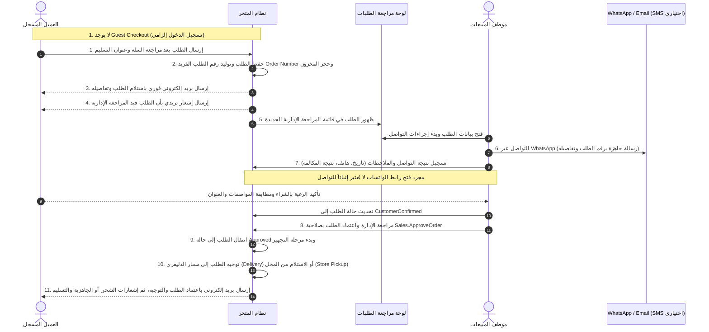
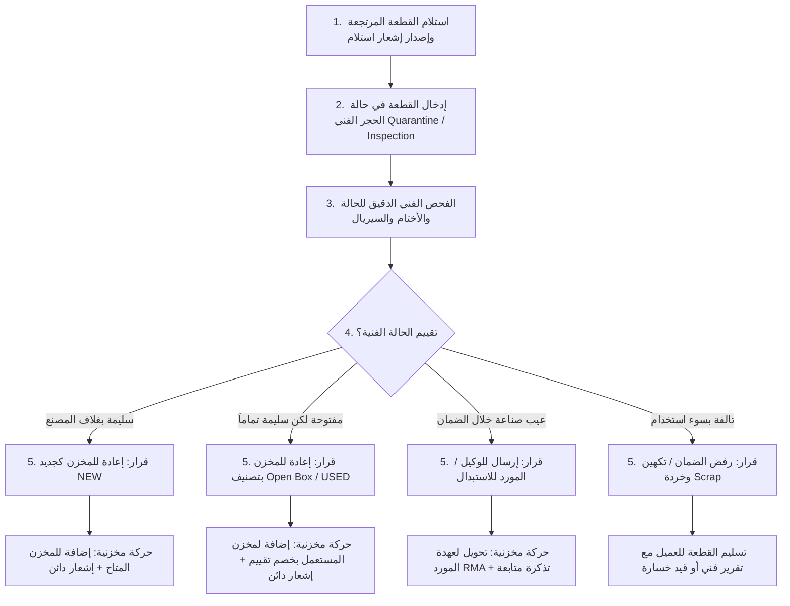

# دورة الطلبات والتسليم والفواتير والضمان (Orders, Invoices & Returns)

تاريخ التحديث: نوفمبر 2026  
الحالة: **مسودة للمراجعة والاعتماد**  

---

## 1. بنية حالات الطلب المنفصلة (Decoupled Order State Model)

لتفادي التداخل في المنطق التجاري، يتم فصل مسارات الطلب إلى أربع آلات حالات مستقلة ومتزامنة:

```
                  +-------------------------------------------------------+
                  |               حالة الطلب الإدارية (Order Status)       |
                  | Draft -> Submitted -> UnderReview -> CustomerConfirmed|
                  |       -> Approved -> InFulfillment -> Completed       |
                  +-------------------------------------------------------+
                                              |
         +------------------------------------+------------------------------------+
         |                                                                         |
+----------------------------------+                                     +----------------------------------+
|      حالة الدفع (Payment Status)   |                                     |    حالة التنفيذ والتسليم (Fulfillment) |
| Unpaid -> ProofSubmitted (Manual)|                                     |                                  |
|        -> Verified/Paid          |                                     | [Delivery Track vs Store Pickup] |
|        -> PartiallyPaid/Refunded |                                     +----------------------------------+
+----------------------------------+
```

---

## 2. دورة حياة طلب العميل التفصيلية (11-Step Order Lifecycle)



> [!NOTE]
> **قنوات التواصل المعتمدة في V1:** البريد الإلكتروني وواتساب هما القناتان الأساسيتان لتأكيد ومتابعة الطلبات؛ وتظل رسائل الـ SMS خياراً إضافياً معلقاً لحين البت في مزود الخدمة المعتمد وفق [OPEN_QUESTIONS.md](../../OPEN_QUESTIONS.md#q52-مزود-خدمة-الرسائل-النصية-القصيرة-sms-provider).

---

## 3. مسارات التسليم المنفصلة (Delivery vs Store Pickup)

### 3.1 مسار الشحن والتوصيل المعياري (Delivery Pathway)
```
[Processing]
   └── تجهيز الطلب وتسجيل بيانات التوصيل يدويًا عند توافرها
[ReadyForDispatch]
   └── اكتمال التجهيز والاستعداد لتسليم الشحنة
[Dispatched] 
   └── تسجيل الموظف يدويًا خروج الشحنة إلى شركة الشحن أو المندوب
[Delivered] 
   └── تسجيل الموظف يدويًا تأكيد التسليم الناجح
[DeliveryFailed] 
   └── تسجيل الموظف يدويًا تعذر التسليم عند الحاجة
[ReturnedToStore] 
   └── تأكيد عودة الطرد فعليًا وإجراء الاستلام والفحص
```

في V1 لا يوجد تكامل API مع شركات الشحن أو Webhooks منها. اسم الشركة يدخله الموظف يدويًا؛ رقم التتبع ورابطه اختياريان ويدويان. عند كل تغيير حالة يسجل النظام الوقت وهوية الموظف في سجل حالة التوصيل. الحالات تشغيلية فقط، ولا تحسم وحدها لحظة الصرف المخزني أو الفاتورة؛ تظل هذه السياسة معلقة في `Q7.2`.

### 3.2 مسار الاستلام من المحل المعياري (Store Pickup Pathway)
الاستلام من المحل ليس مجرد خيار شحن عادي، بل إجراء تسليم فعلي موثق:
```
[Processing] 
   └── سحب القطع وتجهيزها في مكتب الاستلام بالمعرض
[ReadyForPickup] 
   └── جاهز بالفرع المحدد، وتخصيص السيريالات بحالة الحجز بالمعرض
[CustomerNotified] 
   └── إرسال رسالة وبريد للعميل بأن طلبه جاهز للاستلام مع العنوان وساعات العمل
[PickedUp] 
   └── حضور العميل وفحص الجهاز وتأكيد الاستلام
[PickupOverdue] 
   └── تأخر العميل عن الحضور بعد انقضاء المهلة، وتسجيله للمتابعة الهاتفية
[Cancelled] 
   └── إلغاء الاستلام وإعادة البضاعة للمخزن المتاح بقرار إداري
```

* **إجراء التوثيق الإلزامي للاستلام من المحل:**  
  عند تسليم الطلب للعميل في صالة العرض، يُسجل في النظام:
  - اسم وهوية الموظف الذي قام بالتسليم الفعلي.
  - طريقة إثبات هوية المستلم (رقم الطلب + بطاقة الهوية / رقم الهاتف).
  - التوقيت الدقيق بالثانية وتوقيع الاستلام الإلكتروني أو الورقي.

### 3.3 حتمية الاستبعاد المتبادل بين المسارين (Mutual Exclusivity Guard)
* لمنع أي ازدواجية أو تعارض برمجي، يُفرض الاستبعاد المتبادل بين جدولي `order_deliveries` و `store_pickups` عبر قيد تصريحي مركب على مستوى قاعدة البيانات (Composite Foreign Key):
  `FOREIGN KEY (order_id, fulfillment_type) REFERENCES orders (id, fulfillment_type)`
* لا يمكن لطلب من نوع `StorePickup` أن يمتلك سجلاً في `order_deliveries`، ولا يمكن لطلب من نوع `Delivery` أن يمتلك سجلاً في `store_pickups`.

### 3.4 توقيت الصرف المخزني وإصدار الفواتير وحماية الحجز (Fulfillment Dispatch Moments & FulfillmentHold)
* **في مسار الاستلام من المحل (Store Pickup):**
  - لحظة الصرف المخزني الفعلي (إنقاص `physical_quantity` وتسجيل حركة `SalesDispatch` في `inventory_movements`)، وتحول الحجز إلى `Fulfilled`، وتحول السيريال إلى `Sold`، وتوليد الفاتورة النهائية المعتمدة هي **لحظة تسليم الجهاز وفحصه وتوقيع العميل في صالة العرض (`PickedUp`)**.
* **في مسار التوصيل الخارجي (Delivery):**
  - تظل السياسة التجارية للاعتراف بالصرف المالي معلقة بانتظار قرار صاحب المشروع في [Q7.2 في OPEN_QUESTIONS.md](../../OPEN_QUESTIONS.md#q72-التوقيت-التجاري-للاعتراف-بالصرف-المخزني-وإصدار-الفاتورة-لمسار-الشحن-والتوصيل-fulfillment-dispatch-moment-for-delivery) بين:
    - **الخيار (أ) [تسليم المندوب - FOB Shipping Point]:** خصم `physical_quantity` وتوليد حركة `SalesDispatch` وإصدار الفاتورة المرفقة مع الطرد عند نقطة `Dispatched`.
    - **الخيار (ب) [تأكيد التسليم للعميل - FOB Destination]:** إبقاء المخزون محجوزاً فقط أثناء النقل، وقيد الخصم وإصدار الفاتورة عند نقطة `Delivered`.
  - **حماية الحجز من الانتهاء أثناء وجود الشحنة مع شركة الشحن (`FulfillmentHold` - تصميم مقترح لحسم المعضلة الهندسية في الخيار ب):**
    - بمجرد انتقال الطلب إلى التجهيز (`InFulfillment`)، تتحول حالة الحجز ذرياً إلى `FulfillmentHold`.
    - **قاعدة حماية قطعية:** لا يقوم مجدول انتهاء الحجوزات الخلفي ولا التسوية الفورية بمساس أو تحرير أي حجز بحالة `FulfillmentHold`.
    - هذا يمنع بشكل قاطع انتهاء مهلة الحجز وبيع البضاعة لعميل آخر أثناء وجودها في سيارة شركة الشحن (التي قد تستغرق من يومين إلى 5 أيام عمل)، مما يحمي النظام من أي تعارض أياً كان الخيار الذي سيعتمده المالك في Q7.2.

### 3.5 دورة معالجة الطرود المرتجعة لفشل التسليم (Failed Delivery Return Intake Flow)
عند تعذر تسليم الطرد للعميل وعودته للمتجر (`DeliveryFailed -> ReturnedToStore`):
1. **استلام الطرد المرتجع وتوثيقه (`Delivery Return Intake`):**
   يقوم أمين المخزن بمسح باركود الشحنة ومطابقة السيريالات المحجوزة والتأكد من حالة الطرد الخارجية.
2. **المعالجة المحاسبية والمخزنية:**
   - إذا كانت الفاتورة والمخزون قد صُرفا عند تسليم المندوب: يُنشأ إشعار مرتجع تسليم دائن، وتُسجل حركة ارتداد مخزنية.
   - إذا كان المخزون محجوزاً فقط: يُلغى الحجز في `stock_reservations` وتعود البضاعة للمخزون المتاح فورياً.
3. **الفحص الفني:**
   - إذا كان الطرد سليماً ومغلقاً بالكامل: يعود السيريال مباشرة إلى `InStock` بحالته الأصلية `NEW`.
   - إذا فتح الطرد أو تضرر أثناء النقل: يُحول السيريال إلى الحجر الفني (`InQuarantine`) لإجراء فحص وتحديد التصرف (بيعه كـ `OPEN_BOX` أو المطالبة بالتعويض من شركة الشحن).
    - لا يفترض هذا الإجراء أن كل مرتجع من طلب واحد يستقبل في مستودع واحد أو يوزع على مستودعات متعددة؛ يظل القرار معلقًا في [Q3.3](../../OPEN_QUESTIONS.md#q33-توزيع-مرتجع-الطلب-على-مستودع-واحد-أو-أكثر-return-warehouse-allocation) قبل بناء تدفق الاستلام.

تحديث الحالة والعودة الميدانية يدويان ولا ينشئان تلقائيًا حركة مخزون أو إشعارًا ماليًا. أثر الفشل يعتمد على اختيار سياسة `Q7.2` وعلى نتيجة استلام وفحص البضاعة عند رجوعها.

---

## 4. نظام الفواتير الشامل والتحكم الكامل بها (Comprehensive Invoicing System)

### 4.1 التمييز الصارم بين أرقام المستندات
* **رقم الطلب (`Order Number`):** كود تشغيلي فريد ينشأ لحظة إنشاء الطلب (مثال: `ORD-202611-0001`). هو معرف للعملية التجارية وسلتها، **وليس بديلاً عن رقم الفاتورة إطلاقاً ولا يغني عنها**.
* **رقم فاتورة البيع (`Sales Invoice Number`):** رقم مالي وقانوني فريد ومستقل تماماً (مثال: `INV-2026-00001`)، يخص الفاتورة الصادرة للعميل.
* **رقم فاتورة المورد الأصلية (`Supplier Invoice Number`):** الرقم الخارجي المطبوع على فاتورة المورد الواردة للمحل (مثال: `VEND-INV-8912`)، ويُسجل كمرجع خارجي في فاتورة الشراء الداخلية (`PurchaseBill`) للمطابقة المحاسبية ومطالبات الضمان.

### 4.2 آلية وتوقيت تخصيص رقم الفاتورة
* **التوصية الفنية للتوقيت:** يتم تخصيص وتوليد رقم الفاتورة النهائي **لحظة الاعتماد والإصدار النهائي فقط (`Upon Final Issuance / Posting`)**، وليس أثناء مرحلة المسودة؛ وذلك لضمان عدم حرق أو فقدان أرقام تسلسلية في حال إلغاء المسودات أو تعديلها.
* **ضمان عدم التكرار تحت التزامن:** يتم توليد الرقم باستخدام تسلسل ذري في قاعدة البيانات (`Database Sequence / Locking Mechanism`) لمنع إصدار نفس الرقم لمستندين نهائيين تحت أي ظرف حتى مع وجود طلبات متزامنة في نفس اللحظة.
* **مسألة الفجوات التسلسلية:** تظل مسألة اشتراط عدم وجود فجوات في التسلسل (Gapless) معلقة لاختيار صاحب المشروع وفق [OPEN_QUESTIONS.md](../../OPEN_QUESTIONS.md#q14-اشتراط-تسلسل-أرقام-الفواتير-بلا-فجوات-gapless-sequential-invoices).

### 4.3 التحكم الكامل في قوالب الفواتير (Template Customization Engine)
يوفر النظام محرك قوالب مرن يدار من لوحة الإدارة بصلاحية مستقلة (`Invoices.ManageTemplates`):
* **تعديل النصوص والعناوين:** إمكانية تخصيص اسم المستند (فاتورة ضريبية، فاتورة بيع، إشعار استلام)، والعناوين الرئيسية والفرعية.
* **الترويسة والتذييل (Header & Footer):** تحرير النصوص العلوية، وبيانات المتجر، وشروط الضمان والاستبدال، والرسائل الترحيبية بالتذييل.
* **التحكم في الأعمدة والحقول:** إظهار أو إخفاء حقول معينة (مثل: إظهار/إخفاء كود الصنف SKU، الباركود، رقم السيريال، نسبة الخصم للبند، بلد المنشأ) وإعادة ترتيب الأعمدة.
* **الهوية والشعار:** إدارة شعار المتجر، بيانات السجل التجاري والبطاقة الضريبية، ومعلومات التواصل ورابط المتجر.
* **ثنائية اللغة والمعاينة الحية:** دعم كامل للعربية (RTL) والإنجليزية (LTR)، مع إمكانية **معاينة القالب لحظياً (Live Preview)** أثناء التحرير.

### 4.4 شاشة مراجعة مسودة الفاتورة قبل الإصدار النهائي
قبل تحويل المسودة إلى فاتورة صادرة نهائية، تتوفر شاشة مراجعة للمستخدم المخول (`Invoices.ReviewDraft`):
* **ما يجوز مراجعته وتعديله:**
  - مراجعة بيانات العميل وعنوان الشحن.
  - تعديل كميات البنود، أو حذف/إضافة أصناف.
  - تعديل الأسعار ونسب الخصم المسموحة بصلاحيات البائع.
  - تخصيص الملاحظات والنصوص المطبوعة في هذه الفاتورة تحديداً.
* **الفصل الصارم بين تعديل القالب وتعديل الأرقام المالية:**  
  > [!IMPORTANT]
  > **يُمنع منعاً باتاً تعديل الإجمالي النهائي أو قيمة الضريبة أو المجموع الفرعي يدوياً كأرقام مجردة؛** جميع الإجماليات والضرائب تُحسب آلياً وحصرياً من واقع بنود الفاتورة والكميات والأسعار وقواعد الخصم المعتمدة برمجياً لضمان النزاهة المحاسبية.

### 4.5 ثبات الفواتير الصادرة وسجل النسخ وقوالبها (Immutable Final Invoices & Template Versions)
بمجرد اعتماد وإصدار الفاتورة نهائياً (`Status = Issued`) عبر وحدة الفواتير المستقلة (`Invoicing Module`):
1. **تثبيت الرقم والبيانات:** يُثبت رقم الفاتورة نهائياً ولا يتغير.
2. **الربط بإصدار القالب المعتمد (`template_version_id`):** ترتبط الفاتورة بسجل إصدار القالب الفعلي (`invoice_template_versions`). أي تعديل يجريه مدير المتجر على نصوص أو تصميم القالب يُنشئ إصداراً جديداً (e.g. Version 2) ولا يُغير الإصدار السابق المرتبط بالفواتير الصادرة نهائياً.
3. **حفظ نسخة ثابتة للبيانات والقالب (Immutable Snapshot):** تُحفظ لقطة كاملة (JSON Snapshot) لكافة بنود الفاتورة وأسعارها وسيريالاتها وبيانات العميل، ورقم إصدار القالب المستخدم (`template_version_number`)، مع توليد وحفظ ملف PDF نهائي ثابت مرتبط برقم الفاتورة في التخزين (`rendered_pdf_storage_key`).
4. **منع التعديل بأثر رجعي وضمان إعادة الطباعة المطابقة:** إذا تم تعديل اسم المنتج، أو سعر الصنف، أو عنوان العميل، أو قالب الفواتير مستقبلاً، **تظل الفواتير الصادرة القديمة محتفظة بشكلها وبياناتها وملفها الأصلي دون أي تغيير**، وتتم إعادة طباعتها دائماً إما بتحميل ملف الـ PDF الثابت أو إعادة رندرتها من اللقطة وإصدار القالب التاريخي نفسه.
5. **التوثيق والمسؤولية:** يُسجل معرف المستخدم الذي أصدر الفاتورة وتاريخ ووقت الإصدار بدقة.
6. **إجراءات التصحيح والحوكمة:** لا يُحصر التصحيح في نمط واحد بل حسب طبيعة الحالة:
   - **إلغاء الفاتورة (Void / Cancelled):** يتم فقط قبل تسليم البضاعة أو عند اكتشاف خطأ جوهري قبل الصرف، عبر إجراء موثق يلغي الفاتورة ويثبت سبب الإلغاء ويفك حجز المخزون دون حذف السجل الأصلي.
   - **المرتجع الكلي أو الجزئي:** تطلب وحدة المرتجعات من وحدة الفواتير إصدار إشعار دائن رسمي (`Sales Return / Credit Note`).
   - **الفروق المالية الإضافية:** تصدر عبر إشعار مدين رسمي (`Debit Note`).
   - **يُمنع التعديل الصامت أو الحذف الفيزيائي للسجل الأصلي نهائياً.**

### 4.6 أنواع المستندات التجارية المستقلة
يفصل النظام فصلاً كاملاً بين 7 أنواع من المستندات:
1. **فاتورة بيع (Sales Invoice):** مستند بيع صادر للعميل مثبت للقيمة المحصلة والضمان والبنود ومصاريف التوصيل.
2. **فاتورة شراء داخلية (Purchase Bill):** مستند القيد الداخلي بالمخازن والحسابات لشحنة بضاعة مورد.
3. **مستند فاتورة المورد الأصلية (Original Supplier Invoice):** رقم ومرجع فاتورة المورد الخارجية الورقية/الإلكترونية.
4. **عرض سعر (Quotation / Proforma Invoice):** مستند تقديري غير ملزم مالياً ولا يؤثر على المخزون أو الحسابات.
5. **إيصال قبض (Receipt Voucher):** سند استلام نقدية أو دفعة بنكية مرتبطة بفاتورة أو حساب عميل.
6. **إيصال صرف (Payment Voucher):** سند خروج نقدية لمصروف تشغيلي أو سداد مورد.
7. **إشعار دائن / مرتجع (Credit Note / Sales Return):** مستند مالي قيد عكسي لتسوية المرتجعات.

### 4.7 الطباعة وتصدير الـ PDF ومصاريف الشحن
* **مصاريف الشحن في الفاتورة:**
  - يتم تضمين مصاريف التوصيل صراحة في الفاتورة عبر حقل `shipping_fee` كمصدر وحيد للحقيقة (Single Source of Truth).
  - معادلة الإجمالي الإلزامي للفاتورة:
    $$\text{Total Amount} = \text{Subtotal} - \text{Discount Amount} + \text{Tax Amount} + \text{Shipping Fee}$$
  - تُحفظ قيمة مصاريف الشحن وحالتها ضمن لقطة الفاتورة الثابتة (`InvoiceSnapshot`).
* **تجهيز الطباعة والمعاينة:** دعم المعاينة المباشرة قبل الطباعة أو التحميل.
* **النماذج المدعومة:**
  - **قالب A4 القياسي:** للفواتير الضريبية والرسمية وعروض الأسعار مع دعم الصفحات المتعددة وحساب فواصل الصفحات (Page Breaks) بطريقة احترافية تمنع انشطار جدول البنود أو عزل الإجماليات والتوقيعات بمفردها.
  - **قالب الإيصال الحراري (Thermal 80mm):** مخصص لنقاط البيع بالمعرض (POS)، يركز على السرعة، واسم الصنف المختصر، والسيريال، وباركود الفاتورة.
* **إخلاء مسؤولية تنظيمي:**
  > [!NOTE]
  > تصميم قوالب الفواتير وتوفير الحقول الضريبية لا يمثل ادعاءً بالامتثال القانوني لمنظومة الفاتورة الإلكترونية المصرية؛ إذ تتطلب متطلبات مصلحة الضرائب المصرية (ETA e-Invoicing) ربطاً برمجياً وتوقيعاً إلكترونياً مستقلاً بمراجعة محاسبية وقانونية منفصلة.

### 4.8 توقيت الدفع الإلكتروني مقارنة بالموافقة الإدارية (Electronic Payment Timing vs Approval)
نظراً لأن المتجر لا يعتمد الطلب بمجرد إرساله بل يمر بمراجعة وتأكيد هاتفي/واتساب، فإن توقيت تحصيل البطاقات الإلكترونية يخضع لدراسة البدائل التالية:
1. **الخيار الأول (المقترح الموصى به لـ V1): إرسال رابط دفع آمن بعد الموافقة الإدارية:**
   - يرسل العميل طلبه ويختار الدفع الإلكتروني.
   - يراجع الموظف الطلب ويتواصل عبر WhatsApp، وعند تأكيد العميل وموافقة الإدارة (`Approved`)، يولد النظام رابط دفع آمن محدد الصلاحية ويرسله للعميل عبر WhatsApp/Email.
   - الميزة: تجنب سحب أموال على طلب قد يتم تعديله أو إلغاؤه أثناء التواصل، وتجنب رسوم الاسترداد (Refund Fees).
2. **الخيار الثاني: التفويض المسبق عند الإرسال والتحصيل بعد الموافقة (Pre-Authorization & Capture):**
   - يتم حجز المبلغ على بطاقة العميل لحظة إرسال الطلب، ولا يتم تحصيله فعلياً (Capture) إلا بعد ضغط الإدارة على "موافقة وتجهيز"، أو إلغاء التفويض (Void) حال الرفض.
   - يتطلب دعماً صريحاً من بوابة الدفع المختارة.
3. **الخيار الثالث: الدفع والتحصيل الفوري عند الإرسال:**
   - يُخصم المبلغ فورياً، وفي حال رفض الطلب أو تعديله يتم إصدار استرداد بنكي (Refund) آلي.
   - العيب: تكلفة رسوم بوابات الدفع والتأخير البنكي لرد الأموال للعميل.

> [!IMPORTANT]
> **القرار معلق لصاحب المشروع:** تم توثيق الخيار الأول كتوصية أولى لـ V1، وتظل المفاضلة بين هذه الخيارات قراراً تجارياً مفتوحاً في [OPEN_QUESTIONS.md](../../OPEN_QUESTIONS.md#q53-توقيت-تحصيل-بوابة-الدفع-الإلكتروني-مقارنة-بالموافقة-الإدارية-payment-timing-vs-approval).  
> وفي جميع الحالات: **لا يُعتبر مجرد فتح صفحة الدفع أو الرجوع للمتصفح دليلاً على نجاح السداد؛ بل يُشترط استلام Webhook رسمي موقّع مشفراً (HMAC Signature) أو تأكيد يدوي من موظف الحسابات.**

---

## 5. دورة المرتجعات والحجر الفني والضمان (Returns, Quarantine & RMA)



### قواعد الحجر الفني والتصرف في المرتجعات:
1. **حظر الإرجاع التلقائي للمخزون:** يُمنع منعاً باتاً عودة أي قطعة مرتجعة إلى رصيد المخزون القابل للبيع فور استلامها؛ يجب أن تدخل أولاً في حالة الحجر الفني (`InQuarantine`) في جدول `return_inspections` حتى انتهاء الفحص الفني وصدور قرار تصرف معتمد.
2. **المرتجع الجزئي من تجميعة أو حزمة (Bundle / PC Build Partial Return):**
   - طريقة احتساب الاسترداد عند إرجاع جزء من باقة ما زالت قرارًا مفتوحًا في [Q3.2](../../OPEN_QUESTIONS.md#q32-آلية-احتساب-المرتجع-الجزئي-من-تجميعة-أو-حزمة-عروض-bundle-partial-return-refund)، ولا توجد معادلة مطبقة أو نتيجة مالية معتمدة حاليًا.
   - التوزيع التناسبي لخصم الحزمة أحد الخيارات المقترحة فقط، إلى جانب استرداد يعيد احتساب الخصم بالكامل على القطع المتبقية أو اشتراط إرجاع الباقة كاملة. لا يُعامل أي خيار كقاعدة قبل قرار المالك.
   - بعد اعتماد `Q3.2`، تُحسب قيمة إشعار الدائن وتكلفة الاسترداد وفق الخيار المختار، وتُحدّث حقول المبالغ المقترحة/الموزعة بما يتسق معه؛ لا تفترض هذه الوثيقة شكل النتيجة الآن.
3. **تتبع السيريالات والتكلفة:**
   - كل قطعة مرتجعة مسلسلة تُفحص لمطابقة سيريالها مع الفاتورة المباعة وتاريخ بدء الضمان.
   - حركة المخزون الناتجة عن قرار التصرف تسجل التكلفة المسترجعة وحالة القطعة الجديدة (`NEW`, `USED`, `OPEN_BOX`) بوضوح.
