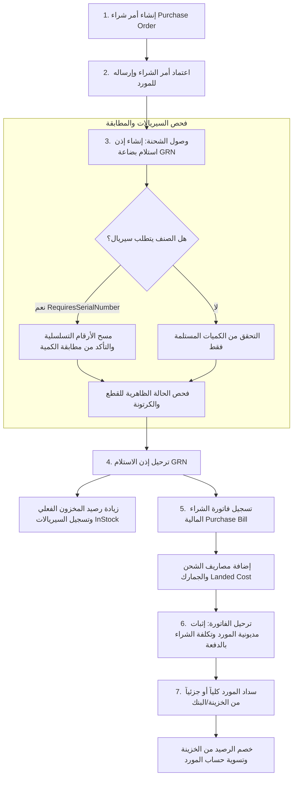
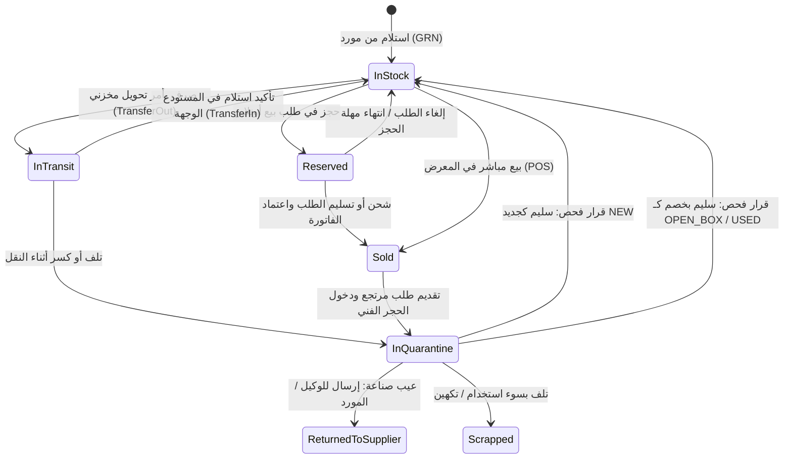

# دورات الشراء والمخزون وحركة الأرقام التسلسلية (Procurement, Inventory & Serial Tracking)

تاريخ التحديث: نوفمبر 2026  
الحالة: **مسودة نهائية مكتملة للمراجعة والاعتماد (Pre-Foundation Final Architecture)**  

---

## 1. دورة المشتريات والتوريد (Procurement Lifecycle)

تهدف دورة الشراء إلى ضبط استلام البضائع وفحصها وتوثيق سيريالاتها إن وُجدت قبل دفع قيمتها أو طرحها للبيع:



### 1.1 الفصل الصارم بين تواريخ دورة المشتريات (Procurement Dates)
لمنع أي التباس محاسبي أو ضريبي، يفصل النظام فصلاً كاملاً بين 4 تواريخ مستقلة لكل عملية شراء:
1. **تاريخ إصدار فاتورة المورد الأصلية (`Supplier Invoice Issue Date`):** التاريخ الفعلي المطبوع على مستند أو فاتورة المورد الخارجية الورقية/الإلكترونية (`supplier_invoice_issue_date`).
2. **تاريخ استحقاق سداد الفاتورة للمورد (`Supplier Invoice Due Date`):** التاريخ المتفق عليه مع المورد لسداد القيمة (أجل/ائتمان) (`supplier_invoice_due_date`).
3. **تاريخ الاستلام الفعلي للبضاعة في المستودع (`Goods Receipt Date`):** وقت وصول وتفريغ وفحص الطرود في مخزن المتجر (`goods_receipts.received_at_utc`).
4. **تاريخ السداد الفعلي للمورد (`Payment Date`):** وقت خروج النقدية أو التحويل البنكي الفعلي للمورد من الخزينة (`payments.paid_at_utc`).

> [!CAUTION]
> **قاعدة محاسبية ملزمة:** يُمنع منعاً باتاً استخدام تاريخ الاستحقاق `due_date` كبديل عن تاريخ إصدار فاتورة المورد `issue_date`؛ فتاريخ الإصدار هو وعاء الضريبة والأساس القانوني لحساب فترة الائتمان.

### 1.2 القواعد التشغيلية لدورة التوريد:
1. **السيريال اختياري بحسب إعدادات الصنف:** لا يُفرض السيريال إلا إذا كان الصنف معلماً بـ `RequiresSerialNumber = true`. في هذه الحالة يُمنع ترحيل إذن الاستلام دون إدخال سيريالات فريدة مطابقة للكمية.
2. **الاستلام الجزئي:** في حال وجود نقص أو عيب في بعض القطع أثناء الاستلام، يتم استلام الكمية السليمة فقط وتثبيت الكمية المعيبة في تقرير استلام جزئي ورفض إدخالها المخزن.
3. **توزيع مصاريف الشحن (Landed Costs):** تُوزع مصاريف الشحن والتفريغ على تكلفة القطع المستلمة لبيان سعر التكلفة الفعلي بدقة داخل `inventory_batches.unit_cost_price` وتثبيتها في `serial_numbers.unit_cost`.

---

## 2. مصدر الحقيقة للمخزون والتسويات (Inventory Source of Truth)

تتكامل خمسة كيانات مخزنية لضمان دقة الأرصدة بدون أي ازدواجية:
* `stock_items`: الأرصدة التجميعية بالمستودع لكل صنف (رصيد فعلي، ورصيد محجوز).
* `inventory_batches`: دفعات الشراء المحملة بتكلفة الشراء وتتبع استنزاف الكميات.
* `serial_numbers`: القطع الفردية المسلسلة وتاريخها وسيريالها وتكلفتها وحالتها.
* `inventory_movements`: سجل الحركات الموثق لكافة عمليات الإضافة والصرف والتسوية والتحويل.
* `stock_reservations`: سجل الحجوزات النشطة للطلبات غير المنفذة.

### 2.0 مرجع الحركة وهوية الحدث
تُربط كل حركة بمصدرها التجاري وبند/حدث المصدر المناسب لنوعها: الاستلام إلى `goods_receipts/goods_receipt_items`، وصرف البيع إلى `invoices/invoice_items`، وإرجاع البيع إلى `sales_returns/return_items`، وصرف التحويل إلى `stock_transfers/stock_transfer_items`، واستلام التحويل إلى `stock_transfer_receipts/stock_transfer_receipt_items`، وتسوية التحويل إلى محضر معتمد عند انطباقه. الجرد العام ومصدر التخريد الداخلي لم يُحسما. هذه خريطة مصادر منطقية وليست ضمان FK؛ حقول `reference_document_*` الحالية polymorphic. تفاصيل المقترح والعلاقات التي تنتظر المراجعة في [ERD](../database/DATABASE_DESIGN_ERD.md#جدول-سجل-حركات-المخزون-المعياري-inventory_movements) و[مذكرة المراجعة](../database/INVENTORY_MOVEMENT_REFERENCE_DESIGN_REVIEW.md).

تُنشأ هوية حدث ثابتة عند قبول الأمر وتحفظ مع أثره. عند Retry بعد انقطاع الاتصال يعيد العميل `Idempotency-Key` نفسه، ويسترجع Backend نتيجة `Command Inbox/Idempotency Store` بدل إنشاء حدث جديد. لا يكفي UNIQUE على رأس/بند/نوع الحركة، لأنه لا يغطي كل API retries وقد يمنع عمليات مستقلة صحيحة. كل حدث عمل جديد له هوية جديدة. لا تزال طريقة تمثيل هوية الحدث والعلاقات المقابلة غير معتمدة معماريًا.

### 2.1 توضيح الفرق بين الكمية الفعلية والكمية المحجوزة والمتاحة
1. **الكمية الفعلية بالمستودع وتوزيع الدفعات (`Physical Quantity & Batch Balances`):**
   - تمثل **البضاعة المتواجدة مادياً على رفوف المستودع الآن**.
   - **لا تنقص** عند قيام العميل بإنشاء طلب وحجز كمية، بل تظل موجودة بالمستودع.
   - لا تُخصم الكمية الفعلية إلا عند **الصرف الفعلي للتسليم أو الشحن (`Fulfillment Dispatch`)** وتوليد حركة صرف رسمية في `inventory_movements`.
   - المصدر المرجعي الدائم هو رصيد الحركات في `inventory_movements`، والمصدر اللحظي هو `stock_items.physical_quantity`.
   - **للأصناف المسلسلة:** يطابق حتماً عدد القطع في `serial_numbers` التي حالتها `InStock` أو `Reserved` داخل نفس المستودع.
   - **للأصناف غير المسلسلة (أرصدة الدفعات عبر `inventory_batch_balances`):**
     - يتم تتبع كمية كل دفعة في كل مستودع عبر جدول `inventory_batch_balances(batch_id, stock_item_id, warehouse_id, remaining_quantity)`.
     - الرصيد الفعلي للمستودع `stock_items.physical_quantity` يطابق دائماً مجموع أرصدة دفعات هذا المستودع.
     - الرصيد المتبقي الإجمالي برأس الدفعة `inventory_batches.remaining_quantity` هو رصيد مادي مشتق/تجميعي (Materialized Rollup) يطابق مجموع أرصدة هذه الدفعة عبر كل المستودعات.
     - يتيح هذا التصميم تقسيم الدفعة الواحدة بين مستودعات متعددة (مثل تحويل جزء للمعرض وإبقاء جزء في المستودع الرئيسي)، وإعادة قيد المرتجعات لرصيد الدفعة بدقة تامة دون تضارب.
2. **الكمية المحجوزة وحماية الحجز أثناء التجهيز (`Reserved Quantity & FulfillmentHold`):**
   - تمثل **الالتزامات المعلقة لطلبات بيع نشطة** قيد المراجعة أو الدفع أو التجهيز والشحن ولم تُسلم نهائياً بعد.
   - هذه البضاعة لا تزال موجودة في المستودع مادياً (ضمن `physical_quantity`)، ولكنها محجوبة عن البيع لعميل آخر.
   - المصدر المرجعي هو السجلات الفعالة في `stock_reservations` التي حالتها `Active` (لم تنته مهلتها) أو `FulfillmentHold` (قيد التجهيز والشحن).
   - المصدر اللحظي التجميعي هو `stock_items.reserved_quantity`.
3. **الكمية المتاحة للبيع (`Available Quantity`):**
   - لا يوجد حقل منفصل للمخزون المتاح، بل هو ناتج معادلة آنية:
     $$\text{Available Quantity} = \text{physical\_quantity} - \text{reserved\_quantity}$$
   - محمي بقيد قاعدة البيانات الصارم:
     `CHECK (physical_quantity >= reserved_quantity AND reserved_quantity >= 0)`
4. **تكلفة المخزون ومصدره (Inventory Cost Origin):**
   - ينشأ عند الاستلام في `inventory_batches.unit_cost_price` (شامل الشحن).
   - للأصناف المسلسلة: يحمل كل سيريال تكلفته الفردية في `serial_numbers.unit_cost`.
   - **حساب COGS عند البيع:** يخضع لسياسة تقييم المخزون التي سيعتمدها صاحب المشروع وفق المسألة المعلقة [Q1.1 في OPEN_QUESTIONS.md](../../OPEN_QUESTIONS.md#q11-طريقة-تقييم-تكلفة-المخزون-لحساب-تكلفة-البضاعة-المباعة-cogs-والأرباح) (المقترح المفتوح: إما ربط كل قطعة بسيريالها Specific Identification + FIFO للقطع العامة، أو تطبيق متوسط التكلفة المرجح WAC). وتظل هذه الطرق **اقتراحات معلقة قيد قرار المالك وليست قرارات معتمدة**.

### 2.2 آلية انتهاء الحجوزات وتحديث الأرصدة (Reservation Expiry & Auto-Release)
لضمان عدم تجميد المخزون في حال عدم استكمال العميل لطلبه:
1. عند إنشاء الحجز، يُحدد له موعد انتهاء (`expires_at_utc`) وفق إعدادات المتجر، ويُضاف إلى `stock_items.reserved_quantity`.
2. يقوم مجدول مهام خلفي دوري (Background Expiration Worker) بالبحث عن الحجوزات المنتهية:
   `WHERE reservation_status = 'Active' AND expires_at_utc <= NOW()`
3. عند العثور على حجز منتهٍ، يُنفذ التحرير داخل معاملة ذرية:
   - تحويل حالة الحجز في `stock_reservations` إلى `Expired`.
   - إنقاص الرصيد المحجوز `stock_items.reserved_quantity` بمقدار كمية الحجز المنتهي.
   - إذا كان الصنف مسلسلاً، إعادة حالة السيريال في `serial_numbers` من `Reserved` إلى `InStock`.
4. **الأثر المباشر:** تعود الكمية المتاحة للبيع فورا للظهور بالمتجر دون أي تعديل على الكمية الفعلية على الرف (`physical_quantity`).
5. **التسوية الفورية المتزامنة (Inline / Lazy Expiration Settlement):**
   - لتفادي أي تأخير زمني لمجدول المهام الخلفي، يفحص محرك المخزون أي حجوزات نشطة منتهية الصلاحية أثناء تنفيذ استعلامات الفحص والقفل الحساسة (`SELECT ... FOR UPDATE`).
   - في حال وجود حجز منتهٍ، يُحرر فوراً وذرّياً وتُعاد الكميات والسيريالات إلى `InStock` قبل تقييم الرصيد المتاح للطلب الجديد، مما يضمن سلوكاً متكرراً بأمان تام (Idempotent) حتى لو توقف العامل الخلفي.
6. **حماية الحجز من الانتهاء أثناء التجهيز والشحن (`FulfillmentHold` - تصميم مقترح مرتبط بـ Q7.2):**
   - عندما ينتقل الطلب إلى مرحلة التجهيز الفعلي (`InFulfillment`)، تنتقل حالة الحجز في `stock_reservations` من `Active` إلى `FulfillmentHold`.
   - **قاعدة حماية قطعية:** لا يقوم مجدول انتهاء الحجوزات ولا التسوية الفورية بفحص أو تحرير أي حجز بحالة `FulfillmentHold`؛ إذ يقتصر استعلامهما حصرياً على `reservation_status = 'Active' AND expires_at_utc <= NOW()`.
   - يضمن ذلك عدم تحرير البضاعة أو بيعها لعميل آخر أثناء وجودها مع شركة الشحن أو قيد التجهيز، وتبقى الكمية محجوبة برمجياً ضمن `reserved_quantity` حتى يتم التسليم النهائي (`Fulfilled`) أو إلغاء الطلب الموثق.

### 2.3 المطابقة والتسويات ومعالجة الأخطاء (Reconciliation & Discrepancies)
* يتم تشغيل فحص تدقيق دوري آلي لمقارنة الحركات بالسيريالات بالأرصدة المحجوزة والفعلية.
* في حال اكتشاف فرق (عجز أو زيادة ناتجة عن جرد أو تلف):
  - **يُمنع التعديل اليدوي المباشر على عمود `physical_quantity`.**
  - يتم إجراء التسوية حصراً عبر تسجيل حركة رسمية معتمدة في `inventory_movements` بنوع `StockCountAdjustment` متضمنة هوية الموظف والسبب والكمية المعدلة.

---

## 3. سلامة وضوابط حجز المخزون (Stock Reservation Integrity)

لحماية المتجر من البيع المزدوج أو حجز القطعة الواحدة مرتين أثناء ذروة الشراء:

1. **فهرس فريد جزئي لمنع حجز السيريال لأكثر من طلب (Partial Unique Index):**
   ```sql
   CREATE UNIQUE INDEX uq_active_serial_reservation 
   ON stock_reservations (serial_number_id) 
   WHERE reservation_status = 'Active' AND serial_number_id IS NOT NULL;
   ```
2. **معاملة ذرية مع قفل حصري للصف (Atomic Transaction & Row Lock):**
   - حجز المخزون يتم داخل Transaction تبدأ بقفل صف المخزون:
     `SELECT physical_quantity, reserved_quantity FROM stock_items WHERE id = @id FOR UPDATE;`
   - إذا كان الرصيد المتاح غير كافٍ، تتراجع المعاملة فوراً دون تعديل، مما يمنع البيع المزدوج في الطلبات المتزامنة.
3. **آلة حالات صارمة لمنع تكرار الخصم أو التحرير (State Machine Guard):**
   - حالة الحجز تنتقل من `Active` إلى `Fulfilled` (عند الشحن) أو `Released` (عند الإلغاء) أو `Expired` (عند انتهاء المهلة).
   - يتم التحديث بشرط أن تكون الحالة السابقة `Active`. إذا لم يتأثر أي صف، يتم إحباط العملية لمنع الخصم أو التحرير مرتين.

---

## 4. دورة حركة المخزون وحالات الأرقام التسلسلية (Stock & Serial Lifecycle)

تخضع الأرقام التسلسلية (للأصناف المسلسلة) لآلة حالات مضبوطة:



* **القائمة الحصرية المعيارية لحالات السيريال (`status`):**
  `InStock`, `Reserved`, `InTransit`, `Sold`, `InQuarantine`, `ReturnedToSupplier`, `Scrapped`.
* **موقع وعهدة السيريال أثناء النقل (`InTransit`):**
  - عند خروج السيريال في أمر تحويل مخزني: تنتقل حالته إلى `InTransit`، ويُفرغ `warehouse_id = NULL` و `stock_item_id = NULL`، ويرتبط ببند التحويل حصرياً عبر `in_transit_transfer_item_id`.
  - السيريال أثناء نقله لا يُحسب متاحاً أو محجوزاً في المصدر أو الوجهة، ولا يظهر في مخزون الوجهة إلا بعد الفحص وتأكيد الاستلام.
  - محمي بقيد فريد يمنع ربط السيريال بأكثر من أمر تحويل نشط.
* **الفصل التام عن حالة القطعة (`condition`):**
  `NEW`, `OPEN_BOX`, `USED` هي خصائص مادية للقطعة، بينما قرارات الفحص (`inspection_disposition`) هي توصيفات فنية مؤقتة داخل تقرير الفحص (`RestockableNew`, `OpenBoxUsed`, `DefectiveUnderWarranty`, `DamagedScrap`).

---

## 5. دورة التحويل بين المستودعات والاستلام المتكرر والجزئي (Inter-Warehouse Transfers & Receipts)

عند نقل بضاعة بين مستودعين (مثل المستودع الرئيسي ومعرض المبيعات)، تُدار العملية عبر **أمر تحويل رسمي (`stock_transfers` و `stock_transfer_items`)** وسيريالاته (`stock_transfer_item_serials`)، وتوثيق أحداث الاستلام عبر **سجلات استلام مخصصة (`stock_transfer_receipts` و `stock_transfer_receipt_items` و `stock_transfer_receipt_item_serials`)**، ومحاضر التسويات المعتمدة (`transfer_discrepancy_settlements`):

1. **أمر التحويل الرسمي وتخصيص السيريالات (`stock_transfers` & `stock_transfer_items`):**
   - يُنشأ المستند برقم تسلسلي فريد (`transfer_number`) وبنود تفصيلية في `stock_transfer_items`.
    - **الحالات المعيارية لرأس الأمر (`stock_transfers.status`):**
     `Draft`, `Approved`, `PartiallyDispatched`, `InTransit`, `PartiallyReceived`, `Completed`, `ClosedWithDiscrepancy`, `Cancelled`.
   - **الحالات المعيارية لبنود الأمر:** `Pending`, `PartiallyDispatched`, `Dispatched`, `PartiallyReceived`, `Received`, `DiscrepantClosed`.
   - **للأصناف المسلسلة (`requires_serial = true`):**
     - يدعم البند الواحد نقل عدة وحدات مسلسلة، حيث تُربط كافة السيريالات المصروفة بالبند عبر جدول تفصيلي `stock_transfer_item_serials(stock_transfer_item_id, serial_number_id)`.
     - تكون الكمية المصروفة مطابقة تماماً لعدد السيريالات: $\text{dispatched\_quantity} = \text{COUNT}(\text{serials})$.
      - يمنع `uq_transfer_item_serial` التكرار داخل البند فقط. ويمنع الفهرس الجزئي الفريد `uq_active_serial_transfer(serial_number_id) WHERE allocation_status='Active'` تخصيص السيريال في أكثر من تحويل نشط. التحويل نشط من إنشاء التخصيص حتى الاستلام، أو إلغاء تحويل لم يصرف، أو اعتماد تسوية الفقد. التحرير والتحديثات المرتبطة تتم ذرياً في المعاملة نفسها؛ يقفل التطبيق صف السيريال بـ `SELECT ... FOR UPDATE` ويظل الفهرس حاجز PostgreSQL ضد السباق المتزامن.

2. **حركة الصرف من المصدر (`TransferOut`):**
   - عند خروج البضاعة من المصدر، تُسجل حركة صرف رسمية `TransferOut` في `inventory_movements`:
      - المصدر المنطقي هو رأس التحويل وبنده (`stock_transfers` و`stock_transfer_items`). الحقول polymorphic الحالية لا تثبت العلاقة بـFK، ولا تمنع إعادة المحاولة بذاتها. هوية كل حدث صرف تحفظ منفصلة؛ السماح بصرف البند نفسه في شحنات متعددة معلق في [Q2.5](../../OPEN_QUESTIONS.md#q25-صرف-بند-التحويل-على-شحنة-واحدة-أو-عدة-شحنات-partial-dispatch-per-transfer-item).
   - تُخصم الكمية فوراً من `stock_items.physical_quantity` ومن رصيد الدفعة `inventory_batch_balances.remaining_quantity` بمستودع المصدر.
   - تتحول حالة أمر التحويل إلى `InTransit` (أو `PartiallyDispatched` في حال الصرف الجزئي).
   - تنتقل السيريالات المرتبطة من `InStock` إلى `InTransit` في `serial_numbers.status`، وتُفرغ من مستودع المصدر (`warehouse_id = NULL` و `stock_item_id = NULL`)؛ وتخصيص السيريال موثق في `stock_transfer_item_serials`.

3. **أحداث الاستلام الجزئي والمتكرر في الوجهة وضوابط Idempotency (`TransferIn`):**
   - يدعم النظام تعدد دفعات الاستلام لنفس أمر التحويل: عند وصول أي شحنة، يُنشأ سجل استلام مستقل (`stock_transfer_receipts`).
   - يُسجل في `stock_transfer_receipt_items` و `stock_transfer_receipt_item_serials` هوية المستلم، وتوقيت الاستلام بالثانية، والكميات المقبولة والمرفوضة للتلف، والسيريالات المفحوصة.
   - **توثيق استلام السيريالات ومنع التكرار:**
      - ترتبط السيريالات المستلمة في `stock_transfer_receipt_item_serials` بسجل صرفها الأصلي عبر FK مركب `(transfer_item_serial_id, serial_number_id)` إلى الزوج نفسه في سجل الصرف، فيستحيل تغيير هوية السيريال.
      - `UNIQUE (transfer_item_serial_id)` يمنع استلام تخصيص الصرف أكثر من مرة حتى عبر أحداث مختلفة.
   - **قواعد كمية حتمية لحساب البضاعة في الطريق ومنع التجاوز:**
      - نرمز بـ `D` للمصروف، و`A` لمجموع المقبول، و`R` لمجموع المرفوض الذي وصل فعلياً، و`L` لما لم يصل وثبت فقده بتسوية معتمدة. بعد قفل البند، يقبل الحدث الجديد `(a,r)` فقط إذا `a >= 0` و`r >= 0` و`a+r <= D-A-R-L`. القطعة التالفة التي وصلت تصنف `R`؛ ولا تتداخل الفئات ولا تُطرح مرتين.
     - يُمنع منعاً باتاً استلام أي كمية لبند لم يتم صرفه من المصدر بعد (`dispatched_quantity = 0`).
    - **ربط حركة الاستلام بحدث الاستلام التفصيلي (Movement Idempotency):**
      - المصدر المنطقي هو رأس حدث الاستلام وبنده (`stock_transfer_receipts` و`stock_transfer_receipt_items`). المراجع polymorphic الحالية لا تمثل FK فعليًا.
      - يسمح بتعدد أحداث الاستلام الصحيحة للبند نفسه. لا يوضع قيد فريد على بند الإيصال لمنع ذلك؛ إعادة نفس العملية تمنع بهوية الحدث المحفوظة وIdempotency Store. إذا توزع المقبول من بند إيصال واحد على أكثر من دفعة، يلزم فصل هوية لكل allocation وعدم منع هذا السيناريو بقيد عام؛ تمثيله التفصيلي ينتظر اعتماد التصميم.
     - تُضاف الكمية المستلمة المقبولة إلى `stock_items.physical_quantity` ورصيد الدفعة `inventory_batch_balances.remaining_quantity` بمستودع الوجهة.
     - تعود السيريالات المقبولة من `InTransit` إلى `InStock` في المستودع المستهدف (`warehouse_id = dest_warehouse_id` و `stock_item_id = dest_stock_item_id`).
     - القطع المرفوضة للتلف الواصلة فعلياً تُوجه مباشرة إلى الحجر الفني بمستودع الوجهة (`quarantine_quantity` في `inventory_batch_balances`، والسيريالات تتحول إلى `InQuarantine` مع `warehouse_id = dest_warehouse_id` و `stock_item_id = NULL`).

4. **تمثيل البضاعة قيد النقل والحجر والمطابقة الشاملة للعهدة:**
      - يفصل النظام بوضوح رياضي بين:
     - **الرصيد الفعلي المتاح للبيع بالمستودعات:** $\sum \text{inventory\_batch\_balances.remaining\_quantity}$.
     - **رصيد الحجر الفني بالمستودعات:** $\sum \text{inventory\_batch\_balances.quarantine\_quantity}$ (وللسيريالات: القطع بحالة `InQuarantine`).
     - **البضاعة التي ما زالت في الطريق فعلياً (`Goods In-Transit`):**
       تخصم كل ما وصل للوجهة (مقبولاً أو مرفوضاً) بالإضافة إلى العجز المفقود المعتمد:
        $$\text{In-Transit} = \sum_{\text{transfer items}} \max(0, D - A - R - L)$$
      - **إجمالي عهدة المتجر للدفعة:** `$Salable + Quarantined + In-Transit`؛ أما `L` فهو فقد معتمد خارج العهدة ولا يضاف إلى أي رصيد. تُخصم `D` عند الصرف، ويُضاف المقبول إلى المتاح والمرفوض إلى الحجر، ويقل الطريق بالمقدار ذاته؛ لذلك لا تُحتسب الكمية الواصلة في الطريق مرة أخرى.
   - عند الاستلام بالوجهة (`TransferIn`): ترتفع أرصدة المستودعات (المتاح و/أو الحجر) وتنخفض بضاعة الطريق بنفس المقدار ذرياً، مما يمنع الاحتساب المزدوج ويحافظ على ثبات إجمالي العهدة.

5. **حظر الإغلاق الناقص واعتماد فروق الكميات ومصفوفة الصلاحيات (Discrepancy Settlements & Q2.4):**
   - **قاعدة حظر قطعية:** يُمنع تحويل أمر التحويل إلى حالة الإغلاق النهائي (`Completed` أو `ClosedWithDiscrepancy`) مع وجود كميات معلقة لم تُستلم ولم تُسوَّ:
      $$\text{RemainingInTransit} = D - (A + R + L) = 0$$
   - في حال وجود عجز مفقود، يلزم إنشاء مستند تسوية رسمي `transfer_discrepancy_settlements`؛ وتخضع مصفوفة الصلاحيات والحدود المالية لاعتماد العجز لقرار صاحب المشروع المعلق في [Q2.4 في OPEN_QUESTIONS.md](../../OPEN_QUESTIONS.md#q24-مصفوفة-الصلاحيات-والحدود-المالية-لاعتماد-تسويات-عجز-وفروق-التحويلات-المخزنية-transfer-discrepancy-settlement-approval-matrix) (**Pending Owner Approval**)، مع ارتباط أساس تقييم تكلفة العجز بـ **Q1.1**.
    - بعد الاعتماد وفق Q2.4 التي ما زالت معلقة: تسجل حركة `StockCountAdjustment` مرة واحدة وتُحدّث `L` وحالة البند ورأس التحويل ذرياً. لا يوجد حد مالي أو دور اعتماد مُقرّ.
   - **حماية السجلات التاريخية وحظر الحذف التعاقبي:** تُضبط كافة علاقات التحويلات والاستلامات بـ `ON DELETE RESTRICT`، وتُلغى المسودات غير المنفذة كـ `Cancelled` حفاظاً على سجل التدقيق `audit_logs` دون حذف فيزيائي.
